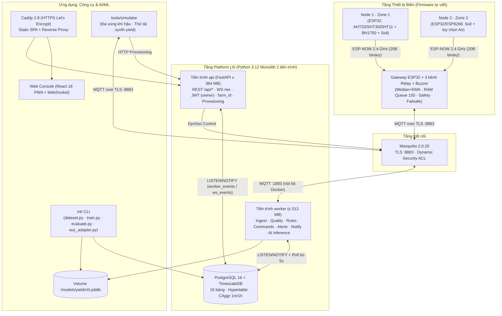
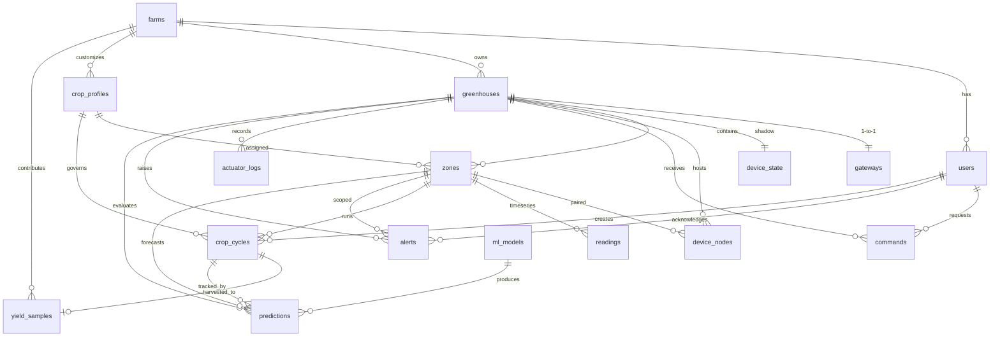
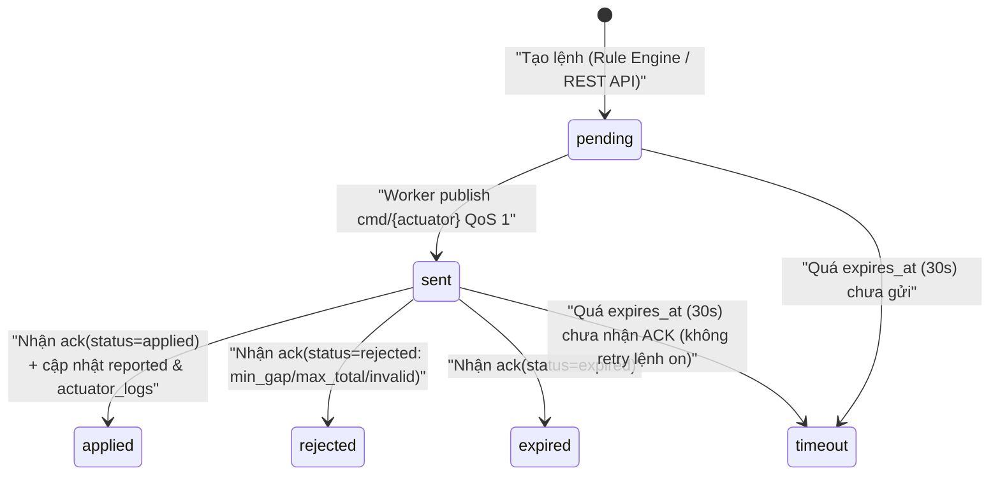
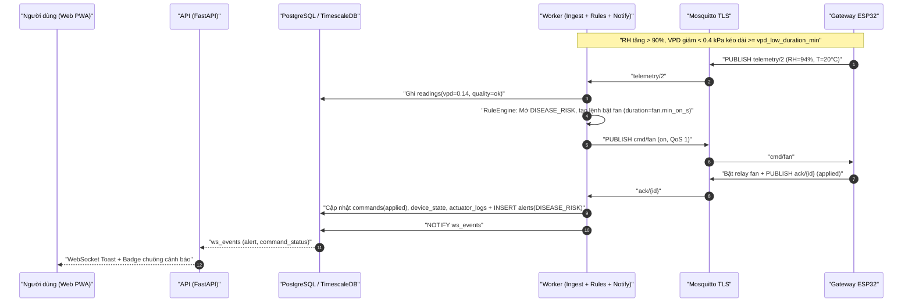

# BÁO CÁO TỔNG HỢP HỆ THỐNG GREENHUB
## Nền tảng IoT Chuyên biệt Giám sát, Điều khiển Nhà kính Thông minh và Hỗ trợ Quyết định Canh tác bằng Học máy

> **Dự án:** GreenHub – Smart Greenhouse IoT Platform  
> **Phiên bản báo cáo:** 1.0 (tổng hợp trực tiếp từ toàn bộ mã nguồn, đặc tả kiến trúc và kết quả kiểm thử thực tế của hệ thống)  
> **Ngày lập:** 20/11/2026  

---

## MỤC LỤC

1. [Chương 1: Bài toán](#chương-1-bài-toán)
   - [1.1. Bối cảnh thực tiễn và các thách thức trong canh tác nhà kính](#11-bối-cảnh-thực-tiễn-và-các-thách-thức-trong-canh-tác-nhà-kính)
   - [1.2. Định vị bài toán: Nền tảng IoT chuyên biệt vs. Hệ thống tự động hoá nhúng](#12-định-vị-bài-toán-nền-tảng-iot-chuyên-biệt-vs-hệ-thống-tự-động-hoá-nhúng)
   - [1.3. Mục tiêu và yêu cầu cốt lõi của hệ thống GreenHub](#13-mục-tiêu-và-yêu-cầu-cốt-lõi-của-hệ-thống-greenhub)
   - [1.4. Phạm vi hệ thống (Trong phạm vi và Ngoài phạm vi)](#14-phạm-vi-hệ-thống-trong-phạm-vi-và-ngoài-phạm-vi)
   - [1.5. Các giả định khoa học và giới hạn thực nghiệm](#15-các-giả-định-khoa-học-và-giới-hạn-thực-nghiệm)
2. [Chương 2: Giải pháp và Công nghệ sử dụng](#chương-2-giải-pháp-và-công-nghệ-sử-dụng)
   - [2.1. Tổng quan giải pháp kỹ thuật 4 tầng End-to-End](#21-tổng-quan-giải-pháp-kỹ-thuật-4-tầng-end-to-end)
   - [2.2. Bảng tổng hợp công nghệ và phiên bản thực tế](#22-bảng-tổng-hợp-công-nghệ-và-phiên-bản-thực-tế)
   - [2.3. Phân tích các quyết định lựa chọn công nghệ và kiến trúc](#23-phân-tích-các-quyết-định-lựa-chọn-công-nghệ-và-kiến-trúc)
3. [Chương 3: Phân tích và Thiết kế hệ thống](#chương-3-phân-tích-và-thiết-kế-hệ-thống)
   - [3.1. Phân tích yêu cầu chức năng và phi chức năng](#31-phân-tích-yêu-cầu-chức-năng-và-phi-chức-năng)
   - [3.2. Kiến trúc tổng thể và cơ chế giao tiếp liên tiến trình](#32-kiến-trúc-tổng-thể-và-cơ-chế-giao-tiếp-liên-tiến-trình)
   - [3.3. Thiết kế phần cứng và tầng thiết bị (Firmware Node & Gateway)](#33-thiết-kế-phần-cứng-và-tầng-thiết-bị-firmware-node--gateway)
   - [3.4. Thiết kế giao thức MQTT và bảo mật Broker](#34-thiết-kế-giao-thức-mqtt-và-bảo-mật-broker)
   - [3.5. Thiết kế cơ sở dữ liệu (PostgreSQL + TimescaleDB)](#35-thiết-kế-cơ-sở-dữ-liệu-postgresql--timescaledb)
   - [3.6. Thiết kế các module Backend Platform (`api` và `worker`)](#36-thiết-kế-các-module-backend-platform-api-và-worker)
   - [3.7. Thiết kế phân hệ AI/ML: Dự đoán năng suất và Gợi ý cây trồng](#37-thiết-kế-phân-hệ-aiml-dự-đoán-năng-suất-và-gợi-ý-cây-trồng)
   - [3.8. Thiết kế Web Console PWA và hệ thống thông báo 2 lớp](#38-thiết-kế-web-console-pwa-và-hệ-thống-thông-báo-2-lớp)
4. [Chương 4: Cài đặt, Kiểm thử và Triển khai hệ thống](#chương-4-cài-đặt-kiểm-thử-và-triển-khai-hệ-thống)
   - [4.1. Tổ chức mã nguồn và kết quả cài đặt thực tế](#41-tổ-chức-mã-nguồn-và-kết-quả-cài-đặt-thực-tế)
   - [4.2. Chiến lược kiểm thử và kết quả đo đạc thực tế](#42-chiến-lược-kiểm-thử-và-kết-quả-đo-đạc-thực-tế)
   - [4.3. Kết quả huấn luyện và đánh giá mô hình AI/ML](#43-kết-quả-huấn-luyện-và-đánh-giá-mô-hình-aiml)
   - [4.4. Triển khai hệ thống (Laptop Dev và VPS Linux Production)](#44-triển-khai-hệ-thống-laptop-dev-và-vps-linux-production)
   - [4.5. Bảo mật, sao lưu và vận hành hệ thống](#45-bảo-mật-sao-lưu-và-vận-hành-hệ-thống)
   - [4.6. Đánh giá tổng kết, hạn chế và hướng phát triển](#46-đánh-giá-tổng-kết-hạn-chế-và-hướng-phát-triển)

---

# Chương 1: Bài toán

## 1.1. Bối cảnh thực tiễn và các thách thức trong canh tác nhà kính

Canh tác nông nghiệp công nghệ cao trong nhà kính (nhà màng, nhà lưới) tại Việt Nam — đặc biệt tại các vùng chuyên canh như Đà Lạt (Lâm Đồng), đồng bằng sông Hồng, Đông Nam Bộ và đồng bằng sông Cửu Long — đang mở rộng nhanh chóng nhằm kiểm soát sâu bệnh, tăng năng suất và nâng cao chất lượng nông sản. Tuy nhiên, trong thực tế vận hành các trang trại quy mô nhỏ và vừa, người canh tác phải đối mặt với năm nhóm thách thức cốt lõi:

1. **Điều khiển cảm tính, thiếu các chỉ số nông học cốt lõi:** Nhiều hệ thống tự động hoá giá rẻ chỉ dựa vào ngưỡng nhiệt độ (`T`) hoặc độ ẩm tương đối (`RH`) rời rạc, bỏ qua **thâm hụt áp suất hơi bão hoà (VPD – Vapor Pressure Deficit)** và **tích phân ánh sáng hằng ngày (DLI – Daily Light Integral)**. Trong khi đó, VPD mới là đại lượng vật lý quyết định trực tiếp tốc độ thoát hơi nước của khí khổng, khả năng hút dinh dưỡng và nguy cơ bùng phát nấm bệnh (như sương mai, mốc xám *Botrytis* khi VPD < 0.4 kPa và RH ≥ 85–90% kéo dài).
2. **Đa vùng canh tác – đa loại cây trồng trong cùng một nhà kính:** Các loại cây có phổ sinh lý rất khác nhau (ví dụ: Dâu tây và Xà lách ưa mát 15–24 °C, VPD 0.6–1.0 kPa; trong khi Dưa leo và Cà chua bi chịu nhiệt tốt hơn 20–30 °C, VPD 0.8–1.2 kPa, cần DLI 20–30 mol/m²/ngày). Việc dùng chung một bộ ngưỡng cứng dẫn đến tưới quá mức ở luống này hoặc thiếu ẩm ở luống khác.
3. **Rủi ro từ nhiễu/lỗi cảm biến và mất kết nối mạng:** Trong môi trường nhà kính có độ ẩm cao, cảm biến ẩm đất điện dung dễ bị oxy hoá, đứt dây (trả ADC sát 0 hoặc 4095), kẹt giá trị (`stuck`) hoặc sinh gai nhiễu (`spike`). Nếu logic điều khiển không kiểm tra chất lượng dữ liệu, sự cố đứt dây cảm biến sẽ bị hiểu nhầm là "đất khô 0%" và kích bơm chạy liên tục gây ngập úng. Tương tự, khi mất Wi-Fi/Internet, thiết bị chấp hành đang bật có nguy cơ chạy không ngừng nếu không có cơ chế tự ngắt theo thời lượng (`duration_s`) và failsafe cục bộ tại biên.
4. **Kiểm soát điều kiện không khí và thao tác thủ công:** Khi độ ẩm tăng vọt lên vùng nguy cơ nấm bệnh hoặc nhiệt độ tăng cao, cần kích hoạt quạt thông gió đúng ngưỡng và tôn trọng thời gian chạy tối thiểu (`min_on_s`), đồng thời ngăn chặn bật quạt khi không khí đã quá khô (`VPD > high_crit`) và quản lý rõ chế độ `auto`/`manual` có thời hạn.
5. **Thiếu khai thác dữ liệu lịch sử liên nhà kính để hỗ trợ quyết định canh tác:** Dữ liệu khí hậu và sản lượng thu hoạch thường bị phân tán theo từng trang trại hoặc không được số hoá, khiến nông hộ khó ước lượng sớm năng suất vụ đang trồng và khó trả lời câu hỏi chiến lược: *"Với đặc trưng khí hậu thực tế của nhà kính này, loại cây nào mang lại năng suất tương đối tốt nhất?"*.

## 1.2. Định vị bài toán: Nền tảng IoT chuyên biệt vs. Hệ thống tự động hoá nhúng

Bài toán GreenHub được đặt ra không phải là một mạch vi điều khiển đóng/ngắt relay cục bộ, mà là **một nền tảng IoT (IoT Platform) chuyên biệt tự xây dựng hoàn chỉnh** từ phần cứng/firmware đến backend, cơ sở dữ liệu chuỗi thời gian, giao diện web và học máy. Sự khác biệt bản chất được thể hiện qua bảng sau:

| Tiêu chí | Hệ thống nhúng / Tự động hoá cục bộ | Nền tảng IoT chuyên biệt GreenHub |
|---|---|---|
| **Vị trí vòng quyết định** | Hard-code trực tiếp trong vi điều khiển | Nằm ở **Server (Cloud/VPS)**; vi điều khiển chỉ giữ lớp an toàn và failsafe khi mất mạng |
| **Quản lý vòng đời thiết bị** | Đấu nối tĩnh, sửa ngưỡng phải nạp lại code | Provisioning cấp credential MQTT TLS riêng, tự phát hiện (`discovery`) và ghép node vào zone, đồng bộ cấu hình có phiên bản (`cfg_version`) từ xa, theo dõi online/offline (LWT), RSSI, last seen |
| **Kiến trúc đa người dùng (Multi-tenant)** | 1 mạch phục vụ 1 vị trí đơn lẻ | Quản lý nhiều trang trại (`farm`), nhiều nhà kính, nhiều zone; cô lập dữ liệu theo `farm_id` với một quyền người dùng duy nhất (`owner`) |
| **Mô hình dữ liệu theo miền nông học** | Biến nhiệt độ/độ ẩm thô | Thực thể hạng nhất: `Farm → Greenhouse → Zone → CropProfile → CropCycle`; tự động tính VPD, PPFD, DLI, rủi ro nấm và năng suất (`kg/m²`) |
| **Tự chủ nền tảng** | Dùng Blynk / ThingsBoard / Cloud managed | **Tự xây dựng 100%** firmware, backend API/Worker, Web Console PWA, ML pipeline, vận hành trên VPS Linux tự quản trị |
| **Khai thác dữ liệu liên nhà kính** | Không có | Gộp dữ liệu khí hậu & năng suất thu hoạch từ nhiều nhà kính để huấn luyện mô hình dự báo năng suất và gợi ý cây trồng |

## 1.3. Mục tiêu và yêu cầu cốt lõi của hệ thống GreenHub

Hệ thống GreenHub hướng tới 5 mục tiêu chính:

1. **Xây dựng đầy đủ kiến trúc IoT 3 lớp vật lý + đám mây:** Sensor Node (ESP32/ESP8266) $\rightarrow$ Gateway ESP32 + 3 kênh Relay $\rightarrow$ Server trên VPS Linux (Docker Compose) $\rightarrow$ Web Console PWA.
2. **Thống nhất luồng vận hành giữa thiết bị thật và thiết bị giả lập:** Nhà kính mini thật (2 zone, 2 sensor node, 1 gateway, 3 thiết bị chấp hành: `pump_1`, `pump_2`, `fan`) và hàng chục tới hàng trăm nhà kính giả lập từ `tools/simulator` đều đi qua **cùng một luồng** cấp phát HTTP provisioning, xác thực MQTT TLS + ACL, ingestion, điều khiển và phân tích.
3. **Đảm bảo an toàn đa tầng (Defense-in-Depth):**
   - Kiểm tra chất lượng dữ liệu theo luật trước khi đưa vào điều khiển và học máy.
   - An toàn cứng tại Gateway (tự ngắt theo `duration_s`, giới hạn `min_gap_s` / `max_total_s_per_hour`, failsafe cục bộ khi mất MQTT > 60 s).
   - Cơ chế bảo vệ chống tác dụng phụ ở Rule Engine: không bật quạt thông gió khi VPD đang vượt ngưỡng quá khô (`vpd.high_crit`), và tự động hết hạn chế độ `manual` về `auto` theo thời hạn đã đặt.
4. **Cung cấp bài toán AI/ML duy nhất, thực dụng và minh bạch:** Xây dựng một mô hình LightGBM toàn cục (`task = 'yield'`) học từ dữ liệu khí hậu gộp từ nhiều nhà kính để phục vụ đồng thời hai tính năng: **Dự báo năng suất vụ đang trồng** (`yield_forecast`) và **Gợi ý top-3 cây nên trồng** (`crop_recommendation`) kèm lý do giải thích tiếng Việt; tách biệt hoàn toàn AI khỏi vòng điều khiển thiết bị trực tiếp.
5. **Khả năng triển khai thực tế tiết kiệm tài nguyên:** Đóng gói toàn bộ backend, CSDL, broker và web vào Docker Compose chạy gọn trên một VPS Linux tối thiểu 2 vCPU, 2 GB RAM (+ 2 GB swap) với HTTPS tự động, thông báo In-app WebSocket thời gian thực và sao lưu tự động.

## 1.4. Phạm vi hệ thống (Trong phạm vi và Ngoài phạm vi)

Để đảm bảo độ hoàn thiện cao, chạy trọn vòng mọi kịch bản và tránh phình kiến trúc, phạm vi dự án được xác định chặt chẽ:

- **Trong phạm vi (In-scope – Bắt buộc xây dựng):**
  - 01 mô hình nhà kính mini thật (~40×30×30 cm bằng bìa fomex có cửa sổ trong): 2 zone, 2 sensor node, 1 gateway ESP32 + 3 kênh relay (`pump_1`, `pump_2`, `fan`) + buzzer, sử dụng điện áp an toàn 5 V DC.
  - Công cụ giả lập đa trang trại/đa vùng khí hậu (`tools/simulator`) đăng ký qua REST API provisioning và truyền dữ liệu qua MQTT TLS `:8883`, hỗ trợ chế độ thử tải 50–100 gateway.
  - Backend monolith module hoá gồm 2 tiến trình (`api` và `worker`) bằng Python 3.12 + FastAPI + PostgreSQL/TimescaleDB + Mosquitto 2.x.
  - Web Console React 18 + Vite + TypeScript (9 trang, giao diện tiếng Việt, responsive, PWA manifest).
  - Kiểm tra chất lượng dữ liệu bằng luật và Rule & Control Engine một chiến lược cố định (hysteresis).
  - Một bài toán AI/ML duy nhất: dự đoán năng suất (`yield_forecast`) và gợi ý cây trồng (`crop_recommendation`), huấn luyện offline bằng CLI (`ml/train.py`, `ml/dataset.py`, `ml/evaluate.py`, `ml/wur_adapter.py`).
  - Triển khai Docker Compose cho laptop (`dev`) và một VPS Linux Ubuntu 24.04 (`prod`).

- **Ngoài phạm vi (Out-of-scope – Không xây dựng):**
  - Kênh thông báo ngoài Web Console và Buzzer: Web Push (VAPID / Service Worker), Email leo thang (SMTP), Telegram bot, FCM/Firebase, ứng dụng di động native (Android/iOS).
  - Các hướng AI/ML ngoài trọng tâm: LLM, bảng `farm_activities`, học tăng cường (RL), phân loại bệnh từ ảnh, *federated learning*, điều khiển thích nghi bằng ML (`adaptive`), dự báo rủi ro bằng ML (`risk_forecast`), phản hồi đúng/sai cảnh báo.
  - Phần cứng/cảm biến ngoài danh mục: OTA firmware, cảm biến CO₂, PAR, MLX90614 (nhiệt độ lá hồng ngoại), DS18B20, rèm cắt nắng, kết nối 4G, pin/tấm pin mặt trời.
  - Hạ tầng ngoài mục tiêu: PostgreSQL Row-Level Security (cô lập tenant thực hiện ở tầng ứng dụng theo `farm_id`), Redis, Grafana, kiến trúc microservice tách rời, và các dịch vụ cloud managed (AWS IoT Core, RDS, Lambda hoặc tương đương).

## 1.5. Các giả định khoa học và giới hạn thực nghiệm

Các giả định kỹ thuật dưới đây được chuẩn hoá và ghi nhận minh bạch trong toàn bộ hệ thống:

1. **Nhiệt độ lá ($T_{\text{lá}}$):** Do không trang bị cảm biến hồng ngoại đo nhiệt độ tán lá (MLX90614), hệ thống tính VPD với giả định $T_{\text{lá}} = T_{\text{khí}} - \text{leaf\_offset\_c}$ (mặc định `leaf_offset_c = 1.0 °C`, cho phép cấu hình).
2. **Quy đổi cường độ sáng sang bức xạ quang hợp (PPFD/DLI):** Cảm biến BH1750 đo độ rọi quang thông (`lux`, tối đa 65.535 lux) thay vì cảm biến lượng tử PAR chuyên dụng. Hệ số quy đổi $\text{PPFD} \approx \text{lux} \times 0.0185\;\mu\text{mol}\cdot\text{m}^{-2}\cdot\text{s}^{-1}$ là phép xấp xỉ cho phổ ánh sáng mặt trời tự nhiên.
3. **Thang thời gian `real` và `demo`:** Thể tích hộp mô hình nhà kính mini (~36 lít) phản ứng nhiệt–ẩm nhanh hơn rất nhiều so với nhà kính sản xuất hàng trăm m². Vì vậy, mỗi loại cây trong 5 cây mẫu đều có 2 bộ tham số cấu hình (`real` cho sản xuất và `demo` thu nhỏ thang thời gian cho trình diễn); toàn bộ ngưỡng sinh học trong template là giá trị khởi tạo, cho phép người dùng hiệu chỉnh theo giống cây thực tế.
4. **Giả định tưới đủ khi gợi ý cây trồng (`crop_recommendation`):** Độ ẩm đất là yếu tố điều khiển chủ động được bằng hệ thống tưới, nên khi xếp hạng các cây ứng viên theo khí hậu hiện tại của nhà kính, mô hình đặt `soil_mean` bằng trung điểm khoảng ẩm đất tối ưu của từng cây và `soil_std` bằng giá trị trung vị tập huấn luyện.
5. **Cửa sổ ngoại suy ngắn hạn (`low_confidence`):** Khi chạy ở chế độ `demo` với cửa sổ quan sát dưới 24 giờ (`recommend_window_h = 1`), các đặc trưng theo ngày (như `dli_mean`, `gdd_per_day`, nhiệt độ ngày/đêm) chỉ mang tính ngoại suy; hệ thống tự động gắn cờ `low_confidence = true` và hiển thị cảnh báo rõ trên giao diện.

---

# Chương 2: Giải pháp và Công nghệ sử dụng

## 2.1. Tổng quan giải pháp kỹ thuật 4 tầng End-to-End

GreenHub áp dụng kiến trúc phân tầng rõ ràng nhằm tách bạch trách nhiệm giữa xử lý thời gian thực tại biên, truyền thông bảo mật, nghiệp vụ nền tảng và phân tích thông minh:

1. **Tầng Thiết bị Biên (Edge / Device Layer):**
   - **Sensor Nodes** đọc cảm biến định kỳ (chu kỳ phần cứng 5 giây trong `DEMO_MODE` hoặc cấu hình từ xa lên tới 60 giây hỗ trợ deep sleep), đóng gói nhị phân siêu gọn (`TelemetryPkt` 20 byte) và truyền không dây qua **ESP-NOW** tới Gateway mà không cần mỗi node tự duy trì kết nối Wi-Fi/TCP/TLS tốn năng lượng.
   - **Gateway ESP32** vừa là cầu nối ESP-NOW $\leftrightarrow$ MQTT over TLS `:8883`, vừa tích hợp tiền xử lý nhiễu (spike rejection + lọc trung vị 3 mẫu + EMA), hàng đợi RAM 150 bản tin chống mất dữ liệu khi rớt mạng, cùng **Lớp an toàn phần cứng & Failsafe cục bộ** bảo vệ 3 kênh relay (`pump_1`, `pump_2`, `fan`).
2. **Tầng Kết nối và Bảo mật Truyền thông (Connectivity Layer):**
   - **Eclipse Mosquitto 2.x** cấu hình bắt buộc TLS 1.2+ trên cổng `8883`, cấm truy cập ẩn danh (`allow_anonymous false`) và quản trị người dùng/ACL động qua **Dynamic Security Plugin** (`$CONTROL/dynamic-security/v1`), khoá quyền đọc/ghi của từng gateway vào đúng tiền tố `gh/{farm_id}/{greenhouse_id}/`.
3. **Tầng Nền tảng Lõi (Core Platform Layer – Monolith 2 tiến trình):**
   - **`api` (FastAPI + Uvicorn):** Xử lý REST API (`/api/*`), xác thực JWT + Argon2 (một quyền duy nhất `owner`), cô lập đa tenant theo `farm_id`, cấp phát thiết bị (`provisioning`), và phân phối sự kiện thời gian thực qua WebSocket (`/ws`).
   - **`worker` (`aiomqtt` + APScheduler):** Lắng nghe toàn bộ topic MQTT `gh/#`, chạy chuỗi xử lý Ingestion $\rightarrow$ Data Quality $\rightarrow$ VPD/DLI $\rightarrow$ Rule & Control Engine $\rightarrow$ Command Service $\rightarrow$ Alert & Notification Service $\rightarrow$ AI Runtime Inference.
   - **PostgreSQL 16 + TimescaleDB 2.17:** Lưu trữ dữ liệu quan hệ, chuỗi thời gian (Hypertable + Continuous Aggregates `readings_1m`, `readings_1h`) và đồng thời đóng vai trò kênh truyền tin nội bộ tốc độ cao giữa `api` và `worker` qua cơ chế `LISTEN/NOTIFY`.
4. **Tầng Ứng dụng, AI/ML và Hạ tầng Triển khai (Application, AI & DevOps Layer):**
   - **Web Console PWA (React 18 + Vite + TypeScript):** 9 trang chức năng responsive cho cả laptop và điện thoại, cập nhật realtime qua WebSocket và hiển thị thông báo cảnh báo tức thời ngay trên giao diện web.
   - **AI/ML Offline Training (`ml/`) + Online Inference (`worker/inference.py`):** Huấn luyện mô hình LightGBM trên dữ liệu gộp từ nhiều nhà kính (`synthetic`, `public` WUR, `sim`, `real`), kiểm định nghiêm ngặt qua cổng kích hoạt (Activation Gate) rồi phát hành artifact `.joblib` cho worker suy luận định kỳ.
   - **Caddy + Docker Compose:** Reverse proxy HTTPS tự động (Let's Encrypt), chia sẻ chứng chỉ TLS cho Mosquitto, đóng gói gọn 5 container vận hành trên 1 VPS Linux.

## 2.2. Bảng tổng hợp công nghệ và phiên bản thực tế

Mọi phiên bản thư viện và image dưới đây được tổng hợp trực tiếp từ lockfile/cấu hình thực tế trong dự án (`platformio.ini`, `platform/requirements.txt`, `web/package.json`, `deploy/docker-compose.yml`):

| Tầng / Phân hệ | Công nghệ & Thư viện | Phiên bản ghim thực tế | Vai trò chính |
|---|---|---|---|
| **Firmware Node** | PlatformIO, Arduino-ESP32 / ESP8266, ESP-NOW, `Adafruit AHTX0`, `Adafruit SHT31`, `DHT sensor`, `BH1750` | `espressif32@^6.9.0`, `espressif8266@^4.2.1`, `AHTX0@^2.0.5`, `SHT31@^2.2.2`, `DHT@^1.4.6`, `BH1750@^1.3.0` | Đọc cảm biến đa biến thể, hiệu chuẩn ẩm đất 2 điểm, tự dò kênh Wi-Fi 1–13, lưu cấu hình NVS/EEPROM |
| **Firmware Gateway** | ESP32 DevKit, `PubSubClient`, `ArduinoJson`, `WiFiManager`, `WiFiClientSecure` | `espressif32@^6.9.0`, `PubSubClient@^2.8`, `ArduinoJson@^7.2.1`, `WiFiManager@^2.0.17` | Captive portal, ESP-NOW $\leftrightarrow$ MQTT TLS, lọc nhiễu Median+EMA, RAM queue, safety engine & failsafe |
| **MQTT Broker** | Eclipse Mosquitto + Dynamic Security Plugin | `eclipse-mosquitto:2.0.20` | Broker MQTT TLS `:8883`, LWT, QoS 1, retained `cfg`/`status`, phân quyền ACL động theo từng gateway |
| **Cơ sở dữ liệu** | PostgreSQL + TimescaleDB | `timescale/timescaledb:2.17.2-pg16` | Dữ liệu quan hệ (16 bảng), Hypertable `readings`, Continuous Aggregates (`readings_1m`, `readings_1h`), `LISTEN/NOTIFY` |
| **Backend Web & API** | Python 3.12, FastAPI, Uvicorn, Pydantic v2, SQLAlchemy 2 Async, `asyncpg`, Alembic | `fastapi==0.162.0`, `uvicorn==0.54.0`, `pydantic==2.14.2`, `SQLAlchemy==2.1.8`, `asyncpg==0.32.0`, `alembic==1.20.1` | REST API `/api/*`, WebSocket `/ws`, migration tự động, async I/O |
| **Bảo mật Backend** | `PyJWT`, `argon2-cffi` | `PyJWT==2.15.1`, `argon2-cffi==25.1.0` | Băm mật khẩu Argon2id, cấp và xác thực JWT Bearer token |
| **Worker & Notify** | `aiomqtt`, `APScheduler` | `aiomqtt==2.5.1`, `APScheduler==3.11.3` | Ingestion MQTT, lịch 5 s / 60 s / 10 phút, thông báo cảnh báo In-app qua PostgreSQL `LISTEN/NOTIFY` |
| **AI / Machine Learning** | `LightGBM`, `scikit-learn`, `pandas`, `numpy`, `joblib` | `lightgbm==4.7.0`, `scikit-learn==1.9.1`, `pandas==3.1.1`, `numpy==2.5.4`, `joblib==1.6.0` | Huấn luyện offline (`ml/train.py`) & suy luận trong `worker` (không import trong tiến trình `api`) |
| **Web Console (PWA)** | React 18, TypeScript, Vite, React Router, TanStack React Query, Recharts | `react@18.3.1`, `typescript@~5.7.2`, `vite@6.0.5`, `@tanstack/react-query@5.62.0`, `recharts@3.10.1`, `react-router-dom@6.28.0` | 9 trang SPA responsive, biểu đồ vi khí hậu trực tiếp, PWA manifest & WebSocket client |
| **Proxy & Triển khai** | Caddy, Docker Compose v2, Ubuntu 24.04 LTS | `caddy:2.8-alpine`, `node:22-alpine` (builder) | Multi-stage build web tĩnh, HTTPS Let's Encrypt tự động, reverse proxy `/api/*` & `/ws*`, chia sẻ cert TLS sang Mosquitto |
| **Kiểm thử & Chất lượng** | `pytest`, `pytest-asyncio`, `ruff`, `tsc` | Cấu hình qua `pyproject.toml` và `web/tsconfig.json` | 58 unit tests, integration tests end-to-end, lint Python & kiểm tra kiểu tĩnh TypeScript |

## 2.3. Phân tích các quyết định lựa chọn công nghệ và kiến trúc

Các quyết định thiết kế quan trọng (được ghi nhận xuyên suốt trong `docs/DECISIONS.md`) đều xuất phát từ bài toán tối ưu độ tin cậy, chi phí vận hành và sự nhất quán dữ liệu:

1. **Tại sao chọn ESP-NOW cho chặng Node $\rightarrow$ Gateway thay vì nối Wi-Fi trực tiếp?**
   - Giao tiếp ESP-NOW ở tầng liên kết (MAC-to-MAC, tải trọng ≤ 250 byte) có độ trễ thấp (vài mili-giây), không tốn chi phí bắt tay DHCP/TCP/TLS lặp lại sau mỗi chu kỳ ngủ sâu (`deep sleep`), và giúp tập trung quản trị chứng chỉ TLS, bộ đệm mất mạng và logic an toàn về duy nhất điểm Gateway.
2. **Tại sao chọn kiến trúc Monolith 2 tiến trình (`api` + `worker`) dùng chung codebase và Docker image?**
   - Tách riêng tiến trình `worker` đảm bảo vòng nhận MQTT, bộ luật điều khiển và suy luận LightGBM không làm nghẽn tiến trình phục vụ HTTP/WebSocket.
   - Đóng gói chung 1 Docker image (`greenhub-platform:latest`) nhưng ràng buộc bằng unit test `test_api_process_does_not_import_heavy_ml_libraries` giúp tiến trình `api` giữ mức tiêu thụ RAM dưới `384 MB`, vừa vặn tổng ngân sách RAM 2 GB của VPS.
3. **Tại sao dùng PostgreSQL `LISTEN/NOTIFY` thay vì bổ sung Redis?**
   - Hệ thống đã sử dụng `asyncpg` làm driver duy nhất cho SQLAlchemy async. Tận dụng trực tiếp 2 kênh `worker_events` (`api/ml -> worker`) và `ws_events` (`worker -> api`) kèm vòng quét bù 5 giây trong `worker/scheduler.py` loại bỏ hoàn toàn một container/dịch vụ trung gian (tiết kiệm RAM, giảm điểm lỗi đơn lẻ) mà vẫn đạt độ trễ phát lệnh và cập nhật WebSocket tức thời.
4. **Tại sao viết `platform/core/climate_features.py` bằng Python thuần?**
   - Tránh hiện tượng lệch đặc trưng giữa lúc huấn luyện và lúc vận hành (*training-serving skew*) bằng cách dùng chung đúng một hàm trích xuất 16 đặc trưng khí hậu (`feature_version = 1`) cho cả `worker`, `ml/` và `tools/simulator`, đồng thời không kéo `pandas`/`numpy` vào gói `core` hay tiến trình `api`.
5. **Tại sao dùng LightGBM (ML cổ điển trên dữ liệu bảng) thay vì Deep Learning hay LLM?**
   - Dữ liệu huấn luyện ở mức vụ trồng là dữ liệu dạng bảng gồm 16 đặc trưng khí hậu tổng hợp + `crop_code` (quy mô hàng trăm tới vài nghìn mẫu). LightGBM vượt trội trên dữ liệu bảng cỡ vừa, hỗ trợ trực tiếp biến phân loại (`crop_code`) và giá trị khuyết (`NaN` khi nhà kính thiếu cảm biến ánh sáng BH1750), suy luận trong vài mili-giây trên CPU mà không cần GPU. Việc loại bỏ hoàn toàn LLM/AI khỏi vòng điều khiển đảm bảo tính tất định và an toàn vật lý cho thiết bị chấp hành.
6. **Tại sao chọn Caddy + chia sẻ chứng chỉ sang Mosquitto?**
   - Caddy tự động đăng ký và gia hạn chứng chỉ Let's Encrypt cho kết nối HTTPS/WSS an toàn (bảo vệ JWT token và luồng WebSocket thời gian thực). Bằng cách mount chỉ đọc volume `caddy_data` sang container Mosquitto và thiết lập cron khởi động lại Mosquitto mỗi tháng một lần, toàn bộ hệ thống chỉ cần duy nhất một luồng quản lý chứng chỉ TLS hợp lệ (ISRG Root X1) cho cả trình duyệt và Gateway ESP32.

---

# Chương 3: Phân tích và Thiết kế hệ thống

## 3.1. Phân tích yêu cầu chức năng và phi chức năng

### 3.1.1. Yêu cầu chức năng và mô hình quyền người dùng

Hệ thống hỗ trợ mô hình đa tenant theo `farm_id` với **một quyền người dùng duy nhất (`users.role = 'owner'`)** giúp chủ trang trại trực tiếp vận hành và quản lý toàn bộ nhà kính thuộc trang trại của mình:

| Nhóm chức năng | Quyền `owner` | Mô tả chi tiết |
|---|---|---|
| **Xác thực & Tài khoản** | Toàn quyền | Đăng ký tạo farm (`POST /api/auth/register`), đăng nhập JWT (`POST /api/auth/login`), xem thông tin bản thân (`GET /api/me`) |
| **Giám sát thời gian thực** | Toàn quyền | Xem danh sách nhà kính, biểu đồ telemetry (`raw`/`1m`/`1h`), VPD, DLI, trạng thái thiết bị, cảnh báo, dự báo năng suất & gợi ý cây, metadata mô hình AI, nhận WebSocket `/ws` |
| **Vận hành & Điều khiển** | Toàn quyền | Phát lệnh `on`/`off` kèm thời lượng, chuyển chế độ `auto`/`manual`, xác nhận (`ack`) cảnh báo, tạo/thu hoạch/hủy vụ trồng (`crop_cycles`), kích hoạt làm mới gợi ý cây trồng (`202 Accepted`) |
| **Quản trị thiết bị & Cấu hình** | Toàn quyền | Tạo nhà kính, provisioning gateway (cấp user MQTT + ACL động), ghép node (`discovered` hoặc nhập MAC thủ công), hiệu chuẩn ẩm đất 2 điểm, cập nhật zone và chỉnh sửa `crop_profiles` (tăng `cfg_version`) |

### 3.1.2. Yêu cầu phi chức năng

- **Cô lập đa tenant nghiêm ngặt:** Mọi truy vấn REST API và kênh fan-out WebSocket bắt buộc lọc theo `current_user.farm_id`. Riêng bảng `yield_samples` (chứa dữ liệu huấn luyện gộp từ nhiều nhà kính) **tuyệt đối không có endpoint đọc qua API**; `GET /api/models*` chỉ trả metadata và metrics tổng hợp.
- **Độ tin cậy và khả năng phục hồi (Resilience):**
  - Mất mạng Wi-Fi/MQTT tại Gateway: lưu tạm tối đa 150 bản tin trong RAM Ring Buffer và gửi bù khi online trở lại; sau `offline_failsafe_after_s` (mặc định 60 s) tự động chuyển sang chế độ Failsafe cục bộ và phát còi Buzzer.
  - Khởi động lại `worker`: tự động `warm_up` cửa sổ lịch sử đọc cảm biến (để tiếp tục phát hiện `stuck`/`spike`) và lịch sử hoạt động relay gần đây từ DB trước khi vào vòng xử lý chính.
- **Hiệu năng & Ngân sách tài nguyên:** Tổng giới hạn RAM của 5 container không vượt quá `1.792 MB` để vận hành ổn định trên VPS 2 GB RAM (+ 2 GB swap); tác vụ đồng bộ nặng (`LightGBM predict`) được đẩy sang thread pool bằng `asyncio.to_thread` để không block event loop của `worker`.
- **An toàn vật lý và điện áp:** Toàn bộ prototype chỉ dùng điện áp thấp `5 V DC`, mọi relay đều tắt ngay lúc khởi động (`digitalWrite(pin, HIGH)` trước `pinMode(pin, OUTPUT)`), có diode dập xung ngược `1N4007` trên bơm và tụ lọc `1000 µF` trên rail nguồn.

## 3.2. Kiến trúc tổng thể và cơ chế giao tiếp liên tiến trình

### 3.2.1. Sơ đồ kiến trúc tổng thể



### 3.2.2. Cơ chế giao tiếp `api` $\leftrightarrow$ `worker` qua PostgreSQL `LISTEN/NOTIFY`

Thay vì dùng message broker phụ (Redis/RabbitMQ), hai tiến trình phối hợp tức thời qua `platform/core/pubsub.py`:

- **Kênh `worker_events` (`api` hoặc `ml/train.py` $\rightarrow$ `worker`):**
  - `{"type": "command_created", "cmd_id": "..."}`: Worker gửi ngay lệnh `cmd/{actuator}` xuống Mosquitto.
  - `{"type": "cfg_updated", "greenhouse_id": "..."}`: Worker tạo JSON `cfg` mới từ DB và publish retained.
  - `{"type": "cycle_harvested", "cycle_id": "..."}`: Worker trích xuất đặc trưng khí hậu toàn vụ và tạo bản ghi `yield_samples`.
  - `{"type": "recommend", "greenhouse_id": "..."}`: Worker chạy suy luận `crop_recommendation` theo yêu cầu bấm nút "Làm mới" từ Web.
  - `{"type": "model_activated"}`: Worker nạp ngay artifact `.joblib` của phiên bản mô hình mới kích hoạt.
- **Kênh `ws_events` (`worker` $\rightarrow$ `api`):**
  - Chuyển tiếp 7 loại thông điệp realtime (`telemetry`, `alert`, `command_status`, `device_status`, `prediction`, `crop_cycle`, `config_sync`) kèm `farm_id` để `api/ws.py` fan-out đúng các client WebSocket đang đăng nhập của farm đó.
- **Cơ chế chống mất sự kiện:** Bên cạnh `LISTEN/NOTIFY` tức thời, `APScheduler` trong `worker/scheduler.py` duy trì 3 vòng định kỳ:
  - **5 giây (`worker_tick_5s`):** Kiểm tra lệnh quá hạn (`timeout`), hết hạn chế độ `manual`, chạy `rule_engine.tick_5s`, gửi bù các lệnh `pending` và đồng bộ các nhà kính có `cfg_version_desired > cfg_version_reported`.
  - **60 giây (`worker_inference_60s`):** Chạy suy luận `yield_forecast` và `crop_recommendation` theo ngưỡng `ai.inference_interval_s`.
  - **10 phút (`worker_model_sync_10m`):** Kiểm tra nạp bù mô hình active mới và tạo bù `yield_samples` cho các vụ đã thu hoạch nếu lỡ sự kiện NOTIFY.

## 3.3. Thiết kế phần cứng và tầng thiết bị (Firmware Node & Gateway)

### 3.3.1. Sơ đồ phần cứng và phân bổ chân GPIO

Hệ thống hỗ trợ linh hoạt nhiều biến thể cảm biến trên thực tế lắp ráp (được chọn qua các environment biên dịch trong `firmware/node/platformio.ini` gồm `node`, `node_demo`, `node_sht30`, `node_dht11`, `node_esp8266`):

**Bảng đấu nối Sensor Node:**

| Linh kiện | ESP32 (AHT20 / SHT30 / DHT11) | ESP8266 (NodeMCU v2 – Soil only) | Ghi chú kỹ thuật |
|---|---|---|---|
| AHT20 / SHT30 & BH1750 (I2C: `0x38`/`0x44`, `0x23`) | `SDA = GPIO21`, `SCL = GPIO22`, `VCC = 3V3` | Không gắn (`-DNO_AIR_SENSOR -DNO_LIGHT_SENSOR`) | Tự dò BH1750 lúc khởi động; không có gửi `lux = 0xFFFFFFFF` |
| DHT11 (biến thể `node_dht11`) | `DATA = GPIO4` (`-DUSE_DHT11`) | Không dùng | Dùng khi phần cứng prototype lắp DHT11 |
| Cảm biến ẩm đất điện dung v1.2 (`AOUT`) | `GPIO34` (**ADC1** – 12 bit) | `A0` (10 bit) | **Bắt buộc dùng ADC1** trên ESP32 vì ADC2 xung đột với Wi-Fi/ESP-NOW |
| Nguồn cảm biến ẩm đất (`VCC`) | `GPIO25` (bật 50 ms khi đo rồi tắt) | `GPIO14` | Chống điện phân ăn mòn đầu dò và tiết kiệm điện |
| LED trạng thái | `GPIO2` | `GPIO2` | Nháy báo trạng thái gửi/tìm kênh |

**Bảng đấu nối Gateway ESP32 + Tủ Relay 3 kênh:**

| Chức năng | Chân GPIO | Đặc tả điện & Bảo vệ |
|---|---|---|
| Relay IN1 – Bơm Zone 1 (`pump_1`) | `GPIO25` | Relay 5 V cách ly quang, **kích mức thấp** (LOW = đóng). Bơm 3–6 V đấu song song diode `1N4007` (cathode về `+5V`) |
| Relay IN2 – Bơm Zone 2 (`pump_2`) | `GPIO26` | Tương tự IN1, cấp nước riêng chậu Zone 2 |
| Relay IN3 – Quạt hút (`fan`) | `GPIO27` | Quạt 5 V DC gắn thành hộp fomex |
| Buzzer cảnh báo tại chỗ | `GPIO23` | Kêu theo nhịp khi failsafe kích hoạt hoặc mất cloud kéo dài |
| LED trạng thái | `GPIO2` | Báo trạng thái Wi-Fi/MQTT/Failsafe |
| Nguồn chung 5 V 3 A | Rail 5 V + GND | Mắc **tụ hoá `1000 µF`** trên rail 5 V chống sụt áp làm ESP32 reset khi bơm khởi động |

### 3.3.2. Giao thức nhị phân ESP-NOW (`firmware/common/gh_common/`)

Toàn bộ cấu trúc gói tin nhị phân được khai báo `packed`, little-endian và kiểm tra kích thước tĩnh (`static_assert`) tại thời điểm biên dịch trong `gh_packets.h`:

| Loại gói tin | `type` | Kích thước | Các trường dữ liệu chính |
|---|---|---|---|
| `TelemetryPkt` | `1` | **20 byte** | `zone`, `seq`, `air_t_x100` (`int16`), `air_rh_x100` (`uint16`), `soil_raw`, `soil_pct`, `flags` (bit0 `AHT_ERR`, bit1 `SOIL_ERR`, bit2 `BH_ERR`), `lux` (`uint32`), `vbat_mv`, `fw_major/minor` |
| `HelloPkt` | `2` | **3 byte** | `type`, `fw_major`, `fw_minor` — phát broadcast để dò kênh Wi-Fi và thông báo node mới chưa ghép |
| `HelloAckPkt` | `3` | **2 byte** | `type`, `channel` — Gateway phản hồi kênh Wi-Fi hiện tại (1–13) để Node đồng bộ và lưu NVS/EEPROM |
| `CfgPkt` | `4` | **10 byte** | `type`, `zone`, `sample_interval_s`, `soil_dry_raw`, `soil_wet_raw`, `cfg_version` — Gateway đẩy cấu hình xuống Node trong cửa sổ lắng nghe 200 ms ngay sau gói telemetry |

**Giá trị đánh dấu thiếu cảm biến:** `GH_LUX_NONE = 0xFFFFFFFF`, `GH_AIR_T_NONE = -32768` (`INT16_MIN`), `GH_AIR_RH_NONE = 0xFFFF`. Khi Node Zone 2 chạy biến thể `node_esp8266` không gắn cảm biến nhiệt–ẩm, Gateway tự động chia sẻ số đo nhiệt–ẩm hợp lệ gần nhất từ Zone 1 cùng khối không khí để đảm bảo dữ liệu đầu vào hợp lệ cho backend.

### 3.3.3. Tiền xử lý tín hiệu, Lớp an toàn và Failsafe tại Gateway (`firmware/gateway/src/main.cpp`)

Gateway được thiết kế theo 6 cơ chế trọng yếu:

1. **Khởi tạo an toàn & Provisioning cục bộ:** Gọi `initRelaysOff()` (`digitalWrite(pin, HIGH)` trước `pinMode(pin, OUTPUT)`) ngay dòng đầu `setup()`. Lần đầu chạy (hoặc khi giữ nút BOOT), mở captive portal **WiFiManager** nhập SSID/Password Wi-Fi 2.4 GHz, `mqtt_host`, `mqtt_user`, `mqtt_password`, `farm_id`, `greenhouse_id` và lưu vào NVS (`gh_gw`). Nhúng sẵn **CA Certificate Bundle** gồm cả GreenHub Dev CA và **ISRG Root X1** (Let's Encrypt) để kiểm tra TLS ở cả `dev` và `prod`.
2. **Tiền xử lý nhiễu tại biên (`preprocessZoneTelemetry`):**
   - Bảo toàn nguyên vẹn mẫu lỗi phần cứng (`flags`) hoặc ngoài dải vật lý để backend nhận biết chính xác `dropout`/`out_of_range`.
   - Loại bỏ gai nhiễu đơn lẻ 1 mẫu (chỉ chấp nhận bước nhảy lớn nếu lặp lại 2 chu kỳ liên tiếp).
   - Áp dụng **lọc trung vị 3 mẫu (`FILTER_WIN = 3`) kết hợp lọc trung bình trượt hàm mũ (EMA, $\alpha = 0.5$)** giúp làm mượt tín hiệu DHT11 và ẩm đất điện dung trước khi publish MQTT và đánh giá failsafe.
   - Bộ đếm phát hiện kẹt (`stuck`) vẫn chạy trên mẫu thô (`STUCK_SOIL_CYCLES = 60`, `STUCK_AIR_CYCLES = 30`).
3. **Hàng đợi RAM chống mất dữ liệu:** Ring buffer 150 bản tin (`MQTT_QUEUE_SIZE = 150`, mỗi phần tử gồm `topic[112]` và `payload[320]`) lưu các gói telemetry/event khi rớt MQTT và gửi bù theo thứ tự FIFO khi kết nối lại; tuyệt đối không ghi vòng lặp vào Flash để bảo vệ tuổi thọ bộ nhớ.
4. **Thực thi lệnh an toàn và Idempotent:**
   - Lưu vòng 50 `cmd_id` gần nhất (`SEEN_CMD_CAP = 50`) chống thực thi trùng; kiểm tra `expires_at` theo đồng hồ NTP.
   - Mọi lệnh `on` đều đặt bộ đếm thời gian `g_off_deadline_ms` dùng `millis64()` (chống tràn sau 49,7 ngày); `tickActuatorDeadlines()` tự tắt relay khi hết giờ kể cả khi mất kết nối server.
   - Chặn trần `duration_s` theo `cfg` (`irrigation_max_run_s`, `fan_max_on_s`).
   - **Bảo vệ bơm:** Kiểm tra khoảng nghỉ tối thiểu `min_gap_s` và tổng thời gian chạy trong 1 giờ qua (`PUMP_HIST_CAP = 48`) so với `max_total_s_per_hour`; vi phạm trả `rejected` (`min_gap` / `max_total`).
5. **Failsafe cục bộ khi mất cloud:** Khi mất MQTT liên tục quá `offline_failsafe_after_s` (mặc định 60 s) và dữ liệu cảm biến hợp lệ (không lỗi, không kẹt, còn tươi trong 3 chu kỳ):
   - Nếu `soil_pct < soil_moisture_critical_low_pct`: tự bơm zone tương ứng tối đa `irrigation_max_run_s` (vẫn tuân thủ `min_gap_s` và `max_total_s_per_hour`).
   - Nếu `air_t > temp_critical_high_c`: tự bật quạt cho đến khi `air_t < temp_critical_high_c - 2.0 °C`.
   - Đẩy sự kiện `failsafe_start` / `actuator_changed(source="failsafe")` vào hàng đợi RAM để gửi lên cloud khi có mạng lại và kích hoạt còi Buzzer.

## 3.4. Thiết kế giao thức MQTT và bảo mật Broker

Mọi topic đều nằm dưới không gian tên theo tenant và nhà kính: `gh/{farm_id}/{greenhouse_id}/`:

| Topic hậu tố | Chiều truyền | QoS | Retained | Mục đích & Payload tóm tắt |
|---|---|---|---|---|
| `telemetry/{zone_index}` | Gateway $\rightarrow$ Cloud | 1 | Không | `ts`, `zone`, `air_t`, `air_rh`, `soil_m`, `soil_raw`, `lux` (hoặc `null`), `batt`, `rssi`, `flags`, `seq` |
| `status` | Gateway $\rightarrow$ Cloud | 1 | **Có** (+ LWT) | Heartbeat 30 s: `online`, `fw`, `rssi`, `uptime_s`, `heap`, `queue_len`, `cfg_version`, `actuators`, `nodes`. LWT: `{"online":false}` |
| `event` | Gateway $\rightarrow$ Cloud | 1 | Không | Sự kiện cục bộ: `boot`, `failsafe_start`, `failsafe_stop`, `actuator_changed`, `sensor_invalid` |
| `discovery` | Gateway $\rightarrow$ Cloud | 1 | Không | Node lạ chưa ghép: `ts`, `mac`, `fw`, `rssi` |
| `cmd/{actuator}` | Cloud $\rightarrow$ Gateway | 1 | Không | `cmd_id`, `actuator`, `action` (`on`/`off`), `duration_s`, `expires_at`, `source` (`auto`/`manual`) |
| `ack/{cmd_id}` | Gateway $\rightarrow$ Cloud | 1 | Không | `cmd_id`, `status` (`applied`/`rejected`/`expired`), `reason`, `applied_at`, `side_effects`, `state` |
| `cfg` | Cloud $\rightarrow$ Gateway | 1 | **Có** | Cấu hình có phiên bản `cfg_version`, `offline_failsafe_after_s`, danh sách `nodes` (MAC $\leftrightarrow$ zone), cấu hình `zones` (hiệu chuẩn ẩm đất, giới hạn bơm/quạt, ngưỡng failsafe) |

**Cấu trúc bảo mật Mosquitto (`deploy/mosquitto/`):**
- Cấm anonymous (`allow_anonymous false`); cổng ngoài duy nhất là `8883` với `tls_version tlsv1.2`; cổng `1883` chỉ mở trong mạng nội bộ Docker cho `worker` và `api-admin`.
- Khi `POST /api/gateways` được gọi, `platform/api/provisioning.py` giao tiếp với `$CONTROL/dynamic-security/v1` (qua tài khoản `api-admin`) để tạo client MQTT riêng + role ACL khóa chặt đúng `gh/{farm_id}/{greenhouse_id}/`: chỉ được **subscribe** `cmd/#` và `cfg`; chỉ được **publish** `telemetry/#`, `status`, `event`, `discovery`, `ack/#`. Mật khẩu sinh ngẫu nhiên chỉ trả về duy nhất 1 lần lúc tạo.

## 3.5. Thiết kế cơ sở dữ liệu (PostgreSQL + TimescaleDB)

Cơ sở dữ liệu được quản lý bằng các bản migration Alembic (`platform/migrations/versions/`):
1. `0001_init_extensions`: Kích hoạt `pgcrypto` và `timescaledb`.
2. `0002_core_schema`: Tạo các bảng lõi, khóa ngoại, ràng buộc CHECK/UNIQUE và chuyển `readings` thành TimescaleDB Hypertable phân vùng theo `ts`.
3. `0003_continuous_aggregates`: Tạo 2 Continuous Aggregates (`readings_1m` cập nhật mỗi 1 phút và `readings_1h` cập nhật mỗi 1 giờ, chỉ lọc `quality = 'ok'`) chạy ngoài transaction bằng `autocommit_block()`.
4. `0004_yield_ai_and_cycles`: Bổ sung `zones.area_m2`, `crop_profiles.crop_code`, bảng `crop_cycles`, `yield_samples`, cập nhật `ml_models` (toàn cục, lưu `source_mix`, `crops`, `metrics`, `baseline_metrics`) và `predictions` (`yield_forecast`, `crop_recommendation`).
5. `0005_crop_cycle_feedback`: Bổ sung cột `crop_cycles.feedback` (JSONB) lưu phản hồi thu hoạch thực tế (giống, đánh giá chất lượng, tỷ lệ hao hụt, ghi chú canh tác).
6. `0006_remove_mist_actuator` & `0007_single_owner_role`: Loại bỏ actuator `mist` và chuẩn hoá phân quyền về một vai trò duy nhất `owner`.
7. `0008_remove_push_and_email_escalation`: Xoá hai bảng `push_subscriptions`, `notification_prefs` và cột `alerts.escalated_at` khi loại bỏ cơ chế Web Push và Email leo thang.

### 3.5.1. Sơ đồ thực thể – mối quan hệ (ERD – 16 bảng)



### 3.5.2. Danh mục 10 Crop Profile Templates hệ thống (`schema_version = 2`)

Bảng `crop_profiles` lưu trữ toàn bộ ngưỡng sinh học và tham số thời gian trong cột JSONB `parameters_json` (5 loại cây × 2 bộ tham số `real` / `demo`):

| Thuộc tính sinh học | Cà chua bi (`tomato_cherry`) | Dâu tây (`strawberry`) | Xà lách (`lettuce`) | Dưa leo (`cucumber`) | Ớt chuông (`bell_pepper`) |
|---|---|---|---|---|---|
| `vpd.optimal` (kPa) | 0.8 – 1.2 | 0.6 – 0.9 | 0.6 – 1.0 | 0.8 – 1.2 | 0.8 – 1.2 |
| `temp_c.optimal` (°C) | 20 – 28 | 18 – 24 | 15 – 22 | 22 – 30 | 21 – 28 |
| `light.dli_optimal` (mol/m²/ngày) | 20 – 30 | 15 – 22 | 12 – 17 | 20 – 30 | 20 – 30 |
| `soil_moisture_pct` min–max (%) | 60 – 75 | 50 – 65 | 60 – 80 | 65 – 80 | 60 – 75 |
| `cycle.days` (ngày) | 120 | 150 | 40 | 75 | 150 |
| `yield.reference_kg_m2` (kg/m²) | 10.0 | 4.0 | 3.0 | 15.0 | 8.0 |
| `failsafe.temp_critical_high_c` (°C) | 35 | 30 | 30 | 38 | 35 |
| `disease.rh_gt` (%) | 85 | 90 | 85 | 85 | 85 |

**So sánh bộ tham số thời gian `real` vs. `demo`:**

| Tham số thời gian | Bộ `real` (Nhà kính thực tế) | Bộ `demo` (Nhà kính mini 40×30×30 cm) |
|---|---|---|
| `sample_interval_s` | 60 s | 10 s (Node phần cứng đo 5 s) |
| `irrigation`: `max_run_s` / `min_gap_s` / `max_total_s_per_hour` / `soil_settle_s` | 300 s / 1800 s / 420 s / 300 s | 15 s / 90 s / 120 s / 30 s |
| `fan`: `min_on_s` / `max_on_s` | 300 s / 1800 s | 60 s / 300 s |
| `risk.vpd_low_duration_min` / `disease.fungal_minutes_alert` | 60 phút / 360 phút | 3 phút / 5 phút |
| `ai`: `recommend_window_h` / `min_cycle_hours` / `inference_interval_s` | 336 h / 72 h / 3600 s | 1 h / 0.5 h / 60 s |

## 3.6. Thiết kế các module Backend Platform (`api` và `worker`)

### 3.6.1. Công thức vi khí hậu (`platform/core/vpd.py`)

Từ dữ liệu đo nhiệt độ không khí $T_{\text{khí}}$ (°C), độ ẩm tương đối $\text{RH}$ (%) và độ rọi $\text{lux}$, nền tảng tính các đại lượng vi khí hậu theo công thức Magnus–Tetens:

$$VP_{\text{sat}}(T) = 0.61078 \cdot \exp\left(\frac{17.27 \cdot T}{T + 237.3}\right) \quad [\text{kPa}]$$

$$VP_{\text{air}} = VP_{\text{sat}}(T_{\text{khí}}) \cdot \frac{\text{RH}}{100}, \qquad \text{VPD} = \max\Big(0,\; VP_{\text{sat}}(T_{\text{khí}} - \Delta T_{\text{lá}}) - VP_{\text{air}}\Big)$$

$$\text{PPFD} \approx \text{lux} \times 0.0185 \;\; [\mu\text{mol}\cdot\text{m}^{-2}\cdot\text{s}^{-1}], \qquad \text{DLI} = \frac{1}{10^6}\sum_i \text{PPFD}_i \cdot \Delta t_i \;\; [\text{mol}\cdot\text{m}^{-2}\cdot\text{ngày}^{-1}]$$

Trong tích phân DLI, khoảng cách giữa hai mẫu liên tiếp bị giới hạn trên bởi `max_gap_s` để tránh phồng DLI khi cảm biến bị mất kết nối nhiều giờ. Chỉ số rủi ro chuẩn hoá trong $[0, 1]$ dùng để xếp hạng zone nguy hiểm nhất:

$$\text{risk}_{\text{vpd\_low}} = \text{clamp}\left(\frac{\text{vpd}_{\text{opt,min}} - \text{VPD}}{\text{vpd}_{\text{opt,min}} - \text{vpd}_{\text{low\_crit}}},\; 0,\; 1\right), \qquad \text{risk}_{\text{heat}} = \text{clamp}\left(\frac{T_{\text{khí}} - T_{\text{opt,max}}}{T_{\text{crit\_high}} - T_{\text{opt,max}}},\; 0,\; 1\right)$$

### 3.6.2. Kiểm tra chất lượng dữ liệu theo luật (`platform/core/quality.py`)

Mỗi mẫu telemetry đi qua `ZoneQualityTracker` (giữ cửa sổ RAM tối đa 60 mẫu, được `warm_up` từ DB lúc khởi động) và được gán đúng một nhãn `quality` theo thứ tự ưu tiên:

1. **`dropout`**: Cờ `FLAG_AHT_ERR` hoặc `FLAG_SOIL_ERR` bật (riêng `FLAG_BH_ERR` được miễn trừ để không làm hỏng vòng tưới/quạt) hoặc thiếu `air_t` / `air_rh` / `soil_m`.
2. **`out_of_range`**: Vượt dải vật lý (`air_t` $\notin [-10, 60]$, `air_rh` $\notin [0, 100]$, `soil_m` $\notin [0, 100]$, `lux` $\notin [0, 65535]$) hoặc `soil_raw` $\notin [50, 4090]$ (nhận diện chính xác đứt/chập dây cảm biến điện dung ADC 12-bit).
3. **`spike`**: Khi khoảng cách thời gian với mẫu trước $\le 3 \times \text{sample\_interval\_s}$ mà $|\Delta T| > 5\,^\circ\text{C}$, $|\Delta \text{RH}| > 25\%$, hoặc $|\Delta \text{soil}| > 20\%$.
4. **`stuck`**: `soil_raw` y hệt nhau qua $\ge 60$ chu kỳ liên tiếp, hoặc cặp `(air_t, air_rh)` y hệt nhau qua $\ge 30$ chu kỳ liên tiếp.
5. **`ok`**: Mẫu hợp lệ duy nhất được đưa vào Rule Engine, Continuous Aggregates và AI/ML. Ngoài ra hàm `is_neighbor_divergent` đối chiếu chênh lệch nhiệt độ ($> 8\,^\circ\text{C}$) hoặc RH ($> 35\%$) giữa 2 zone cùng khối không khí.

### 3.6.3. Rule & Control Engine (`platform/worker/rules.py`)

Áp dụng **một chiến lược cố định duy nhất (hysteresis)**, kích hoạt tức thời khi có telemetry `quality = 'ok'` và theo nhịp `tick_5s`:

- **Tưới theo từng zone (`pump_1`, `pump_2`):**
  - Bật bơm với `duration_s = irrigation.max_run_s` khi `soil_moisture < soil_min` (ở chế độ `auto`).
  - Gửi lệnh tắt sớm (`off`) khi `soil_moisture >= soil_max`.
  - Tôn trọng 3 ràng buộc bảo vệ: `min_gap_s`, `max_total_s_per_hour` và thời gian chờ đất thấm `soil_settle_s` sau mỗi lần tưới.
- **Quạt thông gió dùng chung toàn nhà kính (`fan`):**
  - Đánh giá trên zone có mức rủi ro cao nhất. Bật quạt (`duration_s = fan.min_on_s`, tự gia hạn nếu điều kiện còn) khi thỏa ít nhất 1 trong 3 điều kiện: `VPD < vpd.low_crit` kéo dài $\ge$ `risk.vpd_low_duration_min`, hoặc alert `DISEASE_RISK` đang mở, hoặc `air_t > temp_c.optimal[1]`.
  - Kiểm tra tác dụng phụ: không bật quạt nếu `VPD > vpd.high_crit` (quạt sẽ làm VPD tăng cao hơn nữa).
  - Tắt khi `VPD >= vpd.low_off` và nhiệt độ ổn định sau khi đã chạy tối thiểu `fan.min_on_s`.
- **Cảnh báo theo luật:** Tích luỹ `fungal_minutes` khi `RH >= disease.rh_gt` và `air_t` trong `disease.temp_range_c` để bật `DISEASE_RISK`; bật `HEAT_STRESS` khi `air_t >= temp_critical_high_c`; bật `SOIL_DRY` khi ẩm đất xuống dưới ngưỡng nguy cấp kéo dài; bật `SENSOR_FAULT` khi `quality != 'ok'`.

### 3.6.4. Vòng đời Lệnh (Command Service) và Cảnh báo (Alert Service)

**Máy trạng thái lệnh điều khiển (`platform/worker/commands.py`):**



**Vòng đời cảnh báo (`platform/worker/alerts.py`):**
- Chuyển trạng thái: `raised` $\rightarrow$ `notified` $\rightarrow$ `acknowledged` $\rightarrow$ `resolved`.
- Chống trùng lặp ở cấp CSDL bằng partial unique index `alerts_open_dedupe` trên `dedupe_key = "{alert_type}:{zone_id|greenhouse_id}"` với điều kiện `WHERE state <> 'resolved'`.
- Cooldown nhắc lại thông báo: 10 phút (`alert_cooldown_min`); khi đã `acknowledged` thì ngừng nhắc lại. Tự động `resolved` khi điều kiện hết theo hysteresis.

### 3.6.5. Thiết kế hợp đồng REST API, WebSocket và Luồng tương tác End-to-End

Toàn bộ API gắn dưới tiền tố `/api` (9 router trong `platform/api/routers/`):
- **Auth (`auth.py`):** `POST /api/auth/login`, `GET /api/me`.
- **Greenhouses (`greenhouses.py`):** `GET/POST /api/greenhouses`, `GET /api/greenhouses/{id}`, `GET /api/greenhouses/{id}/config-sync`.
- **Devices (`devices.py`):** `POST /api/gateways`, `GET /api/gateways/{id}/status`, `GET /api/nodes`, `POST /api/nodes/{mac}/pair` (hỗ trợ cả ghép node `discovered` lẫn khởi tạo MAC thủ công), `PUT /api/zones/{id}/calibration`.
- **Zones & Crop Profiles (`zones.py`):** `GET/PUT /api/zones/{id}`, `GET /api/zones/{id}/readings?agg=raw|1m|1h`, `GET /api/zones/{id}/dli`, `GET /api/zones/{id}/predictions`, `GET /api/crop-profiles`, `GET/PUT /api/crop-profiles/{id}`.
- **Crop Cycles (`cycles.py`):** `GET/POST /api/zones/{id}/cycles` (trả `409` nếu zone đã có vụ active), `POST /api/cycles/{id}/harvest` (ghi nhận `yield_kg` + `feedback` JSONB và bắn `cycle_harvested`), `POST /api/cycles/{id}/abandon`.
- **Commands & Shadow (`commands.py`):** `POST /api/greenhouses/{id}/commands` (trả `409 gateway_offline` nếu gateway mất kết nối), `PUT /api/greenhouses/{id}/modes`, `GET /api/greenhouses/{id}/commands`.
- **Alerts (`alerts.py`):** `GET /api/alerts`, `POST /api/alerts/{id}/ack`.
- **AI Recommendations & Models (`recommendations.py`, `models.py`):** `GET /api/greenhouses/{id}/recommendations`, `POST /api/greenhouses/{id}/recommendations/refresh` (`202`), `GET /api/models`, `GET /api/models/active`, `GET /api/models/{id}` (dùng truy vấn SQL thuần, bảo vệ RAM tiến trình `api`).
- **Realtime (`ws.py`):** `WS /ws?token=<JWT>` (và alias `/api/ws`), xác thực token và chỉ gửi các sự kiện thuộc `farm_id` của phiên đăng nhập.

**Luồng tương tác hoàn chỉnh (Kịch bản A – Nguy cơ nấm bệnh, Tự động thông gió & Cảnh báo WebSocket):**



## 3.7. Thiết kế phân hệ AI/ML: Dự đoán năng suất và Gợi ý cây trồng

### 3.7.1. Định nghĩa bài toán và chuẩn hoá mục tiêu

GreenHub giải **một bài toán học máy duy nhất (`task = 'yield'`)** bằng mô hình **LightGBM Regressor** toàn cục học từ dữ liệu gộp nhiều nhà kính (`yield_samples`):

- **Đầu vào (17 đặc trưng):** 16 đặc trưng số trích xuất bằng `platform/core/climate_features.py` (`feature_version = 1`) + 1 đặc trưng phân loại `crop_code` $\in$ `{bell_pepper, cucumber, lettuce, strawberry, tomato_cherry}`:
  - Nhiệt độ: `t_mean`, `t_day_mean` (06:00–18:00 giờ `Asia/Ho_Chi_Minh`), `t_night_mean`, `t_p95`, `t_p05`, `frac_t_gt_30` ($T > 30\,^\circ\text{C}$), `frac_t_lt_12` ($T < 12\,^\circ\text{C}$), `gdd_per_day` ($\text{mean}(\max(T - 10, 0))$).
  - Ẩm độ & VPD: `rh_mean`, `vpd_mean`, `vpd_std`, `frac_vpd_low` ($\text{VPD} < 0.4\;\text{kPa}$), `frac_vpd_high` ($\text{VPD} > 1.6\;\text{kPa}$).
  - Ánh sáng: `dli_mean` (mượn `lux` từ zone cùng nhà kính có BH1750 nếu zone hiện tại không có; nếu cả nhà kính không có thì truyền `null` để LightGBM xử lý tự nhiên).
  - Ẩm đất: `soil_mean`, `soil_std`.
- **Biến mục tiêu chuẩn hoá:** Để 5 loại cây có mức năng suất chuẩn rất khác nhau (Xà lách 3 kg/m² vs. Dưa leo 15 kg/m²) có thể học chung một hàm hồi quy và xếp hạng công bằng, nhãn được chuẩn hoá thành:

$$\text{relative\_yield} = \frac{\text{yield\_kg\_m2}}{\text{reference\_kg\_m2}(\text{crop\_code})}$$

- **Khoảng tin cậy 80% (`p10–p90`):** Ước lượng phi tham số từ phân vị thứ 10 và thứ 90 của phần dư ($y_{\text{val}} - \hat{y}_{\text{val}}$) trên tập validation độc lập, sau đó nhân lại `reference_kg_m2` để quy đổi ra `kg/m²`.

### 3.7.2. Hai ứng dụng suy luận từ cùng một mô hình (`platform/worker/inference.py`)

1. **Dự báo năng suất vụ đang trồng (`yield_forecast`):** Áp dụng cho zone có vụ `status = 'active'` đạt thời gian tối thiểu `ai.min_cycle_hours` và độ phủ dữ liệu `coverage >= 0.7`. Tính đặc trưng trên `[started_at, now]` với ẩm đất thực tế $\rightarrow$ xuất `expected_kg_m2`, `relative_yield`, khoảng tin cậy `[low, high]`, cờ `low_confidence` (khi cửa sổ $< 24\;\text{h}$ hoặc có đặc trưng vượt biên `[min, max]` tập train – OOD). Nếu `relative_yield < 0.6`, worker có thể phát cảnh báo mức `info` (`YIELD_FORECAST_LOW`).
2. **Gợi ý cây nên trồng (`crop_recommendation`):** Gộp dữ liệu khí hậu các zone của nhà kính trong cửa sổ `recommend_window_h` gần nhất. Với mỗi cây ứng viên trong `ml_models.crops`, thay `soil_mean` bằng trung điểm khoảng ẩm đất tối ưu của cây đó và `soil_std` bằng median tập train $\rightarrow$ suy luận `relative_yield` $\rightarrow$ xếp hạng giảm dần, chọn **Top-3** và gọi `build_recommendation_reasons()` sinh tối đa 3 câu giải thích tiếng Việt đối chiếu `t_mean`, `vpd_mean`, `dli_mean` với khoảng tối ưu của từng cây.

### 3.7.3. Chiến lược dữ liệu đa nguồn, chống rò rỉ và Cổng kích hoạt (Activation Gate)

- **4 nguồn dữ liệu gộp (`yield_samples.source`):**
  1. `synthetic` (nguồn chính): Sinh tất định theo `seed` bằng `tools/simulator/growth.py` và `crops_growth.json` mô phỏng 6 vùng khí hậu Việt Nam (`dalat`, `hanoi_winter`, `hanoi_summer`, `hcm`, `mekong`, `central_coast`) × 3 mức trang bị nhà kính (`basic`, `standard`, `full`), kèm nhãn chuẩn `meta.oracle_relative_yields` cho cả 5 cây để đánh giá xếp hạng gợi ý.
  2. `public` (WUR Autonomous Greenhouse Challenge): `ml/wur_adapter.py` chuyển đổi dữ liệu thực nghiệm công khai của Đại học Wageningen (Hà Lan) qua 4 mùa giải (1st–4th Edition, 22 buồng thực nghiệm: Dưa leo, Cà chua bi, Xà lách), quy đổi `HumDef -> RH`, `PARin/Iglob -> lux`, và chuẩn hoá theo buồng `Reference` từng mùa giải sang hệ quy chiếu GreenHub.
  3. `sim`: Sinh tự động khi các farm giả lập trực tuyến kết thúc vụ và gọi `POST /api/cycles/{id}/harvest`.
  4. `real`: Sinh tự động từ vụ trồng thật trên mô hình nhà kính mini (được tách riêng khi báo cáo metrics).
- **Chia tập chống rò rỉ nhà kính (`GroupShuffleSplit`):** Chia 70% Train / 15% Validation / 15% Test theo `greenhouse_key`, kèm kiểm tra khẳng định `(train_gh & val_gh) == ∅` và `(train_gh & test_gh) == ∅`. Tập test hoàn toàn gồm các nhà kính **chưa từng xuất hiện** lúc huấn luyện.
- **Hai mô hình cơ sở (Baselines) và Cổng kích hoạt (`ml/evaluate.py`):**
  - **B0 (`CropMedianBaseline`):** Dự đoán bằng trung vị `relative_yield` theo từng loại cây trên tập train.
  - **B1 (`RidgeYieldBaseline`):** `SimpleImputer(median)` + `StandardScaler` + `OneHotEncoder(crop_code)` + `Ridge(alpha=1.0)`.
  - **Activation Gate:** Phiên bản mới chỉ được đánh dấu `is_active = True` (và phát `NOTIFY worker_events {type:"model_activated"}`) khi **MAE trên tập test (kg/m²) nhỏ hơn đồng thời cả B0, B1 và phiên bản đang active**. Ngoài ra hệ thống tính độ lệch phân phối đặc trưng (drift) trong 7 ngày gần nhất so với `train_stats` (mean/std) để hiển thị trên trang Mô hình AI.

## 3.8. Thiết kế Web Console PWA và hệ thống thông báo 2 lớp

### 3.8.1. Kiến trúc 9 trang Web Console (`web/src/pages/`)

Giao diện tiếng Việt hoàn toàn, xây dựng trên React 18 + TypeScript + TanStack React Query + Recharts v3, không sử dụng dữ liệu giả (đã bỏ `mockData.ts`, mọi trang đọc trực tiếp API và tự làm mới khi nhận sự kiện WebSocket từ `WebSocketProvider`):

| STT | Trang (`Component`) | Đường dẫn | Chức năng chính |
|---|---|---|---|
| 1 | Đăng nhập (`LoginPage`) | `/login` | Xác thực email/mật khẩu, lưu JWT và chuyển hướng |
| 2 | Tổng quan Farm (`OverviewPage`) | `/` | Danh sách nhà kính (thật & giả lập của farm), trạng thái online/offline, số cảnh báo mở, nút tạo nhà kính |
| 3 | Điều khiển Nhà kính (`GreenhousePage`) | `/greenhouses/:id` | Bật/tắt 3 actuator (`pump_1`, `pump_2`, `fan`) kèm `duration_s`, công tắc `Auto/Manual`, theo dõi trạng thái lệnh `pending → applied/rejected` |
| 4 | Chi tiết Zone (`ZoneDetailPage`) | `/zones/:id` | Biểu đồ realtime nhiệt độ, RH, VPD (tô vùng tối ưu), ẩm đất, lux, DLI; **khung AI** hiển thị vụ đang trồng, năng suất dự kiến (`kg/m²`, khoảng `p10–p90`, cờ tin cậy), form Bắt đầu vụ / Thu hoạch (kèm feedback chất lượng) / Hủy vụ |
| 5 | Quản lý Thiết bị (`DevicesPage`) | `/devices` | Provisioning gateway (hiển thị credential 1 lần), trạng thái RSSI/last_seen/`cfg_version` đồng bộ hay đang chờ, danh sách node phát hiện mới, ghép node (tự phát hiện hoặc nhập MAC tay), hiệu chuẩn ẩm đất 2 điểm |
| 6 | Hồ sơ cây trồng (`CropProfilesPage`) | `/crop-profiles` | Xem/chỉnh ngưỡng 10 template `schema_version = 2` (`real`/`demo`), lưu tự động tăng `cfg_version` và đẩy xuống gateway |
| 7 | Cảnh báo (`AlertsPage`) | `/alerts` | Lọc cảnh báo đang mở / lịch sử, nút xác nhận (`Ack`) để ngừng nhắc lại |
| 8 | Gợi ý cây trồng (`RecommendationsPage`) | `/recommendations` | Chọn nhà kính, xem tóm tắt khí hậu cửa sổ gần nhất, **3 thẻ Top cây gợi ý** kèm `relative_yield`, `kg/m²`, khoảng tin cậy, tối đa 3 lý do tiếng Việt, bảng đầy đủ 5 ứng viên và nút **Làm mới** |
| 9 | Mô hình AI (`ModelsPage`) | `/models` | Hiển thị mô hình `yield` active, ngày huấn luyện, `source_mix`, số nhà kính, so sánh MAE/RMSE/R²/MAPE với B0 & B1, bảng MAE theo từng cây, chỉ số `Top-1` / `NDCG@3` và giám sát drift 7 ngày |

### 3.8.2. Hệ thống thông báo 2 lớp (`platform/worker/notify.py` + Gateway Buzzer)

| Lớp | Phạm vi hoạt động | Công nghệ thực thi | Cơ chế tin cậy |
|---|---|---|---|
| **Lớp 1: In-app** | Khi đang mở giao diện web | WebSocket `/ws` $\rightarrow$ Toast + Chuông cảnh báo + Badge đếm alert mở + trang `/alerts` | Cập nhật tức thời theo sự kiện `ws_events`; cooldown nhắc lại 10 phút nếu chưa Ack |
| **Lớp 2: Tại chỗ** | Khi mất kết nối cloud kéo dài / kích hoạt Failsafe | Buzzer `GPIO23` trên Gateway ESP32 | Hoạt động độc lập hoàn toàn với Internet và máy chủ |

---

# Chương 4: Cài đặt, Kiểm thử và Triển khai hệ thống

## 4.1. Tổ chức mã nguồn và kết quả cài đặt thực tế

Toàn bộ hệ thống được tổ chức trong một monorepo duy nhất với **27.049 dòng mã nguồn** tự xây dựng (chưa tính lockfile, dữ liệu CSV và tài liệu đặc tả), chia làm 6 phân hệ chính:

| Phân hệ | Thư mục | Ngôn ngữ / Công cụ | Quy mô mã nguồn (dòng) | Thành phần đã hoàn thiện |
|---|---|---|---|---|
| **Firmware** | `firmware/{common,node,gateway}/` | C/C++ (PlatformIO) | **2.820** | `gh_packets.h` & `gh_config.h`; `node/src/main.cpp` (5 env: `node`, `node_demo`, `node_sht30`, `node_dht11`, `node_esp8266`); `gateway/src/main.cpp` (WiFiManager, TLS bundle, Median+EMA, RAM queue, safety engine, failsafe) |
| **Platform Backend** | `platform/{core,api,worker,migrations,tests}/` | Python 3.12 | **12.337** | 16 model SQLAlchemy + 8 migration Alembic; 9 router REST + WS `/ws`; `climate_features.py`, `vpd.py`, `quality.py`; 8 module worker (`ingest`, `rules`, `commands`, `shadow`, `alerts`, `notify`, `inference`, `scheduler`); 14 bộ test |
| **AI / ML Pipeline** | `ml/` | Python 3.12 | **1.883** | `dataset.py`, `features.py`, `train.py`, `evaluate.py`, `wur_adapter.py`; đã huấn luyện & xuất artifact `models/yield/v1.joblib` và `v2.joblib` |
| **Web Console PWA** | `web/` | TypeScript / React 18 / CSS | **8.273** | 9 trang chức năng thật (không mockData), `api.ts`, `auth.tsx`, `ws.tsx`, `manifest.json` |
| **Tools & Simulator** | `tools/` | Python 3.12 | **1.445** | `tools/simulator` (online MQTT TLS simulator, `growth.py`, `crops_growth.json`, `synth-yield`), `gen_dev_certs.py`, `seed_dev.py` |
| **Deployment** | `deploy/` | Docker / Shell / Caddy / Mosquitto | **291** | `docker-compose.yml`, `dev.yml`, `prod.yml`, `Caddyfile`, `mosquitto.conf`, `docker-entrypoint.sh`, `backup.sh`, `gen-dev-certs.sh` |
| **Tổng cộng** | — | — | **27.049** | **Hoàn thiện trọn bộ 4 tầng hệ thống** |

**Các cải tiến thực tế đã bổ sung trong quá trình cài đặt (so với khung đặc tả ban đầu):**
- Mở rộng firmware Node hỗ trợ thêm **DHT11 (`node_dht11`)** và **ESP8266 chỉ gắn cảm biến ẩm đất (`node_esp8266`)**, đồng thời Gateway tự chia sẻ số đo nhiệt–ẩm hợp lệ từ zone có cảm biến sang zone dùng chung.
- Bổ sung bộ tiền xử lý **loại gai nhiễu + trung vị 3 mẫu + EMA ($\alpha = 0.5$)** ngay tại Gateway giúp dữ liệu DHT11 và ẩm đất điện dung ổn định rõ rệt mà vẫn bảo toàn cờ lỗi phần cứng cho backend.
- Hiện thực trọn vẹn **`ml/wur_adapter.py`** khai thác 22 buồng thực nghiệm công khai từ 4 kỳ *WUR Autonomous Greenhouse Challenge* (tạo bộ dữ liệu `data/public_wur.csv` gồm 110 mẫu chuẩn hoá).
- Bổ sung `crop_cycles.feedback` (migration `0005`) lưu phản hồi thu hoạch thực tế và loại bỏ hoàn toàn `mockData.ts` ở Web Console.
- Tách riêng chế độ phát triển không cần Docker (`USE_DEV_SQLITE=true`) trong `platform/core/dev_db.py`, giữ mặc định tuyệt đối PostgreSQL/TimescaleDB.

## 4.2. Chiến lược kiểm thử và kết quả đo đạc thực tế

### 4.2.1. Kết quả chạy bộ kiểm thử tự động (Unit Tests, Typecheck & Lint)

Kết quả thực thi trực tiếp trên mã nguồn hiện tại ngày 20/11/2026:

- **Python Unit Tests (`.venv\Scripts\pytest.exe -m "not integration"`):** **58 / 58 test PASSED (100%)** trong `25,65 giây` (1 test tích hợp `test_m2_integration.py` được đánh dấu `@pytest.mark.integration` riêng cho môi trường Docker Compose).
- **Frontend TypeScript Typecheck (`npm run typecheck --prefix web`):** **PASSED (0 lỗi biên dịch `tsc -b --noEmit`)**.
- **Python Static Lint (`.venv\Scripts\ruff.exe check .`):** Ghi nhận trung thực còn **2 lỗi lint nhỏ** trong `platform/api/routers/zones.py` (`F841`: biến cục bộ `start_ts` ở dòng 103 chưa được sử dụng và `F821`: thiếu import `Any` ở chú thích kiểu dòng 141) — cần xử lý gọn trong bước rà soát cuối trước khi đóng gói sản phẩm.

**Chi tiết 14 bộ kiểm thử tự động trong `platform/tests/`:**

| File kiểm thử | Số test | Loại | Nội dung kiểm chứng trọng tâm |
|---|---:|---|---|
| `test_smoke.py` | 4 | Unit | Cấu hình `Settings`, danh sách route OpenAPI FastAPI, topic subscribe của worker |
| `test_vpd_dli.py` | 5 | Unit | `T=20, RH=94, offset=0 -> VPD ≈ 0.1403 kPa`, `leaf_offset`, clamp ngưng tụ, `lux_to_ppfd`, `integrate_dli` + `max_gap_s`, `risk_vpd_low`, `risk_heat` |
| `test_quality.py` | 5 | Unit | `ok`, `dropout` (flags + miễn trừ `FLAG_BH_ERR`), `out_of_range` (đứt dây ADC 0 / 4095), `spike` (miễn trừ sau mất mạng), `stuck` (air 30 / soil 60), đối chiếu zone lân cận |
| `test_gateway_sim_safety.py` | 3 | Unit | `GatewaySafetyEngine`: từ chối `mist` không hỗ trợ (`invalid`), giới hạn `fan_max_on_s` / `max_run_s`, auto-off, `min_gap_s`, `max_total_s_per_hour`, `expired`, idempotent `cmd_id` |
| `test_core_and_api_unit.py` | 5 | Unit | Argon2 + JWT, 10 crop profile templates `schema_version = 2`, chuẩn hoá MAC, DynSec ACL isolation, và **`test_api_process_does_not_import_heavy_ml_libraries`** |
| `test_worker_and_routers_unit.py` | 4 | Unit | 401 JWT (`owner`), `409 gateway_offline`, ghép MAC thủ công + bump `cfg_version`, `handle_ack` + `side_effects` + `actuator_logs`, hết hạn `manual` |
| `test_rules_engine.py` | 5 | Unit | Hysteresis tưới (`soil_min`/`soil_max`/`soil_settle_s`), quạt theo zone nguy hiểm nhất, chặn quạt khi VPD cao, tích luỹ `fungal_minutes`, bỏ qua khi `quality != 'ok'` |
| `test_alerts_and_notify.py` | 5 | Unit | Vòng đời 4 trạng thái alert, dedupe partial unique index, cooldown 10 phút, `acknowledged` ngừng nhắc lại, auto-resolve, phát sự kiện In-app `ws_events`, API `/alerts` & `/ack` |
| `test_ws_realtime.py` | 6 | Unit | Xác thực `WS /ws?token=`, fan-out 7 loại sự kiện cô lập tuyệt đối theo `farm_id` |
| `test_climate_features.py` | 3 | Unit | Kiểm tra chính xác 16 đặc trưng khí hậu (`feature_version = 1`), múi giờ `Asia/Ho_Chi_Minh`, mượn `lux` từ zone cùng nhà kính, `coverage`, OOD `[min, max]` |
| `test_ml_pipeline.py` | 5 | Unit | Mô hình sinh trưởng tất định theo seed, chia `GroupShuffleSplit` theo `greenhouse_key` **0% rò rỉ**, B0/B1, Activation Gate, thuật toán gợi ý + lý do tiếng Việt |
| `test_inference.py` | 6 | Unit | Nạp bundle `.joblib`, `yield_forecast`, `crop_recommendation`, tạo `yield_samples` khi thu hoạch (bỏ qua nếu `coverage < 0.7`), AI không gửi lệnh actuator |
| `test_cycles_and_models_api.py` | 2 | Unit | Vòng đời REST `crop_cycles` (`409` khi trùng active), cô lập tenant trên `recommendations`/`models`, xác nhận không có endpoint lộ `yield_samples` |
| `test_m2_integration.py` | 1 | Integration | Kiểm thử trọn vòng trên Docker Compose (TimescaleDB + Mosquitto TLS `:8883` + API + Worker): login $\rightarrow$ DynSec provisioning $\rightarrow$ discovery/pair $\rightarrow$ config-sync $\rightarrow$ telemetry + rút dây $\rightarrow$ từ chối `mist` (`422`) + lệnh `fan` $\rightarrow$ LWT offline |

### 4.2.2. Ma trận kiểm thử chấp nhận theo 5 kịch bản Demo (A–E) và 17 ca kiểm thử (T1–T17)

| Kịch bản Demo | Ca kiểm thử ánh xạ | Điều kiện chấp nhận bắt buộc |
|---|---|---|
| **A. Nguy cơ nấm bệnh** | T1, T11, T13 | Tăng RH làm VPD giảm dưới `low_crit` kéo dài $\rightarrow$ Alert `DISEASE_RISK` mở, quạt tự bật (`fan.min_on_s`) $\rightarrow$ WebSocket hiển thị Toast và badge cảnh báo trên Web Console, bấm mở đúng trang `/zones/{id}` |
| **B. Điều khiển ẩm đất** | T2, T5, T6, T9, T10 | Đất khô dưới `soil_min` $\rightarrow$ bơm chạy đúng `max_run_s`, tắt sớm khi đạt `soil_max`, tuân thủ `min_gap_s` / `max_total_s_per_hour` / `soil_settle_s`; bơm tự tắt đúng giờ kể cả khi rớt mạng; chuyển Auto/Manual hoạt động |
| **C. Lỗi cảm biến & Mất mạng** | T7, T8 | Rút dây cảm biến ẩm đất (`soil_raw ≈ 0`) $\rightarrow$ `quality = out_of_range`, **không** tưới sai, bật `SENSOR_FAULT`. Cắt Wi-Fi Gateway > 60 s $\rightarrow$ LWT báo `DEVICE_OFFLINE`, failsafe chạy đúng giới hạn + buzzer, online lại gửi bù RAM buffer và đồng bộ `cfg_version` |
| **D. Đa tenant (Multi-farm)** | T12 | Simulator đăng ký Farm B, C qua đúng API provisioning $\rightarrow$ User Farm A không thấy/tác động được dữ liệu Farm B (`403`); `yield_samples` không lộ qua API |
| **E. AI Năng suất & Gợi ý** | T14, T15, T16, T17 | Trang Mô hình AI hiển thị metrics trên nhà kính chưa thấy thắng B0/B1; Zone có vụ active hiển thị năng suất dự kiến; Gợi ý cây trồng cho kết quả khác biệt hợp lý theo khí hậu (`dalat` $\rightarrow$ dâu tây/xà lách, `hcm` $\rightarrow$ dưa leo/ớt chuông); bấm Làm mới cập nhật tức thời; có số liệu thử tải 50–100 gateway lên VPS |

## 4.3. Kết quả huấn luyện và đánh giá mô hình AI/ML

Pipeline huấn luyện `ml/train.py` đã được thực thi và kiểm chứng trực tiếp trên hai bộ dữ liệu thực tế lưu trong thư mục `data/`:
- **Phiên bản `v1` (`models/yield/v1.joblib`):** Huấn luyện trên **1.000 mẫu `synthetic`** từ **200 nhà kính** (chia theo `greenhouse_key` 70/15/15: 695 mẫu train, 155 mẫu val, 150 mẫu test thuộc 30 nhà kính chưa từng thấy).
- **Phiên bản `v2` (`models/yield/v2.joblib`):** Huấn luyện trên **1.110 mẫu gộp** (**1.000 `synthetic` + 110 `public` WUR**) từ **222 nhà kính** (770 mẫu train, 170 mẫu val, 170 mẫu test thuộc các nhà kính hoàn toàn tách biệt).

### 4.3.1. Bảng so sánh tổng thể trên tập Test (nhà kính chưa từng thấy)

| Phiên bản & Mô hình | Số mẫu Test ($n$) | MAE (kg/m²) ↓ | RMSE (kg/m²) ↓ | $R^2$ ↑ | MAPE (%) ↓ | Top-1 Accuracy ↑ | NDCG@3 ↑ | Trạng thái cổng kích hoạt |
|---|---:|---:|---:|---:|---:|---:|---:|---|
| **`v1` – Baseline B0 (Median theo cây)** | 150 | 2.0935 | 2.9141 | 0.5616 | 236.98% | 54.00% | 0.8116 | Baseline |
| **`v1` – Baseline B1 (Ridge Regression)** | 150 | 2.0113 | 2.7489 | 0.6099 | 391.45% | 54.00% | 0.8099 | Baseline |
| **`v1` – LightGBM (1.000 `synthetic`)** | 150 | **0.6844** | **1.1448** | **0.9323** | **30.20%** | **90.00%** | **0.9929** | **ĐẠT** (thắng B0 & B1) |
| **`v2` – Baseline B0 (Median theo cây)** | 170 | 2.3977 | 3.5870 | 0.3442 | 198.90% | 47.88% | 0.7715 | Baseline |
| **`v2` – Baseline B1 (Ridge Regression)** | 170 | 2.3336 | 3.2220 | 0.4709 | 226.62% | 47.88% | 0.7715 | Baseline |
| **`v2` – LightGBM (`synthetic` + `public` WUR)** | 170 | **0.6792** | **1.0970** | **0.9387** | **24.90%** | **85.45%** | **0.9919** | **KÍCH HOẠT** (thắng B0, B1 & `v1`) |

### 4.3.2. Phân tích chi tiết phiên bản `v2` theo từng loại cây và từng nguồn dữ liệu

**Hiệu năng LightGBM `v2` theo 5 loại cây ứng viên (tập Test):**

| Loại cây (`crop_code`) | Năng suất tham chiếu (kg/m²) | Số mẫu Test ($n$) | MAE (kg/m²) | RMSE (kg/m²) | $R^2$ |
|---|---:|---:|---:|---:|---:|
| Xà lách (`lettuce`) | 3.0 | 38 | 0.1877 | 0.2958 | 0.9488 |
| Dâu tây (`strawberry`) | 4.0 | 33 | 0.2963 | 0.4982 | 0.9047 |
| Ớt chuông (`bell_pepper`) | 8.0 | 33 | 0.5643 | 0.7003 | 0.8928 |
| Cà chua bi (`tomato_cherry`) | 10.0 | 33 | 0.8543 | 1.1999 | 0.8357 |
| Dưa leo (`cucumber`) | 15.0 | 33 | 1.5679 | 1.9799 | 0.8759 |

**Tách biệt kết quả `v2` theo nguồn dữ liệu (`by_source`):**
- Nguồn `synthetic` ($n = 165$): MAE = `0.6982 kg/m²`, RMSE = `1.1134 kg/m²`.
- Nguồn `public` WUR ($n = 5$ buồng thực nghiệm chưa từng thấy): MAE = `0.0532 kg/m²`, RMSE = `0.0632 kg/m²` (vượt trội so với B0 `2.1770` và B1 `1.0171 kg/m²`).
- Khoảng phần dư chuẩn hoá trên tập validation (`v2`): `p10 = -0.1423`, `p90 = +0.1611` (dùng sinh khoảng tin cậy 80% khi suy luận trực tuyến).

**Nhận xét khoa học:**
- Mô hình phi tuyến LightGBM giảm **~70,9% MAE** so với hồi quy tuyến tính Ridge (B1) (`0.6792` vs. `2.3336 kg/m²`), vì phản ứng sinh trưởng của cây trồng trước nhiệt độ, VPD và ánh sáng mang tính phi tuyến mạnh (dạng hình chuông/hình thang có vùng tối ưu và vùng suy giảm nhiệt–ẩm), điều mà mô hình tuyến tính B1 không nắm bắt được.
- Trong bài toán gợi ý cây trồng, `NDCG@3` đạt **0.9919** (và `Top-1 Accuracy` đạt **85,45%–90,00%**), khẳng định thứ hạng Top-3 cây trồng phù hợp gần như khớp tuyệt đối với năng suất chuẩn của từng vùng khí hậu.
- Khi bổ sung thêm dữ liệu thu hoạch thực tế từ mô hình nhà kính mini (`source = 'real'`), hệ thống tiếp tục tách riêng dòng `real` trong `metrics.by_source` để đánh giá trung thực sai số thực địa.

### 4.3.3. Thử tải mô phỏng với `tools/simulator`

Hệ thống cung cấp công cụ thử tải thực tế mô phỏng đồng thời nhiều farm và 50–100 gateway kết nối qua MQTT TLS `:8883`:

```powershell
$env:PYTHONPATH = "platform;."
python -m tools.simulator --farms 2 --gateways 50 --nodes-per-gw 2 --interval 10 --scenario normal --region dalat
```

Simulator đăng ký từng gateway qua API `POST /api/gateways` (`is_simulated = true`), nhận credential Dynamic Security riêng, gửi telemetry theo mô hình vật lý biến thiên ngày/đêm theo vùng khí hậu, tiếp nhận `cmd` và phản hồi `ack` đúng như phần cứng thật. Lưu ý khi thử tải trên VPS phổ thông dùng vCPU chia sẻ cần chạy theo từng đợt ngắn và theo dõi song song `docker stats` (CPU/RAM), thông lượng (bản tin/giây) và độ trễ p50/p95 từ lúc gửi tới lúc ghi TimescaleDB.

## 4.4. Triển khai hệ thống (Laptop Dev và VPS Linux Production)

### 4.4.1. Kiến trúc Docker Compose và Ngân sách RAM (1.792 MB / 2.048 MB)

Cả hai môi trường `dev` và `prod` dùng chung tệp nền `deploy/docker-compose.yml` (nạp toàn bộ biến từ duy nhất 1 tệp `.env` ở gốc repo, không dùng `${}` interpolation trong compose):

| Service | Image / Build | Cổng publish (`prod`) | Giới hạn RAM | Healthcheck & Phụ thuộc |
|---|---|---|---:|---|
| `timescaledb` | `timescale/timescaledb:2.17.2-pg16` | **Không publish** (`dev`: `127.0.0.1:15432`) | `640 MB` | `pg_isready`, `shared_buffers=256MB`, `max_connections=50` |
| `mosquitto` | `eclipse-mosquitto:2.0.20` | `8883/tcp` (`dev`: thêm `127.0.0.1:1883`) | `128 MB` | `mosquitto_ctrl ... getDefaultACLAccess` |
| `api` | `greenhub-platform:latest` (`cmd: api`) | **Không publish** (`dev`: `127.0.0.1:8000`) | `384 MB` | Chờ `timescaledb` healthy; tự chạy `alembic upgrade head`; `curl /api/health` |
| `worker` | `greenhub-platform:latest` (`cmd: worker`) | **Không publish** | `512 MB` | Chờ `timescaledb`, `mosquitto`, `api` healthy |
| `caddy` | `greenhub-caddy:latest` (multi-stage Node 22 $\rightarrow$ Caddy 2.8) | `80/tcp`, `443/tcp`, `443/udp` | `128 MB` | `depends_on: api`; phục vụ `/srv` tĩnh + reverse proxy `/api/*` & `/ws*` |
| **Tổng cộng** | **5 containers + 5 named volumes** | **Chỉ 80, 443, 8883** | **1.792 MB** | Vừa khít VPS **2 GB RAM + 2 GB swap** (khuyến nghị 4 GB RAM) |

### 4.4.2. Quy trình triển khai Môi trường Phát triển (Laptop)

```powershell
# 1. Cấu hình biến môi trường & Python venv
Copy-Item .env.example .env
py -3.12 -m venv .venv
.venv\Scripts\Activate.ps1
pip install -r platform/requirements-dev.txt

# 2. Sinh chứng chỉ TLS tự ký (thêm IP LAN cố định của laptop nếu nối Gateway ESP32 thật)
python -m tools.gen_dev_certs 192.168.1.10

# 3. Khởi động sạch 5 container và tạo dữ liệu mẫu dev (owner@greenhub.vn / greenhub123)
docker compose -f deploy/docker-compose.yml -f deploy/docker-compose.dev.yml up -d --build
python -m tools.seed_dev

# 4. Nạp dữ liệu huấn luyện & train mô hình AI
$env:PYTHONPATH = "platform;."
python -m tools.simulator synth-yield --greenhouses 200 --cycles-per-gh 5 --seed 42 --out data/synthetic_yield.csv
python -m ml.dataset import --source synthetic --file data/synthetic_yield.csv
python -m ml.dataset import --source public --file data/public_wur.csv
python -m ml.train --task yield

# 5. Biên dịch & nạp Firmware ESP32 (PlatformIO)
cd firmware/node;    pio run -e node_demo -t upload
cd firmware/gateway; pio run -e gateway -t upload
```

### 4.4.3. Quy trình triển khai Production trên VPS Linux (Ubuntu 24.04 LTS)

- **Yêu cầu hạ tầng:** 01 VPS Linux bất kỳ có IPv4 công khai tĩnh (≥ 2 vCPU, tối thiểu 2 GB RAM / khuyến nghị 4 GB RAM, SSD ≥ 40 GB), tên miền riêng hoặc DuckDNS có bản ghi `A` trỏ về IP VPS. Không sử dụng dịch vụ cloud managed.
- **Các bước triển khai chuẩn:**
  1. **Hardening hệ điều hành:** Tạo user thường (`deploy`) thuộc nhóm `sudo` và `docker`; tắt đăng nhập root và mật khẩu SSH (`PermitRootLogin no`, `PasswordAuthentication no`); cài `unattended-upgrades` và `fail2ban`.
  2. **Tạo 2 GB Swap:** `fallocate -l 2G /swapfile && chmod 600 /swapfile && mkswap /swapfile && swapon /swapfile` để tránh OOM khi build image hoặc nạp/train ML.
  3. **Cấu hình tường lửa `ufw`:** `default deny incoming`, chỉ mở cổng `22/tcp` (nên giới hạn IP quản trị), `80/tcp`, `443/tcp`, `443/udp`, `8883/tcp`. Vì Docker ghi trực tiếp rule `iptables` bỏ qua `ufw`, `deploy/docker-compose.prod.yml` **tuyệt đối không publish** các cổng `1883`, `5432`, `8000`.
  4. **Cấu hình `.env` & Khởi chạy:** Đặt `DOMAIN`, `MQTT_PUBLIC_HOST`, `TZ=Asia/Ho_Chi_Minh`, và trỏ `MQTT_TLS_CERTFILE`/`KEYFILE` sang đường dẫn chứng chỉ Let's Encrypt trong volume `caddy_data` (mount chỉ đọc sang Mosquitto). Chạy:
     ```bash
     docker compose -f deploy/docker-compose.yml -f deploy/docker-compose.prod.yml up -d --build
     ```
  5. **Xác minh sau triển khai từ mạng ngoài:**
     ```bash
     curl -fsS https://<DOMAIN>/api/health
     openssl s_client -connect <DOMAIN>:8883 -servername <DOMAIN> </dev/null
     nmap -Pn -p 22,80,443,1883,5432,8000,8883 <DOMAIN>   # 1883, 5432, 8000 phải closed/filtered
     ```

## 4.5. Bảo mật, sao lưu và vận hành hệ thống

### 4.5.1. Danh mục kiểm tra bảo mật 6 lớp

1. **Xác thực & Bí mật:** Mật khẩu băm Argon2id (`argon2-cffi`); JWT ký HS256 có thời hạn (`JWT_EXPIRE_MIN = 720`); toàn bộ bí mật nằm trong `.env` (`chmod 600`, bị loại khỏi Git cùng `.dev-gateway.json`, `deploy/certs/`, `backups/`).
2. **Mạng & Hệ điều hành VPS:** SSH chỉ dùng khóa công khai, `ufw` khóa mọi cổng ngoài 22/80/443/8883, Caddy tự chèn các header bảo mật (`Strict-Transport-Security`, `X-Content-Type-Options: nosniff`, `Referrer-Policy`).
3. **MQTT Broker:** Cấm anonymous, TLS 1.2+ bắt buộc trên `:8883`, mỗi gateway một tài khoản riêng với ACL khóa chặt theo `farm_id`/`greenhouse_id`; mọi lệnh đều có `cmd_id` chống phát lại (replay) và `expires_at`.
4. **CSDL & Đa tenant:** TimescaleDB chỉ tồn tại trong mạng nội bộ Docker; mọi endpoint kiểm tra JWT (`owner`) + `farm_id`; `yield_samples` không có API đọc trực tiếp.
5. **An toàn AI & Điều khiển:** AI không nằm trong vòng điều khiển thiết bị; mọi lệnh chấp hành đều chịu giới hạn cứng tại Gateway (`duration_s`, `min_gap_s`, `max_total_s_per_hour`) và kiểm soát `auto`/`manual` có thời hạn.
6. **An toàn điện vật lý:** Toàn bộ tải demo dùng điện áp thấp 5 V DC có diode chống EMF ngược và tụ lọc nguồn, tuyệt đối không đấu tải AC 220 V.

### 4.5.2. Cơ chế sao lưu và lịch bảo trì định kỳ

- **Sao lưu tự động (`deploy/backup.sh`):** Thực thi `pg_dump -Fc` (định dạng nén phục hồi nhanh bằng `pg_restore`) hằng ngày lúc `03:00 UTC` qua cron và xoay vòng xóa bản cũ. *(Ghi chú vận hành: mã `backup.sh` hiện đang giữ `KEEP=14` bản dump DB; cần bổ sung lệnh nén volume `/models` và điều chỉnh `KEEP=7` để khớp hoàn toàn đặc tả triển khai mục 7 của `deploy/FEATURE_DEPLOYMENT_AND_SECURITY.md`).*
- **Gia hạn chứng chỉ TLS cho Mosquitto:** Thiết lập cron lúc `04:00 UTC` ngày 1 hằng tháng chạy `docker compose -f deploy/docker-compose.yml -f deploy/docker-compose.prod.yml restart mosquitto` để entrypoint sao chép lại chứng chỉ Let's Encrypt mới gia hạn từ Caddy.
- **Kéo bản sao ngoại tuyến:** Dùng `rsync -avz deploy@<DOMAIN>:~/greenhub/backups/ ./backups/` định kỳ hằng tuần để đảm bảo an toàn dữ liệu và mô hình.

## 4.6. Đánh giá tổng kết, hạn chế và hướng phát triển

### 4.6.1. Kết quả đạt được

Hệ thống GreenHub đã hiện thực đầy đủ, đồng bộ từ tầng phần cứng/firmware đến backend, học máy, giao diện Web PWA và hạ tầng Docker Production:
- **Tự chủ hoàn toàn 100% mã nguồn** trên cả 4 tầng (27.049 dòng code), không phụ thuộc nền tảng IoT đóng hay dịch vụ cloud managed.
- **Độ tin cậy kỹ thuật cao:** 58/58 unit tests pass, 0 lỗi TypeScript, mô hình AI `v2` (gộp dữ liệu tổng hợp + thực nghiệm WUR) đạt $R^2 = 0.9387$, MAE = `0.6792 kg/m²`, `NDCG@3 = 0.9919`, vượt xa cả hai baseline B0 và B1 trên tập nhà kính chưa từng thấy.
- **An toàn đa lớp:** Kết hợp chặt chẽ giữa lọc nhiễu biên, kiểm tra chất lượng dữ liệu, hysteresis + chống tác dụng phụ VPD ở server, giới hạn thời gian + tự ngắt + failsafe tại gateway, và thông báo 2 lớp (In-app WebSocket + Buzzer tại chỗ).

### 4.6.2. Các hạn chế và điểm cần hoàn thiện tiếp

1. **Dữ liệu thu hoạch thực tế (`source = 'real'`) còn hạn chế:** Do chu kỳ sinh trưởng xà lách baby leaf thực tế cần 3–4 tuần và mô hình chỉ có 2 zone, tập huấn luyện hiện chủ yếu dựa vào `synthetic` (1.000 mẫu) và `public` WUR (110 mẫu). Hệ thống đã sẵn sàng cơ chế thu thập mẫu `real` khi thu hoạch nhưng cần tích luỹ nhiều vụ thật hơn để hiệu chỉnh sai số thực địa.
2. **Sai số từ các giả định cảm biến chi phí thấp:** Chưa có cảm biến đo nhiệt độ lá hồng ngoại (giả định $T_{\text{lá}} = T_{\text{khí}} - 1\,^\circ\text{C}$) và cảm biến PAR chuyên dụng (xấp xỉ từ `lux`).
3. **Chênh lệch động lực học nhà kính mini vs. thực tế:** Thang thời gian chế độ `demo` được thu nhỏ để phù hợp mô hình 40×30×30 cm; khi áp dụng vào nhà kính thương mại cần chuyển sang bộ template `real` và hiệu chỉnh lại `soil_settle_s`, `max_run_s` theo giá thể thực tế.
4. **Một vài điểm nhỏ cần dọn dẹp trước nghiệm thu cuối:** Sửa 2 cảnh báo lint `ruff` tại `platform/api/routers/zones.py` (`start_ts` chưa dùng và import `Any`); bổ sung sao lưu volume `/models` vào `deploy/backup.sh` và hiệu chỉnh `KEEP=7`.

### 4.6.3. Hướng phát triển mở rộng

- **Nâng cấp cảm biến & thiết bị biên:** Hỗ trợ thêm cảm biến CO₂, cảm biến PAR thực, nhiệt kế hồng ngoại MLX90614 đo trực tiếp $T_{\text{lá}}$, cập nhật firmware từ xa (OTA có ký số) và phiên bản node chạy pin/năng lượng mặt trời tận dụng triệt để `deep sleep`.
- **Mở rộng nền tảng & bảo mật CSDL:** Bổ sung PostgreSQL Row-Level Security (RLS) làm lớp bảo vệ thứ hai song song với lọc `farm_id` ở tầng ứng dụng; hỗ trợ xuất báo cáo nhật ký canh tác chuẩn VietGAP/GlobalGAP.
- **Nâng cấp phân hệ AI/ML:** Khi tích luỹ đủ hàng trăm mẫu `real` từ nhiều trang trại, áp dụng tinh chỉnh mô hình theo vùng khí hậu, tích hợp giải thích đặc trưng bằng SHAP/LightGBM `pred_contrib` trực tiếp trên trang Gợi ý cây trồng và cảnh báo sớm bảo trì cảm biến (`MAINTENANCE`) từ xu hướng RSSI và tỷ lệ mất gói.
