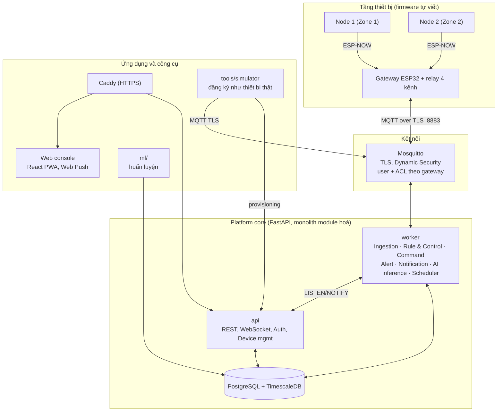

# GreenHub – Đặc tả hệ thống (đầu vào cho Coding Agent)

IoT platform chuyên biệt cho giám sát và điều khiển nhà kính thông minh đa vùng, đa loại cây. Tài liệu này mô tả những gì **đã thống nhất** để agent xây dựng: firmware, platform (backend), web console, AI/ML, simulator và triển khai.

Tài liệu đồng hành: `greenhub-team-plan.md` (kế hoạch nhóm, phần cứng, lịch, demo).

---

## 0. Cách dùng tài liệu này

- **Ngôn ngữ:** identifier, tên bảng, tên topic, API dùng tiếng Anh; giao diện web và nội dung cảnh báo tiếng Việt; comment được phép bằng tiếng Việt.
- **Mức độ ràng buộc:** MUST = bắt buộc, SHOULD = nên làm, MAY = tuỳ chọn.
- **Phạm vi:** chỉ xây những gì nằm trong mục 2 "Trong phạm vi". Không thêm tính năng thuộc mục "Ngoài phạm vi".
- **Khi gặp điểm chưa rõ:** chọn phương án đơn giản nhất phù hợp tài liệu, ghi lại quyết định vào `docs/DECISIONS.md` (một dòng/quyết định). Danh sách điểm còn mở ở mục 17.
- **Ngưỡng sinh học và giá trị thời gian** là giá trị khởi tạo, nằm trong crop profile (cấu hình được), không hard-code.
- **Thứ tự xây dựng:** theo các milestone M1–M6 (mục 16).

---

## 1. Mục tiêu và định vị

**GreenHub** là nền tảng IoT chuyên biệt cho nhà kính: nhận dữ liệu từ nhiều node cảm biến, tính các đại lượng vi khí hậu (VPD, DLI), điều khiển thiết bị chấp hành từ cloud, cảnh báo, và dùng dữ liệu tích luỹ để cải thiện điều khiển.

Ràng buộc từ yêu cầu môn học (ảnh hưởng thiết kế):

| Yêu cầu | Hệ quả |
|---|---|
| Phải là IoT, không phải nhúng/tự động hoá | Vòng quyết định nằm ở cloud; thiết bị quản lý từ xa; đa tenant; có phân tích dữ liệu |
| Có đủ IoT nodes, IoT Gateway, Cloud | Node ESP32 → Gateway ESP32 → Cloud (AWS EC2) |
| Tự xây dựng IoT platform | Firmware node/gateway, backend, web console **đều tự viết**; **không** dùng Blynk/ThingsBoard/AWS IoT Core |
| Độ hoàn thiện | Mọi kịch bản demo chạy trọn vòng: cảm biến → quyết định → chấp hành → cảnh báo |
| AI/ML hoặc cloud | Làm cả hai: AI (mục 8) và triển khai AWS (mục 13) |
| Video demo 5–7 phút | Kịch bản ở `greenhub-team-plan.md` |

**"Chuyên biệt" nghĩa là:**
1. Mô hình dữ liệu theo miền: farm → nhà kính → zone → crop profile; VPD, DLI, rủi ro nấm là khái niệm hạng nhất.
2. Platform quản lý vòng đời thiết bị: cấp phát, ghép node vào zone, đồng bộ cấu hình có phiên bản, theo dõi trạng thái.
3. Mọi thiết bị (thật và giả lập) đều đi qua **cùng một luồng** đăng ký và gửi dữ liệu.

---

## 2. Phạm vi

### 2.1 Trong phạm vi
- 1 nhà kính mini thật: 2 zone, 2 node, 1 gateway, 4 actuator (bơm Z1, bơm Z2, quạt, máy tạo ẩm).
- Nhiều farm/nhà kính giả lập bằng simulator (đăng ký qua đúng luồng provisioning).
- Platform: provisioning, device shadow/config, ingestion, rule & control engine, command service, alert service, notification, analytics (AI), API/auth/tenant.
- Web console (React PWA) với Web Push.
- 3 tầng AI (mục 8), pipeline huấn luyện lại, trang Model, thí nghiệm fixed vs adaptive.
- Thử tải bằng simulator.
- Triển khai Docker Compose: laptop (phát triển) và AWS EC2 (chạy chính).

### 2.2 Ngoài phạm vi (KHÔNG xây)
Telegram bot; FCM/Firebase; ứng dụng di động native; LLM và bảng `farm_activities`; Row-Level Security (có thể thêm sau); OTA; cảm biến CO₂/PAR/MLX90614/DS18B20; rèm cắt nắng; 4G; pin và tấm pin mặt trời; Grafana; dịch vụ managed của AWS (IoT Core, RDS, Lambda...); học tăng cường; phân loại bệnh từ ảnh; học liên farm; microservice tách rời.

---

## 3. Kiến trúc tổng thể



### 3.1 Bảng công nghệ

| Khối | Công nghệ |
|---|---|
| Node | ESP32 DevKit (WROOM-32), PlatformIO + Arduino-ESP32, ESP-NOW |
| Gateway | ESP32 DevKit, ESP-NOW + Wi-Fi (STA), MQTT client có TLS (ví dụ PubSubClient + WiFiClientSecure), ArduinoJson, NVS, NTP |
| Broker | Mosquitto 2.x, TLS 8883, Dynamic Security plugin (fallback: password file + ACL file) |
| Backend | Python 3.12, FastAPI, SQLAlchemy 2 + Alembic, aiomqtt (hoặc paho-mqtt), APScheduler, pywebpush, smtplib/aiosmtplib |
| CSDL | PostgreSQL + TimescaleDB (chạy trong container) |
| AI | pandas, scikit-learn, LightGBM, joblib |
| Web | React 18 + Vite + TypeScript, Recharts, React Query, PWA (manifest + service worker) |
| Proxy/TLS | Caddy (Let's Encrypt); Mosquitto dùng lại file chứng chỉ của Caddy |
| Triển khai | Docker Compose; AWS EC2 (mục 13) |

Ghim phiên bản bằng lockfile (`requirements.txt`/`poetry.lock`, `package-lock.json`, `platformio.ini`).

### 3.2 Quyết định kiến trúc
- **Monolith module hoá**, hai tiến trình: `api` (REST, WebSocket, provisioning) và `worker` (MQTT, rule, command, alert, notify, AI inference, scheduler). Cùng một codebase.
- `api` nhận sự kiện realtime từ `worker` qua **PostgreSQL LISTEN/NOTIFY** (kênh `ws_events`, payload JSON nhỏ), không thêm Redis.
- Mô hình ML huấn luyện **offline** bằng CLI (`ml/train.py`), `worker` chỉ nạp mô hình và suy luận.
- Trạng thái ngắn hạn của rule engine giữ trong bộ nhớ; khi worker khởi động lại thì dựng lại từ N phút readings gần nhất.
- 1 gateway = 1 nhà kính; topic MQTT dùng `farm_id` và `greenhouse_id` (UUID dạng chuỗi).

---

## 4. Phần cứng và firmware

### 4.1 Cấu hình phần cứng (tóm tắt, chi tiết ở plan)

| Khối | Linh kiện |
|---|---|
| Node ×2 | ESP32 DevKit, cảm biến ẩm đất điện dung v1.2, AHT20/AHT21 (hoặc SHT30), BH1750 (chỉ node 1), cấp nguồn USB 5 V |
| Gateway | ESP32 DevKit, relay 4 kênh cách ly quang 5 V (kích mức thấp), 2 bơm chìm mini 3–6 V, quạt 5 V, máy tạo ẩm USB 5 V, nguồn 5 V 3 A, diode 1N4007 ×4, tụ 1000 µF, buzzer |
| Mô hình | Hộp fomex ~40×30×30 cm có cửa sổ nhựa trong, 2 chậu xơ dừa |

### 4.2 Node – đấu nối và hành vi

| Linh kiện | Chân |
|---|---|
| AHT20 và BH1750 (I2C: 0x38 và 0x23) | SDA = GPIO21, SCL = GPIO22, VCC = 3V3 |
| Ẩm đất AOUT | GPIO34 (**ADC1**; không dùng ADC2 vì xung đột Wi-Fi/ESP-NOW) |
| Ẩm đất VCC | GPIO25 (bật khi đo, tắt khi xong) |
| LED trạng thái | GPIO2 |

**Vòng đo (MUST):**
1. Bật nguồn cảm biến ẩm đất → chờ ổn định ~50 ms → đọc ADC 5 mẫu lấy median → tắt nguồn.
2. Đọc AHT20; node 1 đọc thêm BH1750 (node 2 gửi `lux = 0xFFFFFFFF` nghĩa là không có).
3. Tính `soil_pct` từ `soil_raw` bằng hiệu chuẩn 2 điểm (`dry_raw`, `wet_raw` nhận từ cfg), kẹp 0–100.
4. Đóng gói `TelemetryPkt` (4.4), gửi ESP-NOW unicast tới MAC gateway.
5. Lắng nghe ~200 ms để nhận gói cfg đang chờ (nếu có).
6. Ngủ/đợi tới chu kỳ kế.

**Chế độ:** cờ biên dịch `DEMO_MODE`: đo liên tục, chu kỳ mặc định 10 s (cấu hình 10–15 s). Chế độ thường: chu kỳ 60 s, hỗ trợ deep sleep (SHOULD). Chu kỳ đổi được từ xa qua cfg.

**Tìm kênh Wi-Fi (MUST):** ESP-NOW chỉ hoạt động khi cùng kênh với router của gateway. Node khi boot hoặc sau N lần gửi lỗi liên tiếp (N = 5) sẽ quét kênh 1–13: phát `HELLO` broadcast ở từng kênh cho tới khi nhận `HELLO_ACK` từ gateway (chứa kênh gateway), rồi lưu kênh vào NVS.

**Hello khi chưa ghép:** node gửi `HELLO` định kỳ (mỗi 30 s) cho tới khi nhận được cfg có MAC của mình.

### 4.3 Gateway – đấu nối và hành vi

| Chức năng | Chân |
|---|---|
| Relay IN1 – bơm zone 1 | GPIO25 |
| Relay IN2 – bơm zone 2 | GPIO26 |
| Relay IN3 – quạt | GPIO27 |
| Relay IN4 – máy tạo ẩm | GPIO33 |
| Buzzer | GPIO23 |
| LED trạng thái | GPIO2 |

- Relay kích **mức thấp** (LOW = đóng). Khi khởi tạo: `digitalWrite(pin, HIGH)` **trước** `pinMode(pin, OUTPUT)`. Mọi relay tắt khi boot. Tránh GPIO 0/2/12/15 cho relay.
- Mạch tải: +5 V → COM, NO → cực dương tải, cực âm tải → GND. Bơm có diode 1N4007 song song tải (cathode về +). Tụ 1000 µF ở rail 5 V.

**Luồng xử lý (MUST):**
1. **Provisioning cục bộ:** lần đầu mở captive portal (ví dụ WiFiManager) để nhập Wi-Fi 2.4 GHz, `mqtt_host`, `mqtt_user`, `mqtt_password`, `farm_id`, `greenhouse_id`. Lưu vào NVS.
2. **Kết nối:** Wi-Fi → NTP → MQTT TLS (kiểm tra chứng chỉ bằng certificate bundle của thư viện, hoặc nhúng root CA đúng chuỗi). Đặt LWT `status` = `{"online":false}` (retained). Reconnect có exponential backoff.
3. **ESP-NOW → MQTT:** nhận gói từ MAC đã được ghép (danh sách trong cfg), kiểm tra dải vật lý và khử trùng `seq`, gán `ts` theo NTP, publish `telemetry/{zone}` (QoS 1). MAC lạ → publish `discovery`.
4. **Hàng đợi:** khi MQTT mất, giữ bản tin trong ring buffer RAM (100–200 bản tin) và gửi bù khi có lại. **Không** ghi log liên tục vào flash.
5. **Lệnh:** subscribe `cmd/#`. Với mỗi lệnh: kiểm tra `expires_at`, `cmd_id` đã xử lý chưa (idempotent, nhớ ~50 id gần nhất), interlock, giới hạn thời gian; thực thi; publish `ack/{cmd_id}`.
6. **Cfg:** subscribe `cfg` (retained). Lưu bản mới nhất vào NVS (chỉ ghi khi `cfg_version` đổi). Đẩy cấu hình của từng node xuống node khi node gửi telemetry (gói `CFG`).
7. **Heartbeat:** publish `status` (retained) mỗi 30 s.
8. **Buzzer:** kêu khi failsafe kích hoạt hoặc khi mất kết nối cloud kéo dài.

**Quy tắc an toàn tại gateway (MUST):**
- Mọi lệnh `on` đều có `duration_s`; gateway **tự tắt** khi hết thời gian, kể cả khi mất kết nối cloud.
- `duration_s` bị chặn trên: bơm ≤ `irrigation.max_run_s`; quạt ≤ `fan.max_on_s`; máy tạo ẩm ≤ `mist.max_on_s` (lấy từ cfg).
- **Interlock:** quạt và máy tạo ẩm không bao giờ bật đồng thời. Lệnh bật quạt khi máy tạo ẩm đang chạy thì tắt máy tạo ẩm trước và ghi `side_effects` trong ACK. Lệnh bật máy tạo ẩm khi quạt đang chạy bị `rejected` (`reason = "interlock"`).
- Bơm: tôn trọng `min_gap_s` và `max_total_s_per_hour` (lệnh vi phạm bị `rejected`, `reason = "min_gap"` hoặc `"max_total"`).

**Failsafe cục bộ (MUST):** kích hoạt khi mất kết nối MQTT liên tục hơn `offline_failsafe_after_s` (mặc định 60) **và** cảm biến hợp lệ (trong dải vật lý, cập nhật trong 3 chu kỳ gần nhất, không kẹt):
- `soil_pct < soil_moisture_critical_low_pct` → chạy bơm zone đó `irrigation.max_run_s` (vẫn theo min_gap và max_total).
- `air_t > temp_critical_high_c` → bật quạt (tắt máy tạo ẩm) tới khi `air_t < temp_critical_high_c − 2`.
- Cảm biến đứt dây đọc 0 **không** được coi là "đất khô".
- Ghi sự kiện cục bộ vào hàng đợi RAM và gửi lên topic `event` khi có mạng (`source = failsafe`). Có cảnh báo khi kích hoạt (buzzer cục bộ + alert `FAILSAFE_ACTIVE` ở cloud).

### 4.4 Gói tin ESP-NOW (nhị phân, little-endian, packed, ≤ 250 byte)

```c
enum PktType : uint8_t { PKT_TELEMETRY=1, PKT_HELLO=2, PKT_HELLO_ACK=3, PKT_CFG=4 };

struct __attribute__((packed)) TelemetryPkt {
  uint8_t  type;          // PKT_TELEMETRY
  uint8_t  zone;          // zone_index (1..N) từ cfg; 0 nếu chưa ghép
  uint16_t seq;
  int16_t  air_t_x100;    // °C * 100
  uint16_t air_rh_x100;   // %RH * 100
  uint16_t soil_raw;      // ADC thô
  uint8_t  soil_pct;      // 0..100 (đã hiệu chuẩn)
  uint8_t  flags;         // bit0 aht_err, bit1 soil_err, bit2 bh_err
  uint32_t lux;           // 0xFFFFFFFF = không có
  uint16_t vbat_mv;       // 0 nếu cấp nguồn USB
  uint8_t  fw_major, fw_minor;
};

struct __attribute__((packed)) HelloPkt    { uint8_t type; uint8_t fw_major, fw_minor; };
struct __attribute__((packed)) HelloAckPkt { uint8_t type; uint8_t channel; };
struct __attribute__((packed)) CfgPkt {
  uint8_t  type;          // PKT_CFG
  uint8_t  zone;
  uint16_t sample_interval_s;
  uint16_t soil_dry_raw;
  uint16_t soil_wet_raw;
  uint16_t cfg_version;
};
```

### 4.5 Cấu trúc repo firmware
```
firmware/
  common/        # struct gói tin, hằng số, hàm tiện ích dùng chung
  node/          # platformio.ini, src/
  gateway/       # platformio.ini, src/
```
Hai project PlatformIO chia sẻ `common/` (qua `lib_extra_dirs`).

---

## 5. Giao thức MQTT

Tiền tố: `gh/{farm_id}/{greenhouse_id}/`

| Topic | Chiều | QoS | Retained | Nội dung |
|---|---|---|---|---|
| `telemetry/{zone_index}` | gateway → cloud | 1 | không | Số liệu 1 zone |
| `status` | gateway → cloud | 1 | **có** (+ LWT) | Trạng thái gateway |
| `event` | gateway → cloud | 1 | không | Sự kiện cục bộ (failsafe, boot, sensor_invalid) |
| `discovery` | gateway → cloud | 1 | không | Node chưa ghép |
| `cmd/{actuator}` | cloud → gateway | 1 | không | Lệnh điều khiển |
| `ack/{cmd_id}` | gateway → cloud | 1 | không | Kết quả lệnh |
| `cfg` | cloud → gateway | 1 | **có** | Cấu hình có phiên bản |

`actuator` ∈ `pump_1 | pump_2 | fan | mist`. Thời gian: ISO 8601 UTC (`2026-10-14T08:00:00Z`).

**telemetry**
```json
{"ts":"2026-10-14T08:00:00Z","zone":2,"air_t":20.4,"air_rh":93.8,"soil_m":58.2,
 "soil_raw":1873,"lux":18400,"batt":0,"rssi":-58,"flags":0,"seq":1234}
```
(`lux` là `null` khi node không có BH1750.)

**status** (retained; LWT: `{"online":false}`)
```json
{"online":true,"fw":"1.0.0","rssi":-60,"uptime_s":86400,"heap":182000,"queue_len":0,
 "cfg_version":3,
 "actuators":{"pump_1":"off","pump_2":"off","fan":"on","mist":"off"},
 "nodes":[{"mac":"AA:BB:CC:DD:EE:01","zone":1,"last_seen_s":8},
          {"mac":"AA:BB:CC:DD:EE:02","zone":2,"last_seen_s":9}]}
```

**cmd**
```json
{"cmd_id":"6f1c...uuid","actuator":"fan","action":"on","duration_s":120,
 "expires_at":"2026-10-14T08:00:30Z","source":"auto"}
```
`action` ∈ `on | off`; `duration_s` bắt buộc khi `on`; `source` ∈ `auto | manual`.

**ack**
```json
{"cmd_id":"6f1c...uuid","status":"applied","reason":null,
 "applied_at":"2026-10-14T08:00:02Z","side_effects":["mist_off"],
 "state":{"pump_1":"off","pump_2":"off","fan":"on","mist":"off"}}
```
`status` ∈ `applied | rejected | expired`; `reason` ∈ `null | interlock | min_gap | max_total | max_run | invalid`.

**event**
```json
{"ts":"...","type":"failsafe_start","zone":2,"detail":{"trigger":"soil_low","soil_m":27.0}}
```
`type` ∈ `boot | failsafe_start | failsafe_stop | actuator_changed | sensor_invalid`. Với `actuator_changed` do failsafe: kèm `actuator`, `action`, `source:"failsafe"`.

**discovery**
```json
{"ts":"...","mac":"AA:BB:CC:DD:EE:03","fw":"1.0","rssi":-62}
```

**cfg** (retained)
```json
{"cfg_version":3,"offline_failsafe_after_s":60,
 "nodes":[{"mac":"AA:BB:CC:DD:EE:01","zone":1},{"mac":"AA:BB:CC:DD:EE:02","zone":2}],
 "zones":[
  {"zone":1,"pump":"pump_1","sample_interval_s":10,
   "soil_cal":{"dry_raw":2900,"wet_raw":1300},
   "limits":{"irrigation_max_run_s":15,"irrigation_min_gap_s":90,"irrigation_max_total_s_per_hour":120,
             "fan_max_on_s":300,"mist_max_on_s":300},
   "failsafe":{"temp_critical_high_c":35,"soil_moisture_critical_low_pct":30}}
 ]}
```

**Bảo mật MQTT (MUST):**
- Cấm anonymous. TLS bắt buộc trên 8883; **không** mở cổng 1883 ra ngoài.
- Mỗi gateway có user riêng. ACL: **đọc** `gh/{farm}/{gh}/cmd/#` và `cfg`; **ghi** `telemetry/#`, `status`, `event`, `discovery`, `ack/#` (cùng tiền tố farm/gh của nó).
- User `worker`: toàn quyền `gh/#`. User `api-admin`: quản lý client qua `$CONTROL/dynamic-security/v1`.
- Lệnh có `cmd_id` duy nhất và `expires_at`; gateway bỏ lệnh hết hạn và lệnh trùng.

---

## 6. Platform (backend)

### 6.1 Module

| Module | Tiến trình | Trách nhiệm |
|---|---|---|
| Device Registry & Provisioning | api | Tạo gateway, cấp credential MQTT (Dynamic Security), ghép node vào zone |
| Device Shadow / Config | api + worker | `desired` và `reported`, sinh và publish `cfg` có `cfg_version` |
| Ingestion | worker | Nhận MQTT, kiểm tra, tính VPD, gắn `quality` (A1), ghi DB, phát WS |
| Rule & Control Engine | worker | Hysteresis, rủi ro, interlock, auto/manual, fixed/adaptive |
| Command Service | worker | Phát lệnh, theo dõi ACK, hết hạn/timeout |
| Alert Service | worker | Vòng đời cảnh báo, dedupe, leo thang |
| Notification Service | worker | Web Push, email, sự kiện in-app |
| Analytics (AI) | worker + `ml/` | Suy luận định kỳ, lưu `predictions`; huấn luyện qua CLI |
| API / Auth / Tenant | api | JWT, vai trò, lọc theo `farm_id`, REST, WebSocket |

Worker subscribe: `gh/+/+/telemetry/+`, `gh/+/+/status`, `gh/+/+/event`, `gh/+/+/discovery`, `gh/+/+/ack/+`.

### 6.2 Provisioning và ghép node
1. Owner tạo nhà kính trên web. `POST /gateways` tạo bản ghi `gateways`, tạo user MQTT + ACL qua Dynamic Security, trả `{mqtt_username, mqtt_password (chỉ hiển thị 1 lần), host, port, farm_id, greenhouse_id}`.
2. Người dùng nhập thông tin này vào captive portal của gateway.
3. Node lạ → gateway publish `discovery` → worker tạo/ cập nhật `device_nodes(status='discovered')` → web hiện "Phát hiện node lạ".
4. Người dùng gán node vào zone (`POST /nodes/{mac}/pair`) → tăng `cfg_version` → publish `cfg` retained.
5. **Fallback MVP:** cho phép nhập MAC thủ công (bỏ bước tự phát hiện) nhưng vẫn giữ bước tạo gateway + credential.
6. Simulator đăng ký qua đúng API này (với `is_simulated = true`).

### 6.3 Device Shadow và cấu hình
- `device_state.desired` giữ chế độ điều khiển và trạng thái mong muốn; `reported` lấy từ `status`/`ack`.
- Chế độ từng actuator: `{"fan":{"mode":"auto"|"manual","until":"<ts>|null"}}`. Manual hết hạn (`until`) thì tự về auto. Khi manual, rule engine **không** gửi lệnh cho actuator đó (trừ ép interlock/an toàn, xem 6.4).
- `cfg_version_desired` tăng khi đổi crop profile, ánh xạ node, hiệu chuẩn, chu kỳ đo. Worker sinh `cfg` từ DB, publish retained. Gateway báo `cfg_version` trong `status` → `cfg_version_reported`. Web hiển thị "đã đồng bộ" / "đang chờ".

### 6.4 Rule & Control Engine

**Kích hoạt:** mỗi khi có telemetry hợp lệ của một zone, và tick 5 s cho các bộ đếm thời gian.

**Chỉ dùng dữ liệu `quality = ok`.** Zone mất cảm biến đất → không tưới + alert `SENSOR_FAULT`. Mất cảm biến khí → dùng zone lân cận nếu hợp lệ, nếu không thì bỏ qua quyết định khí hậu.

**Công thức (MUST):**
```
VPsat(T) = 0.61078 * exp(17.27 * T / (T + 237.3))        # kPa, T °C
VPair    = VPsat(T_khi) * RH / 100
VPD      = VPsat(T_la) - VPair        # T_la = T_khi - 1.0  (giả định, cấu hình được: leaf_offset_c)
PPFD     ≈ lux * 0.0185               # µmol/m²/s, xấp xỉ cho ánh sáng mặt trời
DLI      = Σ(PPFD * Δt_giây) / 1e6    # mol/m²/ngày, tích luỹ theo ngày
```
Kiểm thử: T=20, RH=94, T_la=T_khi → VPD ≈ 0.14 kPa.

**Tưới theo zone (chiến lược `fixed`):**
- Bật khi `soil < soil_min`; `duration_s = irrigation.max_run_s`; tắt sớm (gửi `off`) khi `soil ≥ soil_max`.
- Tôn trọng `min_gap_s`, `max_total_s_per_hour`.
- Sau mỗi lần tưới, chờ `soil_settle_s` trước khi đánh giá lại (tránh tưới lặp do cảm biến phản ứng chậm).

**Tưới theo zone (chiến lược `adaptive`):**
- `target = (soil_min + soil_max) / 2`
- `duration_s = clamp((target − soil_now) / pump_gain_pct_per_s, 3, irrigation.max_run_s)`, với `pump_gain` lấy từ mô hình A2 (mục 8). Nếu chưa có mô hình hoặc chưa đủ số sự kiện (< `min_events`, mặc định 5) thì **tự động dùng `fixed`**.

**Quạt (một bộ cho cả nhà kính, lấy zone nguy hiểm nhất):**
- Điều kiện BẬT: (VPD < `vpd.low_crit` liên tục ≥ `risk.vpd_low_duration_min`) **hoặc** alert `DISEASE_RISK` đang mở **hoặc** `air_t` > `temp_c.optimal[1]` ở zone nào đó.
- Kiểm tra tác dụng phụ: không bật quạt nếu VPD của zone đó đang > `vpd.high_crit` (quạt làm tăng VPD).
- `duration_s`: `fixed` = `fan.min_on_s`, lặp lại nếu điều kiện còn; `adaptive` = `clamp((vpd.low_off − vpd_now) / fan_vpd_rate_kpa_per_s, fan.min_on_s, fan.max_on_s)` (mô hình A2; fallback `fixed`).
- TẮT khi VPD ≥ `vpd.low_off` và nhiệt độ ổn, sau khi đã chạy tối thiểu `fan.min_on_s`.

**Máy tạo ẩm:**
- Auto: BẬT khi VPD > `vpd.high_crit` và quạt tắt, chạy `mist.max_on_s`; có `min_gap`.
- Điều khiển tay được (dùng để tạo kịch bản demo).
- Khi quạt tự bật vì rủi ro, **ép tắt** máy tạo ẩm (kể cả đang manual) và khoá bật lại `mist.lockout_s`. An toàn thắng thủ công.

**Rủi ro nấm (baseline theo luật):**
- Tích luỹ `fungal_minutes` khi `RH ≥ disease.rh_gt` và `air_t` trong `disease.temp_range_c`; về 0 (hoặc giảm dần) khi hết điều kiện.
- Alert `DISEASE_RISK` khi `fungal_minutes ≥ disease.fungal_minutes_alert` hoặc VPD < `vpd.low_crit` kéo dài ≥ `risk.vpd_low_duration_min`.
- Alert `HEAT_STRESS` khi `air_t ≥ failsafe.temp_critical_high_c` (ngưỡng đơn giản, không cần ML).
- Alert `SOIL_DRY` khi `soil < soil_moisture_critical_low_pct` kéo dài.

**Auto/manual và interlock** như 4.3 và 6.3. Mọi quyết định ghi kèm `reason` (chuỗi ngắn) vào `commands.reason`.

**Chiến lược** đặt theo zone (`zones.control_strategy`). Thí nghiệm so sánh fixed/adaptive dùng `experiment_runs`.

### 6.5 Command Service
Trạng thái lệnh: `pending → sent → applied | rejected | expired | timeout`.
- Tạo lệnh (từ rule engine hoặc API) → ghi `commands(pending)` → publish `cmd/{actuator}` QoS 1 (`sent`).
- Nhận `ack` → cập nhật trạng thái + `reported` + ghi `actuator_logs`. Nếu `ack` chứa `side_effects` thì cập nhật các actuator bị ảnh hưởng.
- Quá `expires_at` (mặc định 30 s) mà chưa có ACK → `timeout`; **không** tự gửi lại lệnh `on` quá hạn. Rule engine có thể tạo lệnh mới theo trạng thái hiện tại.
- Gateway offline (theo `status`/LWT) → không phát lệnh, trả lỗi cho API (`409 gateway_offline`).

### 6.6 Alert Service
Vòng đời: `raised → notified → acknowledged → resolved`.
- `dedupe_key = "{type}:{zone_id|greenhouse_id}"`; chỉ một alert mở cho mỗi key (unique index một phần).
- Cooldown gửi lại thông báo cùng key: 10 phút (cấu hình).
- Tự `resolved` khi điều kiện hết (hysteresis).
- **Leo thang:** alert `critical` chưa `acknowledged` sau `escalate_after_min` (mặc định 5; demo 2) → gửi lại push và gửi email.
- **Phản hồi:** người dùng gắn `true_positive` / `false_positive` (dùng cho AI, mục 8).

Loại alert: `DISEASE_RISK`, `DISEASE_RISK_FORECAST` (từ AI), `HEAT_STRESS`, `SOIL_DRY`, `SENSOR_FAULT`, `DEVICE_OFFLINE` (LWT/không có heartbeat), `FAILSAFE_ACTIVE`, `MAINTENANCE` (MAY).
Mức độ: `info | warning | critical`.

### 6.7 Notification Service
Bốn lớp, chỉ trên web (không Telegram/FCM/app di động):

| Lớp | Khi nào | Công nghệ |
|---|---|---|
| 1. In-app | Đang mở web | WebSocket → toast, chuông, badge số alert chưa xử lý |
| 2. **Web Push** | Đóng tab/trình duyệt | Service Worker + Push API + VAPID; backend dùng `pywebpush` (chạy trong thread) |
| 3. Email | Leo thang `critical` | SMTP |
| 4. Tại chỗ | Failsafe/mất mạng | Buzzer ở gateway |

- Người nhận: user của farm có `notification_prefs.push_enabled` và `min_severity` phù hợp.
- Payload push: `{"title","body","tag":dedupe_key,"severity","url":"/zones/{id}"}`.
- Khi push trả 404/410 → xoá subscription.
- Ví dụ nội dung: "CẢNH BÁO: Nguy cơ nấm bệnh – Luống Dâu tây (Zone 2): VPD 0.14 kPa, RH 94%. Quạt đã được bật."

---

## 7. Cơ sở dữ liệu (PostgreSQL + TimescaleDB)

Dùng Alembic quản lý migration. Mọi API lọc theo `farm_id` của người dùng (cô lập tenant ở tầng ứng dụng; RLS là MAY).

```sql
CREATE EXTENSION IF NOT EXISTS timescaledb;

CREATE TABLE farms (
  id UUID PRIMARY KEY DEFAULT gen_random_uuid(),
  name VARCHAR(100) NOT NULL,
  created_at TIMESTAMPTZ NOT NULL DEFAULT now()
);

CREATE TABLE users (
  id UUID PRIMARY KEY DEFAULT gen_random_uuid(),
  farm_id UUID NOT NULL REFERENCES farms(id),
  email VARCHAR(255) UNIQUE NOT NULL,
  password_hash TEXT NOT NULL,
  role VARCHAR(20) NOT NULL CHECK (role IN ('owner','operator','viewer')),
  created_at TIMESTAMPTZ NOT NULL DEFAULT now()
);

CREATE TABLE greenhouses (
  id UUID PRIMARY KEY DEFAULT gen_random_uuid(),
  farm_id UUID NOT NULL REFERENCES farms(id),
  name VARCHAR(100),
  location VARCHAR(255),
  created_at TIMESTAMPTZ NOT NULL DEFAULT now()
);

CREATE TABLE gateways (
  id UUID PRIMARY KEY DEFAULT gen_random_uuid(),
  greenhouse_id UUID NOT NULL UNIQUE REFERENCES greenhouses(id),
  mqtt_username VARCHAR(100) UNIQUE NOT NULL,
  is_simulated BOOLEAN NOT NULL DEFAULT false,
  provisioned_at TIMESTAMPTZ NOT NULL DEFAULT now(),
  online BOOLEAN NOT NULL DEFAULT false,
  last_seen TIMESTAMPTZ,
  fw_version VARCHAR(20),
  rssi INT
);

CREATE TABLE crop_profiles (
  id UUID PRIMARY KEY DEFAULT gen_random_uuid(),
  farm_id UUID REFERENCES farms(id),            -- NULL = template hệ thống
  crop_name VARCHAR(100) NOT NULL,
  variety VARCHAR(100),
  schema_version INT NOT NULL DEFAULT 1,
  parameters_json JSONB NOT NULL
);

CREATE TABLE zones (
  id UUID PRIMARY KEY DEFAULT gen_random_uuid(),
  greenhouse_id UUID NOT NULL REFERENCES greenhouses(id),
  zone_index INT NOT NULL,
  name VARCHAR(100),
  crop_profile_id UUID REFERENCES crop_profiles(id),
  planting_date DATE,
  pump_channel INT,                              -- kênh relay của bơm zone
  control_strategy VARCHAR(10) NOT NULL DEFAULT 'fixed'
      CHECK (control_strategy IN ('fixed','adaptive')),
  soil_dry_raw INT, soil_wet_raw INT,            -- hiệu chuẩn ẩm đất
  UNIQUE (greenhouse_id, zone_index)
);

CREATE TABLE device_nodes (
  id UUID PRIMARY KEY DEFAULT gen_random_uuid(),
  mac_address VARCHAR(17) UNIQUE NOT NULL,
  greenhouse_id UUID REFERENCES greenhouses(id),
  zone_id UUID REFERENCES zones(id),
  status VARCHAR(12) NOT NULL DEFAULT 'discovered' CHECK (status IN ('discovered','paired')),
  firmware_version VARCHAR(20),
  battery_mv INT,
  rssi INT,
  first_seen TIMESTAMPTZ NOT NULL DEFAULT now(),
  last_seen TIMESTAMPTZ
);

CREATE TABLE readings (
  ts TIMESTAMPTZ NOT NULL,
  zone_id UUID NOT NULL REFERENCES zones(id),
  air_temp REAL, air_rh REAL, vpd REAL,
  soil_moisture REAL, soil_raw INT,
  lux REAL,
  rssi INT, seq INT,
  quality VARCHAR(20) NOT NULL DEFAULT 'ok',     -- ok|stuck|spike|dropout|out_of_range
  source VARCHAR(4) NOT NULL DEFAULT 'real' CHECK (source IN ('real','sim')),
  PRIMARY KEY (zone_id, ts)
);
SELECT create_hypertable('readings', 'ts');

-- Tổng hợp theo phút (continuous aggregate)
CREATE MATERIALIZED VIEW readings_1m WITH (timescaledb.continuous) AS
SELECT time_bucket('1 minute', ts) AS bucket, zone_id,
       avg(air_temp) AS air_temp, avg(air_rh) AS air_rh, avg(vpd) AS vpd,
       avg(soil_moisture) AS soil_moisture, avg(lux) AS lux, count(*) AS n
FROM readings WHERE quality = 'ok'
GROUP BY bucket, zone_id WITH NO DATA;
SELECT add_continuous_aggregate_policy('readings_1m',
  start_offset => INTERVAL '2 hours', end_offset => INTERVAL '1 minute',
  schedule_interval => INTERVAL '1 minute');
-- Tương tự readings_1h. Nén dữ liệu cũ (MAY, kiểm tra cú pháp theo phiên bản Timescale):
-- ALTER TABLE readings SET (timescaledb.compress, timescaledb.compress_segmentby='zone_id');
-- SELECT add_compression_policy('readings', INTERVAL '7 days');

CREATE TABLE commands (
  id UUID PRIMARY KEY,                           -- = cmd_id
  greenhouse_id UUID NOT NULL REFERENCES greenhouses(id),
  actuator VARCHAR(20) NOT NULL,
  action VARCHAR(10) NOT NULL,
  duration_s INT,
  source VARCHAR(10) NOT NULL CHECK (source IN ('auto','manual')),
  requested_by UUID REFERENCES users(id),
  reason TEXT,
  status VARCHAR(10) NOT NULL DEFAULT 'pending'
      CHECK (status IN ('pending','sent','applied','rejected','expired','timeout')),
  reject_reason VARCHAR(30),
  created_at TIMESTAMPTZ NOT NULL DEFAULT now(),
  sent_at TIMESTAMPTZ, acked_at TIMESTAMPTZ,
  expires_at TIMESTAMPTZ NOT NULL
);

CREATE TABLE actuator_logs (                     -- nhật ký thay đổi trạng thái thực tế
  id UUID PRIMARY KEY DEFAULT gen_random_uuid(),
  greenhouse_id UUID NOT NULL REFERENCES greenhouses(id),
  actuator VARCHAR(30) NOT NULL,
  action VARCHAR(20) NOT NULL,
  source VARCHAR(10) NOT NULL CHECK (source IN ('auto','manual','failsafe')),
  cmd_id UUID,
  duration_s INT,
  reason TEXT,
  created_at TIMESTAMPTZ NOT NULL DEFAULT now()
);
CREATE INDEX ON actuator_logs (greenhouse_id, created_at DESC);

CREATE TABLE device_state (
  greenhouse_id UUID PRIMARY KEY REFERENCES greenhouses(id),
  reported JSONB NOT NULL DEFAULT '{}',
  desired  JSONB NOT NULL DEFAULT '{}',          -- gồm modes của từng actuator
  cfg_version_desired INT NOT NULL DEFAULT 0,
  cfg_version_reported INT NOT NULL DEFAULT 0,
  updated_at TIMESTAMPTZ NOT NULL DEFAULT now()
);

CREATE TABLE alerts (
  id UUID PRIMARY KEY DEFAULT gen_random_uuid(),
  greenhouse_id UUID NOT NULL REFERENCES greenhouses(id),
  zone_id UUID REFERENCES zones(id),
  alert_type VARCHAR(50) NOT NULL,
  severity VARCHAR(10) NOT NULL CHECK (severity IN ('info','warning','critical')),
  state VARCHAR(14) NOT NULL DEFAULT 'raised'
      CHECK (state IN ('raised','notified','acknowledged','resolved')),
  dedupe_key VARCHAR(120) NOT NULL,
  payload JSONB,
  created_at TIMESTAMPTZ NOT NULL DEFAULT now(),
  notified_at TIMESTAMPTZ, escalated_at TIMESTAMPTZ,
  acknowledged_at TIMESTAMPTZ, acked_by UUID REFERENCES users(id),
  resolved_at TIMESTAMPTZ,
  feedback VARCHAR(15) CHECK (feedback IN ('true_positive','false_positive')),
  feedback_at TIMESTAMPTZ
);
CREATE UNIQUE INDEX alerts_open_dedupe ON alerts (dedupe_key) WHERE state <> 'resolved';

CREATE TABLE push_subscriptions (
  id UUID PRIMARY KEY DEFAULT gen_random_uuid(),
  user_id UUID NOT NULL REFERENCES users(id),
  endpoint TEXT UNIQUE NOT NULL,
  p256dh TEXT NOT NULL, auth TEXT NOT NULL,
  user_agent TEXT,
  created_at TIMESTAMPTZ NOT NULL DEFAULT now(),
  last_used_at TIMESTAMPTZ
);

CREATE TABLE notification_prefs (
  user_id UUID PRIMARY KEY REFERENCES users(id),
  push_enabled BOOLEAN NOT NULL DEFAULT true,
  email_enabled BOOLEAN NOT NULL DEFAULT true,
  min_severity VARCHAR(10) NOT NULL DEFAULT 'warning'
);

CREATE TABLE ml_models (
  id UUID PRIMARY KEY DEFAULT gen_random_uuid(),
  zone_id UUID REFERENCES zones(id),
  task VARCHAR(30) NOT NULL,                     -- risk_forecast|irrigation_eta|pump_response|fan_response
  version INT NOT NULL,
  artifact_path TEXT NOT NULL,
  trained_at TIMESTAMPTZ NOT NULL DEFAULT now(),
  train_from TIMESTAMPTZ, train_to TIMESTAMPTZ,
  n_samples INT,
  source_mix JSONB,                              -- {"real":n,"sim":m}
  metrics JSONB,                                 -- trên tập test (chỉ dữ liệu real)
  baseline_metrics JSONB,
  is_active BOOLEAN NOT NULL DEFAULT false,
  notes TEXT,
  UNIQUE (zone_id, task, version)
);

CREATE TABLE predictions (
  ts TIMESTAMPTZ NOT NULL,
  zone_id UUID NOT NULL REFERENCES zones(id),
  task VARCHAR(30) NOT NULL,                     -- risk_forecast|irrigation_eta
  model_id UUID REFERENCES ml_models(id),
  horizon_min INT,
  score REAL,                                    -- xác suất (risk_forecast)
  value REAL,                                    -- phút còn lại (irrigation_eta)
  details JSONB,
  PRIMARY KEY (zone_id, task, ts)
);

CREATE TABLE experiment_runs (
  id UUID PRIMARY KEY DEFAULT gen_random_uuid(),
  greenhouse_id UUID NOT NULL REFERENCES greenhouses(id),
  strategy VARCHAR(10) NOT NULL CHECK (strategy IN ('fixed','adaptive')),
  started_at TIMESTAMPTZ NOT NULL DEFAULT now(),
  ended_at TIMESTAMPTZ,
  notes TEXT
);
```

### 7.1 Crop profile (`parameters_json`, schema_version = 1)

```json
{
  "schema_version": 1,
  "vpd": {"optimal": [0.8, 1.2], "low_crit": 0.4, "low_off": 0.6, "high_crit": 1.6},
  "temp_c": {"optimal": [20, 28]},
  "soil_moisture_pct": {"min": 60, "max": 75},
  "disease": {"rh_gt": 85, "temp_range_c": [15, 25], "fungal_minutes_alert": 360},
  "irrigation": {"max_run_s": 300, "min_gap_s": 1800, "max_total_s_per_hour": 420, "soil_settle_s": 300},
  "fan": {"min_on_s": 300, "max_on_s": 1800},
  "mist": {"max_on_s": 900, "lockout_s": 900},
  "risk": {"vpd_low_duration_min": 60, "horizon_min": 120, "trend_windows_min": [30, 60]},
  "sample_interval_s": 60,
  "failsafe": {"temp_critical_high_c": 35, "soil_moisture_critical_low_pct": 30}
}
```

Giá trị khởi tạo theo cây (đối chiếu tài liệu khuyến nông trước khi dùng thực tế):

| Thuộc tính | Cà chua bi | Dâu tây |
|---|---|---|
| `vpd.optimal` (kPa) | 0.8–1.2 | 0.6–0.9 |
| `temp_c.optimal` (°C) | 20–28 | 18–24 |
| `soil_moisture_pct` min–max | 60–75 | 50–65 |
| `failsafe.temp_critical_high_c` | 35 | 30 |
| `disease.rh_gt` | 85 | 90 |
| `vpd.low_crit` / `low_off` / `high_crit` | 0.4 / 0.6 / 1.6 | 0.4 / 0.6 / 1.6 |

**Hai bộ tham số thời gian (MUST có cả hai template cho mỗi cây):** nhà kính mini phản ứng nhanh hơn nhà kính thật rất nhiều, nên có template `real` (bảng trên) và template `demo` (thu nhỏ thang thời gian). Nhà kính demo dùng bản sao `demo`.

| Tham số | `real` | `demo` |
|---|---|---|
| `sample_interval_s` | 60 | 10 |
| `irrigation.max_run_s` | 300 | 15 |
| `irrigation.min_gap_s` | 1800 | 90 |
| `irrigation.max_total_s_per_hour` | 420 | 120 |
| `irrigation.soil_settle_s` | 300 | 30 |
| `fan.min_on_s` / `max_on_s` | 300 / 1800 | 60 / 300 |
| `mist.max_on_s` / `lockout_s` | 900 / 900 | 300 / 120 |
| `risk.vpd_low_duration_min` | 60 | 3 |
| `risk.horizon_min` | 120 | 15 |
| `risk.trend_windows_min` | [30, 60] | [5, 15] |
| `disease.fungal_minutes_alert` | 360 | 5 |

Một số giá trị trong bảng (`fan.*`, `mist.*`, `soil_settle_s`, các giá trị `demo`) là đề xuất khởi tạo, hiệu chỉnh khi chạy thật.

---

## 8. AI/ML

### 8.1 Nguyên tắc
- Dữ liệu cảm biến dạng bảng/chuỗi thời gian → ML cổ điển (Ridge, LightGBM, Random Forest). **Không dùng LLM** và không dùng mạng nơ-ron lớn. Không cần GPU.
- **Mục tiêu:** tạo **vòng lặp dữ liệu**: dữ liệu quá khứ (kể cả `actuator_logs` và phản hồi người dùng) → mô hình → thay đổi hành vi điều khiển.
- Luôn có **baseline** và so sánh trực tiếp. Mô hình không thắng baseline vẫn là kết quả hợp lệ và **không** được kích hoạt.
- **Chia train/test theo thời gian**, không xáo trộn.
- Mọi bản ghi có nhãn nguồn `real`/`sim`. **Chỉ số báo cáo chính tính trên dữ liệu `real`**; dữ liệu `sim` chỉ để thử pipeline và tải. Dữ liệu `real` gồm cả sự kiện vật lý do máy tạo ẩm/bơm thật tạo ra (kể cả khi kích bằng script gọi API).
- Dữ liệu `quality ≠ ok` bị loại khỏi tập huấn luyện.

### 8.2 Ba tầng

**Tầng 1 – Chất lượng dữ liệu (A1, bằng luật, MUST):** gắn `quality` cho từng bản ghi/cảm biến.

| Nhãn | Luật (tham số cấu hình được) |
|---|---|
| `out_of_range` | Ngoài dải vật lý: `air_t` −10..60, `air_rh` 0..100, `soil_pct` 0..100, `lux` 0..65535 |
| `dropout` | Không có bản tin quá 3 × `sample_interval_s`; hoặc cờ `flags` báo lỗi cảm biến |
| `stuck` | Giá trị y hệt qua ≥ N chu kỳ (soil_raw: N=60; air: N=30) |
| `spike` | Thay đổi giữa 2 chu kỳ liên tiếp vượt ngưỡng (air_t > 5 °C, RH > 25%, soil > 20%) |
| (nghi ngờ) | Chênh lệch `air_t`/`air_rh` giữa 2 zone (cùng khối không khí) vượt ngưỡng → đối chiếu node lân cận |

Mô hình ML cho A1 là **MAY** (chỉ khi còn thời gian, để bắt lỗi trôi chậm). Chỉ số bảo trì (MAY): xu hướng RSSI, tỉ lệ mất gói, độ lệch so với node lân cận → alert `MAINTENANCE`.

**Tầng 2 – Học đặc tính từng zone từ chính dữ liệu (A2, MUST):** dùng `actuator_logs` + `readings`, kết quả **đưa vào rule engine** (chiến lược `adaptive`).
- `pump_response` (mỗi zone): từ các lần bơm đã `applied` (thời lượng d), lấy `soil_before` (trung bình 3 điểm hợp lệ trước khi bơm) và `soil_after` (giá trị cực đại trong cửa sổ `soil_settle_s` sau khi bơm). `gain = Δsoil / d` (% mỗi giây). Ước lượng bằng median của K sự kiện gần nhất, hoặc hồi quy Ridge `Δsoil ~ d + soil_before`. Cần ≥ `min_events` (5) mới dùng.
- `fan_response`: từ các lần quạt chạy (thời lượng d), `rate = ΔVPD / d` (kPa mỗi giây, VPD tăng khi quạt hút ẩm). Cách ước lượng như trên.
- `irrigation_eta` (bài toán #2): thời gian còn lại tới khi chạm `soil_min`.
  - Baseline: `(soil_now − soil_min) / tốc độ giảm`, với tốc độ ước lượng bằng hồi quy tuyến tính trên cửa sổ gần nhất (demo: 10–30 phút; thực: 1–3 giờ).
  - Mô hình: Ridge hoặc LightGBM, đặc trưng: `soil_now`, tốc độ giảm, `air_t`, `vpd`, `lux`, giờ trong ngày, thời gian từ lần tưới gần nhất.
  - Nhãn: tại mỗi thời điểm trong đoạn khô–tưới, số phút thật tới khi chạm `soil_min`; bỏ các mẫu mà đoạn đó không chạm ngưỡng trước lần tưới kế (censored).
  - Đánh giá: **MAE (phút)** trên các chu kỳ khô–tưới chưa thấy, so với baseline.

**Tầng 3 – Dự báo rủi ro và học từ phản hồi (A3, MUST):**
- Mục tiêu: dự đoán zone có **chuyển** sang vùng nguy cơ trong `horizon_min` tới hay không (nấm: VPD < `vpd.low_crit` liên tục ≥ `risk.vpd_low_duration_min`; hoặc `air_t` vượt ngưỡng nguy hiểm).
- Nhãn: áp luật lên dữ liệu **tương lai** `(t, t+H]`.
- **Tránh rò rỉ:** chỉ lấy các thời điểm mà trạng thái hiện tại **chưa** ở vùng nguy cơ.
- Đặc trưng: giá trị hiện tại và xu hướng theo `risk.trend_windows_min` của `air_t`, `air_rh`, `vpd`, `lux`; giờ trong ngày; trạng thái quạt/máy tạo ẩm; `fungal_minutes`; (loại cây).
- Mô hình: LightGBM (hoặc Random Forest), một mô hình cho mỗi zone.
- Baseline: luật ngưỡng + ngoại suy tuyến tính xu hướng VPD.
- Đánh giá: PR-AUC, F1 (chọn ngưỡng trên tập validation; báo cáo trên tập test).
- **Phản hồi:** `alerts.feedback` được dùng làm nhãn bổ sung và để đo **precision của cảnh báo** (tỉ lệ `true_positive`) so với chỉ dùng luật.
- Đầu ra: bản ghi `predictions(task='risk_forecast', score)`; khi `score ≥ ngưỡng` (mặc định 0.7) → alert `DISEASE_RISK_FORECAST` (warning). Dự báo **không** tự điều khiển thiết bị.

### 8.3 Vòng đời mô hình (MUST, bản tối giản)
- `ml/train.py` (CLI, cũng gọi được bằng cron/APScheduler): `python -m ml.train --task <task> --zone <id|all> [--from --to]`.
- Mỗi lần chạy: tải dữ liệu, chia theo thời gian (train/val/test), huấn luyện, tính metrics mô hình **và** baseline trên test, lưu artifact (`/models/{task}/{zone}/v{n}.joblib`), ghi `ml_models` (kèm `source_mix`, `metrics`, `baseline_metrics`).
- **Chỉ kích hoạt** (`is_active = true`, tắt bản cũ) khi mô hình thắng cả baseline và bản đang chạy trên test; nếu không, vẫn lưu và ghi `notes`.
- Worker nạp mô hình active khi khởi động và khi có tín hiệu (NOTIFY) hoặc định kỳ; suy luận mỗi 60 s cho từng zone; ghi `predictions`.
- Dấu hiệu lệch dữ liệu (đơn giản): so sánh trung bình/độ lệch chuẩn của đặc trưng gần đây với lúc huấn luyện, hiển thị trên trang Model.

### 8.4 Thí nghiệm "fixed vs adaptive"
Bật/tắt `control_strategy` của zone trên web; mỗi lần bật ghi `experiment_runs`. Chạy lần lượt hai chế độ trong điều kiện tương tự rồi so các KPI (tính bằng SQL trên khoảng `[started_at, ended_at]`):

| KPI | Cách tính |
|---|---|
| Số lần bật/tắt bơm, quạt mỗi giờ | đếm `actuator_logs` |
| % thời gian VPD trong dải tối ưu | tỉ lệ `readings.vpd` trong `vpd.optimal` |
| Overshoot ẩm đất | max(`soil` − `soil_max`) sau mỗi lần tưới |
| Tổng thời gian bơm (proxy lượng nước) | Σ `duration_s` của bơm |
| Số cảnh báo sai | đếm `alerts.feedback = 'false_positive'` |

Nếu adaptive không tốt hơn thì vẫn báo cáo trung thực.

### 8.5 Thử tải
Simulator đăng ký 50–100 gateway (mỗi gateway vài node, chu kỳ 10 s). Đo: bản tin/giây, độ trễ từ lúc gửi đến lúc ghi DB (p50/p95), CPU/RAM của EC2. Ghi rõ đây là tải mô phỏng. Lưu ý t3.small là instance burstable (CPU nền thấp): chạy theo đợt ngắn và theo dõi CPU credit.

---

## 9. API

Base: `/api`. Xác thực JWT (`Authorization: Bearer`). Vai trò: `viewer` (đọc), `operator` (đọc + điều khiển, ack, feedback), `owner` (tất cả + quản lý thiết bị, profile, user). Mọi truy vấn lọc theo `farm_id` của người dùng.

| Nhóm | Endpoint | Vai trò |
|---|---|---|
| Auth | `POST /auth/login`, `GET /me` | — |
| Farm | `GET /greenhouses`, `GET /greenhouses/{id}`, `POST /greenhouses` | viewer / owner |
| Thiết bị | `POST /gateways`, `GET /gateways/{id}/status`, `GET /nodes?status=`, `POST /nodes/{mac}/pair`, `PUT /zones/{id}/calibration` | owner |
| Zone | `GET /zones/{id}`, `PUT /zones/{id}` (crop profile, strategy) | viewer / owner |
| Dữ liệu | `GET /zones/{id}/readings?from&to&agg=raw\|1m\|1h`, `GET /zones/{id}/dli?date=`, `GET /zones/{id}/predictions` | viewer |
| Điều khiển | `POST /greenhouses/{id}/commands` `{actuator,action,duration_s}`, `PUT /greenhouses/{id}/modes` `{actuator,mode,until}`, `GET /greenhouses/{id}/commands` | operator |
| Cấu hình | `GET/PUT /crop-profiles/{id}` (tăng `cfg_version`), `GET /greenhouses/{id}/config-sync` | viewer / owner |
| Cảnh báo | `GET /alerts?state=`, `POST /alerts/{id}/ack`, `POST /alerts/{id}/feedback` | viewer / operator |
| Push | `GET /push/public-key`, `POST /push/subscribe`, `DELETE /push/subscribe`, `PUT /me/notification-prefs` | viewer |
| Model | `GET /models?zone_id=`, `GET /models/{id}` | viewer |
| Thí nghiệm | `POST /experiments` (bắt đầu), `POST /experiments/{id}/stop`, `GET /experiments/{id}/kpis` | operator |
| Realtime | `WS /ws?token=` | viewer |

Lỗi dùng mã HTTP chuẩn; điều khiển khi gateway offline → `409 gateway_offline`; vượt quyền → `403`.

**Thông điệp WebSocket** (JSON `{type, data}`): `telemetry`, `alert`, `command_status`, `device_status`, `prediction`, `config_sync`. Client chỉ nhận sự kiện của farm mình.

---

## 10. Web console (React PWA)

Đối tượng: người vận hành, dùng cả laptop và điện thoại (responsive). **Không** làm app di động riêng.

| Trang | Nội dung |
|---|---|
| Đăng nhập | Email/mật khẩu |
| Tổng quan farm | Danh sách nhà kính (kể cả farm giả lập thuộc farm của user), trạng thái online, số alert mở |
| Zone | Biểu đồ trực tiếp: nhiệt độ, RH, VPD (tô dải tối ưu), ẩm đất, lux, DLI; lớp phủ trạng thái actuator và điểm alert; khung AI: xác suất rủi ro, "cần tưới sau ~N phút" |
| Điều khiển | Từng actuator: bật/tắt (kèm thời lượng), công tắc Auto/Manual, trạng thái lệnh `pending → applied/rejected`; chọn chiến lược fixed/adaptive |
| Thiết bị | Gateway và node: online/offline, RSSI, last seen, `cfg_version` đồng bộ hay đang chờ; ghép node lạ vào zone; hiệu chuẩn ẩm đất |
| Crop profile | Form chỉnh ngưỡng, lưu thì đồng bộ xuống gateway |
| Cảnh báo | Danh sách, ack, nút "đúng/sai" (feedback), lịch sử |
| Model & Thí nghiệm | Phiên bản mô hình, ngày huấn luyện, metrics vs baseline, dấu hiệu lệch dữ liệu; bắt đầu/dừng thí nghiệm và bảng KPI |
| Cài đặt thông báo | Bật Web Push, mức độ tối thiểu, email |

**PWA và Web Push (MUST):**
- `manifest.json` + service worker `sw.js`. Web Push bắt buộc HTTPS (riêng `localhost` được miễn khi phát triển).
- Đăng ký push do **cú bấm của người dùng**: `Notification.requestPermission()` → `PushManager.subscribe({userVisibleOnly:true, applicationServerKey: <VAPID public>})` → `POST /push/subscribe`.
- `sw.js`:
```js
self.addEventListener('push', e => {
  const d = e.data.json();
  e.waitUntil(self.registration.showNotification(d.title, {
    body: d.body, tag: d.tag,
    requireInteraction: d.severity === 'critical',
    data: { url: d.url }
  }));
});
self.addEventListener('notificationclick', e => {
  e.notification.close();
  e.waitUntil(clients.openWindow(e.notification.data.url));
});
```
- iOS (16.4+) chỉ nhận push khi web được **Add to Home Screen**; ghi chú hướng dẫn trong trang Cài đặt thông báo.
- Backend:
```python
from pywebpush import webpush, WebPushException
def send_push(sub, payload: dict) -> bool:
    try:
        webpush(subscription_info={"endpoint": sub.endpoint,
                                   "keys": {"p256dh": sub.p256dh, "auth": sub.auth}},
                data=json.dumps(payload),
                vapid_private_key=VAPID_PRIVATE_KEY,
                vapid_claims={"sub": VAPID_SUBJECT})
        return True
    except WebPushException as e:
        if e.response is not None and e.response.status_code in (404, 410):
            delete_subscription(sub)
        return False
```
- Giới hạn cần biết: push không đảm bảo giao tin và không vượt chế độ Không làm phiền → giữ lớp email và buzzer.

---

## 11. Simulator (`tools/simulator`)

- CLI: `python -m tools.simulator --farms 2 --gateways 5 --nodes-per-gw 2 --interval 10 --scenario normal|humid_spike|dry_down|sensor_fault`.
- Đăng ký **qua API provisioning** (tạo farm/greenhouse/gateway, `is_simulated=true`), nhận credential riêng, kết nối **MQTT TLS** giống gateway thật, publish đúng định dạng `telemetry`/`status`, nhận `cmd` và trả `ack`.
- Mô hình vật lý đơn giản: nhiệt, RH, ẩm đất (khô dần, tăng khi bơm), quạt giảm RH, máy tạo ẩm tăng RH.
- Chế độ thử tải: `--gateways 100` (tuỳ chọn chạy từ laptop trỏ lên EC2).
- Dữ liệu từ gateway giả lập được gắn `readings.source = 'sim'`.

---

## 12. Bảo mật (checklist)

- Mật khẩu người dùng băm (argon2/bcrypt); JWT có hạn; secret chỉ trong `.env`, không commit (`.gitignore`).
- Broker: không anonymous, TLS 8883, ACL theo `farm_id`/`greenhouse_id`, credential riêng mỗi gateway.
- DB không mở ra ngoài (chỉ trong mạng Docker). Chỉ mở cổng 22 (giới hạn IP, dùng key), 80/443, 8883.
- Mọi endpoint API kiểm tra vai trò và `farm_id`.
- Lệnh điều khiển qua API có kiểm tra quyền; LLM/AI **không** nằm trong vòng điều khiển trực tiếp (chỉ cảnh báo; adaptive chỉ chỉnh thời lượng trong giới hạn an toàn của gateway).
- Demo chỉ dùng điện áp thấp (5 V); không đấu tải 220 V.

---

## 13. Triển khai

### 13.1 Docker Compose
Dịch vụ: `mosquitto`, `timescaledb`, `api`, `worker`, `caddy` (phục vụ web build tĩnh và reverse proxy `/api`, `/ws`). Có healthcheck, giới hạn bộ nhớ từng container, volume cho DB, mô hình (`/models`) và chứng chỉ. Hai môi trường dùng cùng file compose: `docker-compose.yml` (+ `docker-compose.dev.yml` cho laptop: cổng 1883 chỉ bind `127.0.0.1`, chứng chỉ tự ký; `docker-compose.prod.yml` cho AWS).

### 13.2 Laptop (phát triển)
Chạy toàn bộ stack bằng compose, phát triển và thử với gateway thật trong LAN (cần cố định IP laptop). Huấn luyện mô hình và chạy simulator từ đây. Web Push thử trên `localhost` hoặc qua HTTPS khi cần thử điện thoại.

### 13.3 AWS (chạy chính)

| Hạng mục | Giá trị |
|---|---|
| Loại tài khoản | Free plan (tài khoản mới); kiểm tra điều kiện hiện hành khi đăng ký |
| Region | ap-southeast-1 (Singapore) |
| Instance | t3.small (2 vCPU, 2 GB), x86; Ubuntu 24.04 LTS |
| Ổ đĩa | EBS gp3 20–30 GB; swap 2 GB |
| IP | Elastic IP; tên miền miễn phí (DuckDNS) trỏ về IP này |
| Chứng chỉ | Caddy lấy Let's Encrypt; Mosquitto đọc lại file chứng chỉ (mount chỉ đọc), restart định kỳ (cron hàng tháng) sau gia hạn |
| Gateway firmware | Dùng tên miền (không phải IP), kiểm tra chứng chỉ; certificate bundle của thư viện hoặc root CA đúng chuỗi (kiểm tra bằng `openssl s_client -connect <domain>:8883`) |

**Security Group:**

| Cổng | Nguồn | Mục đích |
|---|---|---|
| 22 | Chỉ IP quản trị, chỉ key | SSH |
| 80, 443 | Mọi nơi | Web, cấp chứng chỉ |
| 8883 | Mọi nơi | MQTT TLS |
| 1883, 5432 | **Không mở** | — |

**Không dùng** dịch vụ managed của AWS (IoT Core, RDS vì không hỗ trợ TimescaleDB, Lambda...). Tuning gợi ý: `shared_buffers` Postgres ~256 MB.

**Sao lưu:** cron `pg_dump` hằng ngày; kéo bản dump về laptop (hoặc S3 nếu muốn). Free plan tự đóng tài khoản sau 6 tháng hoặc khi hết credit, nên phải xuất dữ liệu, mô hình, video trước hạn.

### 13.4 Biến môi trường (`.env`, không commit)
`POSTGRES_PASSWORD`, `DATABASE_URL`, `JWT_SECRET`, `MQTT_HOST`, `MQTT_WORKER_USER/PASSWORD`, `MQTT_ADMIN_USER/PASSWORD`, `VAPID_PUBLIC_KEY`, `VAPID_PRIVATE_KEY`, `VAPID_SUBJECT`, `SMTP_HOST/PORT/USER/PASSWORD`, `ALERT_EMAIL_FROM`, `DOMAIN`, `MODELS_DIR`.

---

## 14. Cấu trúc repo

```
greenhub/
  firmware/{common,node,gateway}/
  platform/
    api/            # FastAPI routers, auth, provisioning, ws
    worker/         # mqtt ingest, rules, commands, alerts, notify, inference, scheduler
    core/           # models (SQLAlchemy), schemas (pydantic), vpd/dli, config
    migrations/     # Alembic
  web/              # React + Vite + TS, public/{manifest.json,sw.js}
  ml/               # train.py, features.py, evaluate.py, notebooks/
  tools/simulator/
  deploy/           # docker-compose*.yml, mosquitto/, caddy/, backup.sh
  docs/DECISIONS.md
  README.md
```

---

## 15. Kiểm thử và tiêu chí chấp nhận

**Kiểm thử đơn vị (MUST):** VPD (ví dụ T=20, RH=94 → ≈0.14 kPa), DLI, luật quality (A1), rule engine (hysteresis, min_gap, max_total, interlock, manual override, ép tắt máy tạo ẩm khi quạt bật), state machine lệnh, dedupe alert.

**Kiểm thử tích hợp:** simulator + broker + DB: telemetry → readings → rule → cmd → ack → `device_state`; reconnect gateway nhận lại `cfg` retained; Dynamic Security tạo user có ACL đúng.

**Tiêu chí chấp nhận theo kịch bản demo:**

| Kịch bản | Điều kiện đạt |
|---|---|
| **A. Rủi ro nấm** | Bật máy tạo ẩm từ web (manual) → RH tăng, VPD giảm → xuất hiện `DISEASE_RISK_FORECAST` trước → khi điều kiện thật xảy ra, quạt tự bật và máy tạo ẩm bị ép tắt → push hiển thị trên điện thoại/desktop, bấm vào mở trang zone |
| **B. Ẩm đất** | Đất khô dần → web hiển thị "cần tưới sau ~N phút" → bơm chạy đúng hysteresis và giới hạn thời gian → chuyển Auto/Manual hoạt động |
| **C. Cảm biến/mất kết nối** | Rút dây cảm biến → `quality ≠ ok`, không tưới sai, alert `SENSOR_FAULT`. Cắt Wi-Fi gateway → `DEVICE_OFFLINE`, failsafe chạy đúng giới hạn, khi online lại thì dữ liệu được gửi bù và `cfg_version` đồng bộ |
| **D. Đa farm** | Farm giả lập hiển thị trên web, cô lập dữ liệu giữa các farm (user farm A không thấy farm B) |
| **E. AI** | Trang Model hiển thị metrics vs baseline; thí nghiệm fixed vs adaptive có bảng KPI |

**Mọi milestone:** hệ thống khởi động lại bằng `docker compose up -d` sạch, migration chạy tự động, không cần thao tác thủ công ngoài `.env`.

---

## 16. Milestone

| M | Cuối tuần | Kết quả |
|---|---|---|
| M1 | 1 | Phần cứng lắp xong; node → ESP-NOW → gateway → MQTT (broker local); điều khiển relay bằng lệnh MQTT thủ công |
| M2 | 2 | Ingestion → DB, VPD; cmd/ACK/shadow; quality luật (A1) |
| M3 | 3 | Web console cơ bản (đăng nhập, zone, điều khiển, crop profile), rule engine `fixed`, vòng đời alert, Web Push thử trên localhost |
| M4 | 4 | Provisioning/ghép node, deploy EC2 + TLS, Web Push thử trên điện thoại qua HTTPS, simulator đa farm; **bắt đầu thu dữ liệu 3–5 ngày** |
| M5 | 5 | A2/A3, pipeline huấn luyện, trang Model, `adaptive`, thí nghiệm KPI, thử tải, email leo thang |
| M6 | 6 | Chạy thử toàn bộ kịch bản, quay video, xuất/sao lưu dữ liệu và mô hình, hoàn thiện báo cáo |

---

## 17. Giả định và điểm còn mở

**Đã chốt:** các mục 1–16 là các quyết định đã thống nhất. Hai nhóm sau là đề xuất kỹ thuật cho agent, có thể đổi nếu vướng:
- Kỹ thuật: LISTEN/NOTIFY cho WebSocket; Dynamic Security (có fallback); PubSubClient; WiFiManager; Recharts.
- Giá trị khởi tạo: các tham số `fan.*`, `mist.*`, `soil_settle_s`, ngưỡng spike/stuck, ngưỡng dự báo 0.7, bộ `demo`.

**Còn mở (nhóm cần quyết, agent hỗ trợ cả hai phương án nếu có thể):**
1. Cảm biến nhiệt-ẩm: AHT20/AHT21 hay SHT30 (tuỳ giá lúc mua; cùng giao tiếp I2C, khác địa chỉ/thư viện).
2. Loại tài khoản AWS cụ thể (mới theo Free plan hay cũ) và credit thực nhận.
3. Nhà cung cấp SMTP cho email leo thang.
4. Ghép node: tự phát hiện hay nhập MAC thủ công cho MVP.
5. Có thêm cảnh báo `MAINTENANCE` và mô hình ML cho A1 hay không (MAY).
6. Có làm script tự động bật/tắt máy tạo ẩm khi thu dữ liệu (để có đủ sự kiện rủi ro thật) hay làm bằng tay.

---

## Phụ lục A – Lưu ý kỹ thuật ESP32/cảm biến
- Cảm biến analog nối chân **ADC1**; ADC2 không dùng được khi Wi-Fi/ESP-NOW hoạt động.
- Cảm biến ẩm đất điện dung: seal mép bằng epoxy/sơn chống nước; hiệu chuẩn 2 điểm (không khí khô, đất ướt) theo giá thể.
- BH1750 đo **lux** (không phải PAR), tối đa 65.535 lux; nắng gắt ngoài trời có thể vượt. Hệ số lux→PPFD 0.0185 chỉ là xấp xỉ cho ánh sáng mặt trời.
- AHT/SHT có thể sai số và phục hồi chậm sau khi bị ngưng tụ hoặc ở RH rất cao; đặt xa miệng phun ẩm.
- Gateway phải cùng kênh Wi-Fi với router khi dùng ESP-NOW; ESP32 chỉ hỗ trợ Wi-Fi 2.4 GHz (không kết nối được Wi-Fi có captive portal hoặc WPA2-Enterprise).
- PubSubClient: tăng `setBufferSize` (≥ 1024) cho payload `cfg`.
- Nhiều module relay kích mức thấp; kiểm tra trạng thái relay lúc boot.
- Máy tạo ẩm USB: chọn loại tự chạy khi có điện (một số loại phải bấm nút mới chạy).

## Phụ lục B – Công thức bổ sung
- Rủi ro chuẩn hoá (dùng cho xếp hạng zone nguy hiểm nhất và hiển thị): `risk_vpd_low = clamp((vpd.optimal[0] − vpd)/(vpd.optimal[0] − vpd.low_crit), 0, 1)`; `risk_heat = clamp((air_t − temp_c.optimal[1])/(failsafe.temp_critical_high_c − temp_c.optimal[1]), 0, 1)`.
- Khi không có cảm biến nhiệt độ lá, VPD dùng `T_la = T_khi − leaf_offset_c` (mặc định 1.0); ghi rõ giả định này trong báo cáo.
