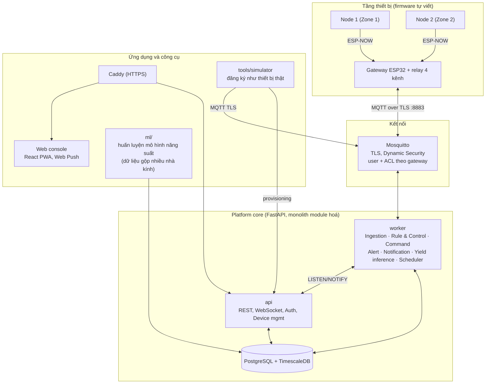

# GreenHub – Đặc tả hệ thống (đầu vào cho Coding Agent)

IoT platform chuyên biệt cho giám sát và điều khiển nhà kính thông minh đa vùng, đa loại cây. Tài liệu này mô tả những gì **đã thống nhất** để agent xây dựng: firmware, platform (backend), web console, AI/ML, simulator và triển khai.

Tài liệu đồng hành: `greenhub-team-plan.md` (kế hoạch nhóm, phần cứng, lịch, demo).

---

## 0. Cách dùng tài liệu này

- **Ngôn ngữ:** identifier, tên bảng, tên topic, API dùng tiếng Anh; giao diện web và nội dung cảnh báo tiếng Việt; comment được phép bằng tiếng Việt.
- **Mức độ ràng buộc:** MUST = bắt buộc, SHOULD = nên làm, MAY = tuỳ chọn.
- **Phạm vi:** chỉ xây những gì nằm trong mục 2 "Trong phạm vi". Không thêm tính năng thuộc mục "Ngoài phạm vi".
- **Khi gặp điểm chưa rõ:** chọn phương án đơn giản nhất phù hợp tài liệu, ghi lại quyết định vào `docs/DECISIONS.md` (một dòng/quyết định). Danh sách điểm còn mở ở mục 17.
- **Ngưỡng sinh học và giá trị thời gian** là giá trị khởi tạo, nằm trong crop profile (cấu hình được), không hard-code.
- **Thứ tự xây dựng:** theo các milestone M1–M6 (mục 16).

---

## 1. Mục tiêu và định vị

**GreenHub** là nền tảng IoT chuyên biệt cho nhà kính: nhận dữ liệu từ nhiều node cảm biến, tính các đại lượng vi khí hậu (VPD, DLI), điều khiển thiết bị chấp hành từ server, cảnh báo, và dùng dữ liệu khí hậu tích luỹ từ **nhiều nhà kính** để **dự đoán năng suất cây trồng** và **gợi ý cây nên trồng** với điều kiện khí hậu hiện tại.

Ràng buộc từ yêu cầu môn học (ảnh hưởng thiết kế):

| Yêu cầu | Hệ quả |
|---|---|
| Phải là IoT, không phải nhúng/tự động hoá | Vòng quyết định nằm ở cloud; thiết bị quản lý từ xa; đa tenant; có phân tích dữ liệu |
| Có đủ IoT nodes, IoT Gateway, Cloud | Node ESP32 → Gateway ESP32 → Server (VPS Linux, mục 13) |
| Tự xây dựng IoT platform | Firmware node/gateway, backend, web console **đều tự viết**; **không** dùng Blynk/ThingsBoard/AWS IoT Core |
| Độ hoàn thiện | Mọi kịch bản demo chạy trọn vòng: cảm biến → quyết định → chấp hành → cảnh báo |
| AI/ML hoặc cloud | Làm cả hai: AI dự đoán năng suất + gợi ý cây trồng (mục 8) và triển khai trên VPS (mục 13) |
| Video demo 5–7 phút | Kịch bản ở `greenhub-team-plan.md` |

**"Chuyên biệt" nghĩa là:**
1. Mô hình dữ liệu theo miền: farm → nhà kính → zone → crop profile → vụ trồng; VPD, DLI, rủi ro nấm, năng suất là khái niệm hạng nhất.
2. Platform quản lý vòng đời thiết bị: cấp phát, ghép node vào zone, đồng bộ cấu hình có phiên bản, theo dõi trạng thái.
3. Mọi thiết bị (thật và giả lập) đều đi qua **cùng một luồng** đăng ký và gửi dữ liệu.

---

## 2. Phạm vi

### 2.1 Trong phạm vi
- 1 nhà kính mini thật: 2 zone, 2 node, 1 gateway, 4 actuator (bơm Z1, bơm Z2, quạt, máy tạo ẩm).
- Nhiều farm/nhà kính giả lập bằng simulator (đăng ký qua đúng luồng provisioning).
- Platform: provisioning, device shadow/config, ingestion, kiểm tra chất lượng dữ liệu (luật), rule & control engine, command service, alert service, notification, quản lý vụ trồng, analytics (AI), API/auth/tenant.
- Web console (React PWA) với Web Push.
- **Một bài toán AI duy nhất** (mục 8): dự đoán năng suất cây trồng từ dữ liệu khí hậu, dùng chung mô hình để gợi ý cây trồng; dữ liệu huấn luyện gộp từ nhiều nhà kính (thật, giả lập, tổng hợp); pipeline huấn luyện offline, trang Gợi ý cây trồng và trang Mô hình AI.
- Thử tải bằng simulator.
- Triển khai Docker Compose: laptop (phát triển) và **một VPS Linux** (chạy chính).

### 2.2 Ngoài phạm vi (KHÔNG xây)
Telegram bot; FCM/Firebase; ứng dụng di động native; LLM và bảng `farm_activities`; Row-Level Security (có thể thêm sau); OTA; cảm biến CO₂/PAR/MLX90614/DS18B20; rèm cắt nắng; 4G; pin và tấm pin mặt trời; Grafana; dịch vụ cloud managed (AWS IoT Core, RDS, Lambda... hoặc tương đương); học tăng cường; phân loại bệnh từ ảnh; federated learning (huấn luyện **tập trung** trên dữ liệu gộp nhiều farm là trong phạm vi); điều khiển thích nghi bằng ML (`adaptive`), dự báo rủi ro bằng ML; microservice tách rời.

---

## 3. Kiến trúc tổng thể



### 3.1 Bảng công nghệ

| Khối | Công nghệ |
|---|---|
| Node | ESP32 DevKit (WROOM-32), PlatformIO + Arduino-ESP32, ESP-NOW |
| Gateway | ESP32 DevKit, ESP-NOW + Wi-Fi (STA), MQTT client có TLS (ví dụ PubSubClient + WiFiClientSecure), ArduinoJson, NVS, NTP |
| Broker | Mosquitto 2.x, TLS 8883, Dynamic Security plugin (fallback: password file + ACL file) |
| Backend | Python 3.12, FastAPI, SQLAlchemy 2 + Alembic, aiomqtt (hoặc paho-mqtt), APScheduler, pywebpush, smtplib/aiosmtplib |
| CSDL | PostgreSQL + TimescaleDB (chạy trong container) |
| AI | pandas, scikit-learn, LightGBM, joblib (chỉ trong `worker` và `ml/`) |
| Web | React 18 + Vite + TypeScript, Recharts, React Query, PWA (manifest + service worker) |
| Proxy/TLS | Caddy (Let's Encrypt); Mosquitto dùng lại file chứng chỉ của Caddy |
| Triển khai | Docker Compose; VPS Linux Ubuntu 24.04 (mục 13) |

Ghim phiên bản bằng lockfile (`requirements.txt`/`poetry.lock`, `package-lock.json`, `platformio.ini`).

### 3.2 Quyết định kiến trúc
- **Monolith module hoá**, hai tiến trình: `api` (REST, WebSocket, provisioning) và `worker` (MQTT, rule, command, alert, notify, AI inference, scheduler). Cùng một codebase.
- `api` nhận sự kiện realtime từ `worker` qua **PostgreSQL LISTEN/NOTIFY** (kênh `ws_events`, payload JSON nhỏ), không thêm Redis.
- Mô hình ML huấn luyện **offline** bằng CLI (`ml/train.py`), `worker` chỉ nạp mô hình và suy luận. Chỉ có **một mô hình toàn cục** (task `yield`) dùng cho mọi farm, học từ dữ liệu gộp nhiều nhà kính.
- Cách tính đặc trưng khí hậu nằm ở một chỗ duy nhất `platform/core/climate_features.py` (Python thuần), dùng chung cho `worker`, `ml/` và `tools/simulator`.
- Trạng thái ngắn hạn của rule engine giữ trong bộ nhớ; khi worker khởi động lại thì dựng lại từ N phút readings gần nhất.
- 1 gateway = 1 nhà kính; topic MQTT dùng `farm_id` và `greenhouse_id` (UUID dạng chuỗi).

---

## 4. Phần cứng và firmware

### 4.1 Cấu hình phần cứng (tóm tắt, chi tiết ở plan)

| Khối | Linh kiện |
|---|---|
| Node ×2 | ESP32 DevKit, cảm biến ẩm đất điện dung v1.2, AHT20/AHT21 (hoặc SHT30), BH1750 (chỉ node 1), cấp nguồn USB 5 V |
| Gateway | ESP32 DevKit, relay 4 kênh cách ly quang 5 V (kích mức thấp), 2 bơm chìm mini 3–6 V, quạt 5 V, máy tạo ẩm USB 5 V, nguồn 5 V 3 A, diode 1N4007 ×4, tụ 1000 µF, buzzer |
| Mô hình | Hộp fomex ~40×30×30 cm có cửa sổ nhựa trong, 2 chậu xơ dừa |

### 4.2 Node – đấu nối và hành vi

| Linh kiện | Chân |
|---|---|
| AHT20 và BH1750 (I2C: 0x38 và 0x23) | SDA = GPIO21, SCL = GPIO22, VCC = 3V3 |
| Ẩm đất AOUT | GPIO34 (**ADC1**; không dùng ADC2 vì xung đột Wi-Fi/ESP-NOW) |
| Ẩm đất VCC | GPIO25 (bật khi đo, tắt khi xong) |
| LED trạng thái | GPIO2 |

**Vòng đo (MUST):**
1. Bật nguồn cảm biến ẩm đất → chờ ổn định ~50 ms → đọc ADC 5 mẫu lấy median → tắt nguồn.
2. Đọc AHT20; node 1 đọc thêm BH1750 (node 2 gửi `lux = 0xFFFFFFFF` nghĩa là không có).
3. Tính `soil_pct` từ `soil_raw` bằng hiệu chuẩn 2 điểm (`dry_raw`, `wet_raw` nhận từ cfg), kẹp 0–100.
4. Đóng gói `TelemetryPkt` (4.4), gửi ESP-NOW unicast tới MAC gateway.
5. Lắng nghe ~200 ms để nhận gói cfg đang chờ (nếu có).
6. Ngủ/đợi tới chu kỳ kế.

**Chế độ:** cờ biên dịch `DEMO_MODE`: đo liên tục, chu kỳ mặc định 10 s (cấu hình 10–15 s). Chế độ thường: chu kỳ 60 s, hỗ trợ deep sleep (SHOULD). Chu kỳ đổi được từ xa qua cfg.

**Tìm kênh Wi-Fi (MUST):** ESP-NOW chỉ hoạt động khi cùng kênh với router của gateway. Node khi boot hoặc sau N lần gửi lỗi liên tiếp (N = 5) sẽ quét kênh 1–13: phát `HELLO` broadcast ở từng kênh cho tới khi nhận `HELLO_ACK` từ gateway (chứa kênh gateway), rồi lưu kênh vào NVS.

**Hello khi chưa ghép:** node gửi `HELLO` định kỳ (mỗi 30 s) cho tới khi nhận được cfg có MAC của mình.

### 4.3 Gateway – đấu nối và hành vi

| Chức năng | Chân |
|---|---|
| Relay IN1 – bơm zone 1 | GPIO25 |
| Relay IN2 – bơm zone 2 | GPIO26 |
| Relay IN3 – quạt | GPIO27 |
| Relay IN4 – máy tạo ẩm | GPIO33 |
| Buzzer | GPIO23 |
| LED trạng thái | GPIO2 |

- Relay kích **mức thấp** (LOW = đóng). Khi khởi tạo: `digitalWrite(pin, HIGH)` **trước** `pinMode(pin, OUTPUT)`. Mọi relay tắt khi boot. Tránh GPIO 0/2/12/15 cho relay.
- Mạch tải: +5 V → COM, NO → cực dương tải, cực âm tải → GND. Bơm có diode 1N4007 song song tải (cathode về +). Tụ 1000 µF ở rail 5 V.

**Luồng xử lý (MUST):**
1. **Provisioning cục bộ:** lần đầu mở captive portal (ví dụ WiFiManager) để nhập Wi-Fi 2.4 GHz, `mqtt_host`, `mqtt_user`, `mqtt_password`, `farm_id`, `greenhouse_id`. Lưu vào NVS.
2. **Kết nối:** Wi-Fi → NTP → MQTT TLS (kiểm tra chứng chỉ bằng certificate bundle của thư viện, hoặc nhúng root CA đúng chuỗi). Đặt LWT `status` = `{"online":false}` (retained). Reconnect có exponential backoff.
3. **ESP-NOW → MQTT:** nhận gói từ MAC đã được ghép (danh sách trong cfg), kiểm tra dải vật lý và khử trùng `seq`, gán `ts` theo NTP, publish `telemetry/{zone}` (QoS 1). MAC lạ → publish `discovery`.
4. **Hàng đợi:** khi MQTT mất, giữ bản tin trong ring buffer RAM (100–200 bản tin) và gửi bù khi có lại. **Không** ghi log liên tục vào flash.
5. **Lệnh:** subscribe `cmd/#`. Với mỗi lệnh: kiểm tra `expires_at`, `cmd_id` đã xử lý chưa (idempotent, nhớ ~50 id gần nhất), interlock, giới hạn thời gian; thực thi; publish `ack/{cmd_id}`.
6. **Cfg:** subscribe `cfg` (retained). Lưu bản mới nhất vào NVS (chỉ ghi khi `cfg_version` đổi). Đẩy cấu hình của từng node xuống node khi node gửi telemetry (gói `CFG`).
7. **Heartbeat:** publish `status` (retained) mỗi 30 s.
8. **Buzzer:** kêu khi failsafe kích hoạt hoặc khi mất kết nối cloud kéo dài.

**Quy tắc an toàn tại gateway (MUST):**
- Mọi lệnh `on` đều có `duration_s`; gateway **tự tắt** khi hết thời gian, kể cả khi mất kết nối cloud.
- `duration_s` bị chặn trên: bơm ≤ `irrigation.max_run_s`; quạt ≤ `fan.max_on_s`; máy tạo ẩm ≤ `mist.max_on_s` (lấy từ cfg).
- **Interlock:** quạt và máy tạo ẩm không bao giờ bật đồng thời. Lệnh bật quạt khi máy tạo ẩm đang chạy thì tắt máy tạo ẩm trước và ghi `side_effects` trong ACK. Lệnh bật máy tạo ẩm khi quạt đang chạy bị `rejected` (`reason = "interlock"`).
- Bơm: tôn trọng `min_gap_s` và `max_total_s_per_hour` (lệnh vi phạm bị `rejected`, `reason = "min_gap"` hoặc `"max_total"`).

**Failsafe cục bộ (MUST):** kích hoạt khi mất kết nối MQTT liên tục hơn `offline_failsafe_after_s` (mặc định 60) **và** cảm biến hợp lệ (trong dải vật lý, cập nhật trong 3 chu kỳ gần nhất, không kẹt):
- `soil_pct < soil_moisture_critical_low_pct` → chạy bơm zone đó `irrigation.max_run_s` (vẫn theo min_gap và max_total).
- `air_t > temp_critical_high_c` → bật quạt (tắt máy tạo ẩm) tới khi `air_t < temp_critical_high_c − 2`.
- Cảm biến đứt dây đọc 0 **không** được coi là "đất khô".
- Ghi sự kiện cục bộ vào hàng đợi RAM và gửi lên topic `event` khi có mạng (`source = failsafe`). Có cảnh báo khi kích hoạt (buzzer cục bộ + alert `FAILSAFE_ACTIVE` ở cloud).

### 4.4 Gói tin ESP-NOW (nhị phân, little-endian, packed, ≤ 250 byte)

```c
enum PktType : uint8_t { PKT_TELEMETRY=1, PKT_HELLO=2, PKT_HELLO_ACK=3, PKT_CFG=4 };

struct __attribute__((packed)) TelemetryPkt {
  uint8_t  type;          // PKT_TELEMETRY
  uint8_t  zone;          // zone_index (1..N) từ cfg; 0 nếu chưa ghép
  uint16_t seq;
  int16_t  air_t_x100;    // °C * 100
  uint16_t air_rh_x100;   // %RH * 100
  uint16_t soil_raw;      // ADC thô
  uint8_t  soil_pct;      // 0..100 (đã hiệu chuẩn)
  uint8_t  flags;         // bit0 aht_err, bit1 soil_err, bit2 bh_err
  uint32_t lux;           // 0xFFFFFFFF = không có
  uint16_t vbat_mv;       // 0 nếu cấp nguồn USB
  uint8_t  fw_major, fw_minor;
};

struct __attribute__((packed)) HelloPkt    { uint8_t type; uint8_t fw_major, fw_minor; };
struct __attribute__((packed)) HelloAckPkt { uint8_t type; uint8_t channel; };
struct __attribute__((packed)) CfgPkt {
  uint8_t  type;          // PKT_CFG
  uint8_t  zone;
  uint16_t sample_interval_s;
  uint16_t soil_dry_raw;
  uint16_t soil_wet_raw;
  uint16_t cfg_version;
};
```

### 4.5 Cấu trúc repo firmware
```
firmware/
  common/        # struct gói tin, hằng số, hàm tiện ích dùng chung
  node/          # platformio.ini, src/
  gateway/       # platformio.ini, src/
```
Hai project PlatformIO chia sẻ `common/` (qua `lib_extra_dirs`).

---

## 5. Giao thức MQTT

Tiền tố: `gh/{farm_id}/{greenhouse_id}/`

| Topic | Chiều | QoS | Retained | Nội dung |
|---|---|---|---|---|
| `telemetry/{zone_index}` | gateway → cloud | 1 | không | Số liệu 1 zone |
| `status` | gateway → cloud | 1 | **có** (+ LWT) | Trạng thái gateway |
| `event` | gateway → cloud | 1 | không | Sự kiện cục bộ (failsafe, boot, sensor_invalid) |
| `discovery` | gateway → cloud | 1 | không | Node chưa ghép |
| `cmd/{actuator}` | cloud → gateway | 1 | không | Lệnh điều khiển |
| `ack/{cmd_id}` | gateway → cloud | 1 | không | Kết quả lệnh |
| `cfg` | cloud → gateway | 1 | **có** | Cấu hình có phiên bản |

`actuator` ∈ `pump_1 | pump_2 | fan | mist`. Thời gian: ISO 8601 UTC (`2026-10-14T08:00:00Z`).

**telemetry**
```json
{"ts":"2026-10-14T08:00:00Z","zone":2,"air_t":20.4,"air_rh":93.8,"soil_m":58.2,
 "soil_raw":1873,"lux":18400,"batt":0,"rssi":-58,"flags":0,"seq":1234}
```
(`lux` là `null` khi node không có BH1750.)

**status** (retained; LWT: `{"online":false}`)
```json
{"online":true,"fw":"1.0.0","rssi":-60,"uptime_s":86400,"heap":182000,"queue_len":0,
 "cfg_version":3,
 "actuators":{"pump_1":"off","pump_2":"off","fan":"on","mist":"off"},
 "nodes":[{"mac":"AA:BB:CC:DD:EE:01","zone":1,"last_seen_s":8},
          {"mac":"AA:BB:CC:DD:EE:02","zone":2,"last_seen_s":9}]}
```

**cmd**
```json
{"cmd_id":"6f1c...uuid","actuator":"fan","action":"on","duration_s":120,
 "expires_at":"2026-10-14T08:00:30Z","source":"auto"}
```
`action` ∈ `on | off`; `duration_s` bắt buộc khi `on`; `source` ∈ `auto | manual`.

**ack**
```json
{"cmd_id":"6f1c...uuid","status":"applied","reason":null,
 "applied_at":"2026-10-14T08:00:02Z","side_effects":["mist_off"],
 "state":{"pump_1":"off","pump_2":"off","fan":"on","mist":"off"}}
```
`status` ∈ `applied | rejected | expired`; `reason` ∈ `null | interlock | min_gap | max_total | max_run | invalid`.

**event**
```json
{"ts":"...","type":"failsafe_start","zone":2,"detail":{"trigger":"soil_low","soil_m":27.0}}
```
`type` ∈ `boot | failsafe_start | failsafe_stop | actuator_changed | sensor_invalid`. Với `actuator_changed` do failsafe: kèm `actuator`, `action`, `source:"failsafe"`.

**discovery**
```json
{"ts":"...","mac":"AA:BB:CC:DD:EE:03","fw":"1.0","rssi":-62}
```

**cfg** (retained)
```json
{"cfg_version":3,"offline_failsafe_after_s":60,
 "nodes":[{"mac":"AA:BB:CC:DD:EE:01","zone":1},{"mac":"AA:BB:CC:DD:EE:02","zone":2}],
 "zones":[
  {"zone":1,"pump":"pump_1","sample_interval_s":10,
   "soil_cal":{"dry_raw":2900,"wet_raw":1300},
   "limits":{"irrigation_max_run_s":15,"irrigation_min_gap_s":90,"irrigation_max_total_s_per_hour":120,
             "fan_max_on_s":300,"mist_max_on_s":300},
   "failsafe":{"temp_critical_high_c":35,"soil_moisture_critical_low_pct":30}}
 ]}
```

**Bảo mật MQTT (MUST):**
- Cấm anonymous. TLS bắt buộc trên 8883; **không** mở cổng 1883 ra ngoài.
- Mỗi gateway có user riêng. ACL: **đọc** `gh/{farm}/{gh}/cmd/#` và `cfg`; **ghi** `telemetry/#`, `status`, `event`, `discovery`, `ack/#` (cùng tiền tố farm/gh của nó).
- User `worker`: toàn quyền `gh/#`. User `api-admin`: quản lý client qua `$CONTROL/dynamic-security/v1`.
- Lệnh có `cmd_id` duy nhất và `expires_at`; gateway bỏ lệnh hết hạn và lệnh trùng.

---

## 6. Platform (backend)

### 6.1 Module

| Module | Tiến trình | Trách nhiệm |
|---|---|---|
| Device Registry & Provisioning | api | Tạo gateway, cấp credential MQTT (Dynamic Security), ghép node vào zone |
| Device Shadow / Config | api + worker | `desired` và `reported`, sinh và publish `cfg` có `cfg_version` |
| Ingestion | worker | Nhận MQTT, kiểm tra, tính VPD, gắn `quality` (luật chất lượng dữ liệu, mục 8.2), ghi DB, phát WS |
| Rule & Control Engine | worker | Hysteresis, rủi ro (luật), interlock, auto/manual |
| Crop Cycle | api + worker | Vụ trồng theo zone: bắt đầu, thu hoạch (ghi năng suất); khi thu hoạch, worker tạo mẫu huấn luyện `yield_samples` |
| Command Service | worker | Phát lệnh, theo dõi ACK, hết hạn/timeout |
| Alert Service | worker | Vòng đời cảnh báo, dedupe, leo thang |
| Notification Service | worker | Web Push, email, sự kiện in-app |
| Analytics (AI) | worker + `ml/` | Suy luận định kỳ dự báo năng suất vụ đang trồng và gợi ý cây trồng theo nhà kính, lưu `predictions`; huấn luyện qua CLI |
| API / Auth / Tenant | api | JWT, vai trò, lọc theo `farm_id`, REST, WebSocket |

Worker subscribe: `gh/+/+/telemetry/+`, `gh/+/+/status`, `gh/+/+/event`, `gh/+/+/discovery`, `gh/+/+/ack/+`.

### 6.2 Provisioning và ghép node
1. Owner tạo nhà kính trên web. `POST /gateways` tạo bản ghi `gateways`, tạo user MQTT + ACL qua Dynamic Security, trả `{mqtt_username, mqtt_password (chỉ hiển thị 1 lần), host, port, farm_id, greenhouse_id}`.
2. Người dùng nhập thông tin này vào captive portal của gateway.
3. Node lạ → gateway publish `discovery` → worker tạo/ cập nhật `device_nodes(status='discovered')` → web hiện "Phát hiện node lạ".
4. Người dùng gán node vào zone (`POST /nodes/{mac}/pair`) → tăng `cfg_version` → publish `cfg` retained.
5. **Fallback MVP:** cho phép nhập MAC thủ công (bỏ bước tự phát hiện) nhưng vẫn giữ bước tạo gateway + credential.
6. Simulator đăng ký qua đúng API này (với `is_simulated = true`).

### 6.3 Device Shadow và cấu hình
- `device_state.desired` giữ chế độ điều khiển và trạng thái mong muốn; `reported` lấy từ `status`/`ack`.
- Chế độ từng actuator: `{"fan":{"mode":"auto"|"manual","until":"<ts>|null"}}`. Manual hết hạn (`until`) thì tự về auto. Khi manual, rule engine **không** gửi lệnh cho actuator đó (trừ ép interlock/an toàn, xem 6.4).
- `cfg_version_desired` tăng khi đổi crop profile, ánh xạ node, hiệu chuẩn, chu kỳ đo. Worker sinh `cfg` từ DB, publish retained. Gateway báo `cfg_version` trong `status` → `cfg_version_reported`. Web hiển thị "đã đồng bộ" / "đang chờ".

### 6.4 Rule & Control Engine

**Kích hoạt:** mỗi khi có telemetry hợp lệ của một zone, và tick 5 s cho các bộ đếm thời gian.

**Chỉ dùng dữ liệu `quality = ok`.** Zone mất cảm biến đất → không tưới + alert `SENSOR_FAULT`. Mất cảm biến khí → dùng zone lân cận nếu hợp lệ, nếu không thì bỏ qua quyết định khí hậu.

**Công thức (MUST):**
```
VPsat(T) = 0.61078 * exp(17.27 * T / (T + 237.3))        # kPa, T °C
VPair    = VPsat(T_khi) * RH / 100
VPD      = VPsat(T_la) - VPair        # T_la = T_khi - 1.0  (giả định, cấu hình được: leaf_offset_c)
PPFD     ≈ lux * 0.0185               # µmol/m²/s, xấp xỉ cho ánh sáng mặt trời
DLI      = Σ(PPFD * Δt_giây) / 1e6    # mol/m²/ngày, tích luỹ theo ngày
```
Kiểm thử: T=20, RH=94, T_la=T_khi → VPD ≈ 0.14 kPa.

**Tưới theo zone (hysteresis cố định – chiến lược duy nhất):**
- Bật khi `soil < soil_min`; `duration_s = irrigation.max_run_s`; tắt sớm (gửi `off`) khi `soil ≥ soil_max`.
- Tôn trọng `min_gap_s`, `max_total_s_per_hour`.
- Sau mỗi lần tưới, chờ `soil_settle_s` trước khi đánh giá lại (tránh tưới lặp do cảm biến phản ứng chậm).

**Quạt (một bộ cho cả nhà kính, lấy zone nguy hiểm nhất):**
- Điều kiện BẬT: (VPD < `vpd.low_crit` liên tục ≥ `risk.vpd_low_duration_min`) **hoặc** alert `DISEASE_RISK` đang mở **hoặc** `air_t` > `temp_c.optimal[1]` ở zone nào đó.
- Kiểm tra tác dụng phụ: không bật quạt nếu VPD của zone đó đang > `vpd.high_crit` (quạt làm tăng VPD).
- `duration_s = fan.min_on_s`, lặp lại nếu điều kiện còn.
- TẮT khi VPD ≥ `vpd.low_off` và nhiệt độ ổn, sau khi đã chạy tối thiểu `fan.min_on_s`.

**Máy tạo ẩm:**
- Auto: BẬT khi VPD > `vpd.high_crit` và quạt tắt, chạy `mist.max_on_s`; có `min_gap`.
- Điều khiển tay được (dùng để tạo kịch bản demo).
- Khi quạt tự bật vì rủi ro, **ép tắt** máy tạo ẩm (kể cả đang manual) và khoá bật lại `mist.lockout_s`. An toàn thắng thủ công.

**Rủi ro nấm (baseline theo luật):**
- Tích luỹ `fungal_minutes` khi `RH ≥ disease.rh_gt` và `air_t` trong `disease.temp_range_c`; về 0 (hoặc giảm dần) khi hết điều kiện.
- Alert `DISEASE_RISK` khi `fungal_minutes ≥ disease.fungal_minutes_alert` hoặc VPD < `vpd.low_crit` kéo dài ≥ `risk.vpd_low_duration_min`.
- Alert `HEAT_STRESS` khi `air_t ≥ failsafe.temp_critical_high_c` (ngưỡng đơn giản, không cần ML).
- Alert `SOIL_DRY` khi `soil < soil_moisture_critical_low_pct` kéo dài.

**Auto/manual và interlock** như 4.3 và 6.3. Mọi quyết định ghi kèm `reason` (chuỗi ngắn) vào `commands.reason`.

Rule engine **không** dùng mô hình ML; AI (mục 8) chỉ dự báo/gợi ý, không phát lệnh.

### 6.5 Command Service
Trạng thái lệnh: `pending → sent → applied | rejected | expired | timeout`.
- Tạo lệnh (từ rule engine hoặc API) → ghi `commands(pending)` → publish `cmd/{actuator}` QoS 1 (`sent`).
- Nhận `ack` → cập nhật trạng thái + `reported` + ghi `actuator_logs`. Nếu `ack` chứa `side_effects` thì cập nhật các actuator bị ảnh hưởng.
- Quá `expires_at` (mặc định 30 s) mà chưa có ACK → `timeout`; **không** tự gửi lại lệnh `on` quá hạn. Rule engine có thể tạo lệnh mới theo trạng thái hiện tại.
- Gateway offline (theo `status`/LWT) → không phát lệnh, trả lỗi cho API (`409 gateway_offline`).

### 6.6 Alert Service
Vòng đời: `raised → notified → acknowledged → resolved`.
- `dedupe_key = "{type}:{zone_id|greenhouse_id}"`; chỉ một alert mở cho mỗi key (unique index một phần).
- Cooldown gửi lại thông báo cùng key: 10 phút (cấu hình).
- Tự `resolved` khi điều kiện hết (hysteresis).
- **Leo thang:** alert `critical` chưa `acknowledged` sau `escalate_after_min` (mặc định 5; demo 2) → gửi lại push và gửi email.

Loại alert: `DISEASE_RISK`, `HEAT_STRESS`, `SOIL_DRY`, `SENSOR_FAULT`, `DEVICE_OFFLINE` (LWT/không có heartbeat), `FAILSAFE_ACTIVE`, `MAINTENANCE` (MAY), `YIELD_FORECAST_LOW` (MAY, `info`: năng suất tương đối dự báo của vụ đang trồng < 0.6).
Mức độ: `info | warning | critical`.

### 6.7 Notification Service
Bốn lớp, chỉ trên web (không Telegram/FCM/app di động):

| Lớp | Khi nào | Công nghệ |
|---|---|---|
| 1. In-app | Đang mở web | WebSocket → toast, chuông, badge số alert chưa xử lý |
| 2. **Web Push** | Đóng tab/trình duyệt | Service Worker + Push API + VAPID; backend dùng `pywebpush` (chạy trong thread) |
| 3. Email | Leo thang `critical` | SMTP |
| 4. Tại chỗ | Failsafe/mất mạng | Buzzer ở gateway |

- Người nhận: user của farm có `notification_prefs.push_enabled` và `min_severity` phù hợp.
- Payload push: `{"title","body","tag":dedupe_key,"severity","url":"/zones/{id}"}`.
- Khi push trả 404/410 → xoá subscription.
- Ví dụ nội dung: "CẢNH BÁO: Nguy cơ nấm bệnh – Luống Dâu tây (Zone 2): VPD 0.14 kPa, RH 94%. Quạt đã được bật."

---

## 7. Cơ sở dữ liệu (PostgreSQL + TimescaleDB)

Dùng Alembic quản lý migration. Mọi API lọc theo `farm_id` của người dùng (cô lập tenant ở tầng ứng dụng; RLS là MAY).

```sql
CREATE EXTENSION IF NOT EXISTS timescaledb;

CREATE TABLE farms (
  id UUID PRIMARY KEY DEFAULT gen_random_uuid(),
  name VARCHAR(100) NOT NULL,
  created_at TIMESTAMPTZ NOT NULL DEFAULT now()
);

CREATE TABLE users (
  id UUID PRIMARY KEY DEFAULT gen_random_uuid(),
  farm_id UUID NOT NULL REFERENCES farms(id),
  email VARCHAR(255) UNIQUE NOT NULL,
  password_hash TEXT NOT NULL,
  role VARCHAR(20) NOT NULL CHECK (role IN ('owner','operator','viewer')),
  created_at TIMESTAMPTZ NOT NULL DEFAULT now()
);

CREATE TABLE greenhouses (
  id UUID PRIMARY KEY DEFAULT gen_random_uuid(),
  farm_id UUID NOT NULL REFERENCES farms(id),
  name VARCHAR(100),
  location VARCHAR(255),
  created_at TIMESTAMPTZ NOT NULL DEFAULT now()
);

CREATE TABLE gateways (
  id UUID PRIMARY KEY DEFAULT gen_random_uuid(),
  greenhouse_id UUID NOT NULL UNIQUE REFERENCES greenhouses(id),
  mqtt_username VARCHAR(100) UNIQUE NOT NULL,
  is_simulated BOOLEAN NOT NULL DEFAULT false,
  provisioned_at TIMESTAMPTZ NOT NULL DEFAULT now(),
  online BOOLEAN NOT NULL DEFAULT false,
  last_seen TIMESTAMPTZ,
  fw_version VARCHAR(20),
  rssi INT
);

CREATE TABLE crop_profiles (
  id UUID PRIMARY KEY DEFAULT gen_random_uuid(),
  farm_id UUID REFERENCES farms(id),            -- NULL = template hệ thống
  crop_code VARCHAR(40) NOT NULL,                -- tomato_cherry|strawberry|lettuce|cucumber|bell_pepper
  crop_name VARCHAR(100) NOT NULL,
  variety VARCHAR(100),
  schema_version INT NOT NULL DEFAULT 2,
  parameters_json JSONB NOT NULL
);

CREATE TABLE zones (
  id UUID PRIMARY KEY DEFAULT gen_random_uuid(),
  greenhouse_id UUID NOT NULL REFERENCES greenhouses(id),
  zone_index INT NOT NULL,
  name VARCHAR(100),
  crop_profile_id UUID REFERENCES crop_profiles(id),
  area_m2 REAL,                                  -- diện tích canh tác (m²)
  planting_date DATE,
  pump_channel INT,                              -- kênh relay của bơm zone
  soil_dry_raw INT, soil_wet_raw INT,            -- hiệu chuẩn ẩm đất
  UNIQUE (greenhouse_id, zone_index)
);

CREATE TABLE device_nodes (
  id UUID PRIMARY KEY DEFAULT gen_random_uuid(),
  mac_address VARCHAR(17) UNIQUE NOT NULL,
  greenhouse_id UUID REFERENCES greenhouses(id),
  zone_id UUID REFERENCES zones(id),
  status VARCHAR(12) NOT NULL DEFAULT 'discovered' CHECK (status IN ('discovered','paired')),
  firmware_version VARCHAR(20),
  battery_mv INT,
  rssi INT,
  first_seen TIMESTAMPTZ NOT NULL DEFAULT now(),
  last_seen TIMESTAMPTZ
);

CREATE TABLE readings (
  ts TIMESTAMPTZ NOT NULL,
  zone_id UUID NOT NULL REFERENCES zones(id),
  air_temp REAL, air_rh REAL, vpd REAL,
  soil_moisture REAL, soil_raw INT,
  lux REAL,
  rssi INT, seq INT,
  quality VARCHAR(20) NOT NULL DEFAULT 'ok',     -- ok|stuck|spike|dropout|out_of_range
  source VARCHAR(4) NOT NULL DEFAULT 'real' CHECK (source IN ('real','sim')),
  PRIMARY KEY (zone_id, ts)
);
SELECT create_hypertable('readings', 'ts');

-- Tổng hợp theo phút (continuous aggregate)
CREATE MATERIALIZED VIEW readings_1m WITH (timescaledb.continuous) AS
SELECT time_bucket('1 minute', ts) AS bucket, zone_id,
       avg(air_temp) AS air_temp, avg(air_rh) AS air_rh, avg(vpd) AS vpd,
       avg(soil_moisture) AS soil_moisture, avg(lux) AS lux, count(*) AS n
FROM readings WHERE quality = 'ok'
GROUP BY bucket, zone_id WITH NO DATA;
SELECT add_continuous_aggregate_policy('readings_1m',
  start_offset => INTERVAL '2 hours', end_offset => INTERVAL '1 minute',
  schedule_interval => INTERVAL '1 minute');
-- Tương tự readings_1h. Nén dữ liệu cũ (MAY, kiểm tra cú pháp theo phiên bản Timescale):
-- ALTER TABLE readings SET (timescaledb.compress, timescaledb.compress_segmentby='zone_id');
-- SELECT add_compression_policy('readings', INTERVAL '7 days');

CREATE TABLE commands (
  id UUID PRIMARY KEY,                           -- = cmd_id
  greenhouse_id UUID NOT NULL REFERENCES greenhouses(id),
  actuator VARCHAR(20) NOT NULL,
  action VARCHAR(10) NOT NULL,
  duration_s INT,
  source VARCHAR(10) NOT NULL CHECK (source IN ('auto','manual')),
  requested_by UUID REFERENCES users(id),
  reason TEXT,
  status VARCHAR(10) NOT NULL DEFAULT 'pending'
      CHECK (status IN ('pending','sent','applied','rejected','expired','timeout')),
  reject_reason VARCHAR(30),
  created_at TIMESTAMPTZ NOT NULL DEFAULT now(),
  sent_at TIMESTAMPTZ, acked_at TIMESTAMPTZ,
  expires_at TIMESTAMPTZ NOT NULL
);

CREATE TABLE actuator_logs (                     -- nhật ký thay đổi trạng thái thực tế
  id UUID PRIMARY KEY DEFAULT gen_random_uuid(),
  greenhouse_id UUID NOT NULL REFERENCES greenhouses(id),
  actuator VARCHAR(30) NOT NULL,
  action VARCHAR(20) NOT NULL,
  source VARCHAR(10) NOT NULL CHECK (source IN ('auto','manual','failsafe')),
  cmd_id UUID,
  duration_s INT,
  reason TEXT,
  created_at TIMESTAMPTZ NOT NULL DEFAULT now()
);
CREATE INDEX ON actuator_logs (greenhouse_id, created_at DESC);

CREATE TABLE device_state (
  greenhouse_id UUID PRIMARY KEY REFERENCES greenhouses(id),
  reported JSONB NOT NULL DEFAULT '{}',
  desired  JSONB NOT NULL DEFAULT '{}',          -- gồm modes của từng actuator
  cfg_version_desired INT NOT NULL DEFAULT 0,
  cfg_version_reported INT NOT NULL DEFAULT 0,
  updated_at TIMESTAMPTZ NOT NULL DEFAULT now()
);

CREATE TABLE alerts (
  id UUID PRIMARY KEY DEFAULT gen_random_uuid(),
  greenhouse_id UUID NOT NULL REFERENCES greenhouses(id),
  zone_id UUID REFERENCES zones(id),
  alert_type VARCHAR(50) NOT NULL,
  severity VARCHAR(10) NOT NULL CHECK (severity IN ('info','warning','critical')),
  state VARCHAR(14) NOT NULL DEFAULT 'raised'
      CHECK (state IN ('raised','notified','acknowledged','resolved')),
  dedupe_key VARCHAR(120) NOT NULL,
  payload JSONB,
  created_at TIMESTAMPTZ NOT NULL DEFAULT now(),
  notified_at TIMESTAMPTZ, escalated_at TIMESTAMPTZ,
  acknowledged_at TIMESTAMPTZ, acked_by UUID REFERENCES users(id),
  resolved_at TIMESTAMPTZ
);
CREATE UNIQUE INDEX alerts_open_dedupe ON alerts (dedupe_key) WHERE state <> 'resolved';

CREATE TABLE push_subscriptions (
  id UUID PRIMARY KEY DEFAULT gen_random_uuid(),
  user_id UUID NOT NULL REFERENCES users(id),
  endpoint TEXT UNIQUE NOT NULL,
  p256dh TEXT NOT NULL, auth TEXT NOT NULL,
  user_agent TEXT,
  created_at TIMESTAMPTZ NOT NULL DEFAULT now(),
  last_used_at TIMESTAMPTZ
);

CREATE TABLE notification_prefs (
  user_id UUID PRIMARY KEY REFERENCES users(id),
  push_enabled BOOLEAN NOT NULL DEFAULT true,
  email_enabled BOOLEAN NOT NULL DEFAULT true,
  min_severity VARCHAR(10) NOT NULL DEFAULT 'warning'
);

CREATE TABLE crop_cycles (                         -- vụ trồng (dữ liệu tenant)
  id UUID PRIMARY KEY DEFAULT gen_random_uuid(),
  zone_id UUID NOT NULL REFERENCES zones(id),
  crop_profile_id UUID NOT NULL REFERENCES crop_profiles(id),
  started_at TIMESTAMPTZ NOT NULL,
  harvested_at TIMESTAMPTZ,
  area_m2 REAL NOT NULL CHECK (area_m2 > 0),
  yield_kg REAL CHECK (yield_kg >= 0),
  status VARCHAR(10) NOT NULL DEFAULT 'active' CHECK (status IN ('active','harvested','abandoned')),
  notes TEXT,
  created_by UUID REFERENCES users(id),
  created_at TIMESTAMPTZ NOT NULL DEFAULT now()
);
CREATE UNIQUE INDEX crop_cycles_one_active ON crop_cycles (zone_id) WHERE status = 'active';

CREATE TABLE yield_samples (                       -- tập huấn luyện, gộp nhiều nhà kính
  id UUID PRIMARY KEY DEFAULT gen_random_uuid(),
  source VARCHAR(10) NOT NULL CHECK (source IN ('real','sim','synthetic','public')),
  greenhouse_key VARCHAR(100) NOT NULL,            -- UUID nhà kính platform hoặc mã ngoài ('syn-0042')
  farm_id UUID REFERENCES farms(id),               -- NULL với dữ liệu ngoài platform
  crop_cycle_id UUID UNIQUE REFERENCES crop_cycles(id),
  crop_code VARCHAR(40) NOT NULL,
  started_at TIMESTAMPTZ, ended_at TIMESTAMPTZ,
  cycle_days REAL,
  feature_version INT NOT NULL,
  features JSONB NOT NULL,
  coverage REAL,
  yield_kg_m2 REAL NOT NULL CHECK (yield_kg_m2 >= 0),
  meta JSONB,                                      -- vd region, oracle_relative_yields (synthetic)
  created_at TIMESTAMPTZ NOT NULL DEFAULT now()
);
CREATE INDEX ON yield_samples (crop_code);
CREATE INDEX ON yield_samples (greenhouse_key);

CREATE TABLE ml_models (                           -- mô hình toàn cục
  id UUID PRIMARY KEY DEFAULT gen_random_uuid(),
  task VARCHAR(30) NOT NULL DEFAULT 'yield',
  version INT NOT NULL,
  feature_version INT NOT NULL,
  artifact_path TEXT NOT NULL,
  trained_at TIMESTAMPTZ NOT NULL DEFAULT now(),
  n_samples INT, n_greenhouses INT,
  source_mix JSONB,                                -- {"synthetic":n,"sim":m,"real":k,"public":p}
  crops JSONB,                                     -- [{"crop_code":"lettuce","n":412,"reference_kg_m2":3.0}]
  metrics JSONB,                                   -- trên test (nhà kính chưa thấy) + theo cây + theo source + top1/ndcg3
  baseline_metrics JSONB,                          -- {"B0":{...},"B1":{...}}
  is_active BOOLEAN NOT NULL DEFAULT false,
  notes TEXT,
  UNIQUE (task, version)
);

CREATE TABLE predictions (
  id UUID PRIMARY KEY DEFAULT gen_random_uuid(),
  ts TIMESTAMPTZ NOT NULL,
  task VARCHAR(30) NOT NULL CHECK (task IN ('yield_forecast','crop_recommendation')),
  greenhouse_id UUID NOT NULL REFERENCES greenhouses(id),
  zone_id UUID REFERENCES zones(id),               -- chỉ yield_forecast
  crop_cycle_id UUID REFERENCES crop_cycles(id),   -- chỉ yield_forecast
  model_id UUID REFERENCES ml_models(id),
  value REAL,                                      -- kg/m² dự kiến (yield_forecast)
  score REAL,                                      -- relative_yield (yield_forecast) / top-1 (recommendation)
  details JSONB,
  CHECK (task <> 'yield_forecast' OR zone_id IS NOT NULL)
);
CREATE INDEX ON predictions (greenhouse_id, task, ts DESC);
```

Lưu ý cô lập tenant: `yield_samples` chứa dữ liệu gộp từ nhiều nhà kính và **không bao giờ** được trả qua API; `GET /models` chỉ trả số liệu tổng hợp. Mô hình toàn cục học từ dữ liệu gộp nhiều nhà kính là quyết định kiến trúc có chủ đích (mục 8).

### 7.1 Crop profile (`parameters_json`, `schema_version = 2`)

```json
{
  "schema_version": 2,
  "vpd": {"optimal": [0.8, 1.2], "low_crit": 0.4, "low_off": 0.6, "high_crit": 1.6},
  "temp_c": {"optimal": [20, 28]},
  "light": {"dli_optimal": [20, 30]},
  "soil_moisture_pct": {"min": 60, "max": 75},
  "disease": {"rh_gt": 85, "temp_range_c": [15, 25], "fungal_minutes_alert": 360},
  "irrigation": {"max_run_s": 300, "min_gap_s": 1800, "max_total_s_per_hour": 420, "soil_settle_s": 300},
  "fan": {"min_on_s": 300, "max_on_s": 1800},
  "mist": {"max_on_s": 900, "lockout_s": 900},
  "risk": {"vpd_low_duration_min": 60},
  "cycle": {"days": 120},
  "yield": {"reference_kg_m2": 10.0},
  "ai": {"recommend_window_h": 336, "min_cycle_hours": 72, "inference_interval_s": 3600, "min_coverage": 0.7},
  "sample_interval_s": 60,
  "failsafe": {"temp_critical_high_c": 35, "soil_moisture_critical_low_pct": 30}
}
```

5 cây template (mỗi cây 2 bản `real` + `demo` = 10 template hệ thống). Giá trị khởi tạo, đối chiếu tài liệu khuyến nông trước khi dùng thực tế:

| Thuộc tính | Cà chua bi (`tomato_cherry`) | Dâu tây (`strawberry`) | Xà lách (`lettuce`) | Dưa leo (`cucumber`) | Ớt chuông (`bell_pepper`) |
|---|---|---|---|---|---|
| `vpd.optimal` (kPa) | 0.8–1.2 | 0.6–0.9 | 0.6–1.0 | 0.8–1.2 | 0.8–1.2 |
| `temp_c.optimal` (°C) | 20–28 | 18–24 | 15–22 | 22–30 | 21–28 |
| `light.dli_optimal` (mol/m²/ngày) | 20–30 | 15–22 | 12–17 | 20–30 | 20–30 |
| `soil_moisture_pct` min–max | 60–75 | 50–65 | 60–80 | 65–80 | 60–75 |
| `cycle.days` | 120 | 150 | 40 | 75 | 150 |
| `yield.reference_kg_m2` (kg/m²) | 10 | 4 | 3 | 15 | 8 |
| `failsafe.temp_critical_high_c` | 35 | 30 | 30 | 38 | 35 |
| `disease.rh_gt` | 85 | 90 | 85 | 85 | 85 |
| `vpd.low_crit` / `low_off` / `high_crit` | 0.4 / 0.6 / 1.6 | 0.4 / 0.6 / 1.6 | 0.4 / 0.6 / 1.6 | 0.4 / 0.6 / 1.6 | 0.4 / 0.6 / 1.6 |

**Hai bộ tham số thời gian (MUST có cả hai template cho mỗi cây):** nhà kính mini phản ứng nhanh hơn nhà kính thật rất nhiều, nên có template `real` (bảng trên) và template `demo` (thu nhỏ thang thời gian). Nhà kính demo dùng bản sao `demo`.

| Tham số | `real` | `demo` |
|---|---|---|
| `sample_interval_s` | 60 | 10 |
| `irrigation.max_run_s` | 300 | 15 |
| `irrigation.min_gap_s` | 1800 | 90 |
| `irrigation.max_total_s_per_hour` | 420 | 120 |
| `irrigation.soil_settle_s` | 300 | 30 |
| `fan.min_on_s` / `max_on_s` | 300 / 1800 | 60 / 300 |
| `mist.max_on_s` / `lockout_s` | 900 / 900 | 300 / 120 |
| `risk.vpd_low_duration_min` | 60 | 3 |
| `disease.fungal_minutes_alert` | 360 | 5 |
| `ai.recommend_window_h` | 336 | 1 |
| `ai.min_cycle_hours` | 72 | 0.5 |
| `ai.inference_interval_s` | 3600 | 60 |

(`cycle.days`, `yield.*`, `light.*` ở bản `demo` giữ nguyên như bản `real`; với gợi ý cấp nhà kính dùng `recommend_window_h` nhỏ nhất trong các zone.) Một số giá trị trong bảng (`fan.*`, `mist.*`, `soil_settle_s`, các giá trị `demo`) là đề xuất khởi tạo, hiệu chỉnh khi chạy thật.

---

## 8. AI/ML & Chất lượng dữ liệu

### 8.1 Kiểm tra chất lượng dữ liệu (luật, MUST)
*(Không thuộc bài toán AI; là tiền xử lý bắt buộc để bảo vệ rule engine và tạo đặc trưng sạch cho mô hình năng suất.)* Gắn `quality` cho từng bản ghi:

| Nhãn | Luật (tham số cấu hình được) |
|---|---|
| `out_of_range` | Ngoài dải vật lý: `air_t` −10..60, `air_rh` 0..100, `soil_pct` 0..100, `lux` 0..65535 |
| `dropout` | Không có bản tin quá 3 × `sample_interval_s`; hoặc cờ `flags` báo lỗi cảm biến |
| `stuck` | Giá trị y hệt qua ≥ N chu kỳ (soil_raw: N=60; air: N=30) |
| `spike` | Thay đổi giữa 2 chu kỳ liên tiếp vượt ngưỡng (air_t > 5 °C, RH > 25%, soil > 20%) |
| (nghi ngờ) | Chênh lệch `air_t`/`air_rh` giữa 2 zone (cùng khối không khí) vượt ngưỡng → đối chiếu node lân cận |

Chỉ số bảo trì (MAY): xu hướng RSSI, tỉ lệ mất gói, độ lệch so với node lân cận → alert `MAINTENANCE`. Dữ liệu `quality ≠ ok` bị loại khỏi tổng hợp đặc trưng và huấn luyện.

### 8.2 Bài toán AI duy nhất: Dự đoán năng suất & Gợi ý cây trồng (`task = 'yield'`, MUST)

- **Định vị:** dữ liệu khí hậu dạng bảng tổng hợp theo vụ trồng → ML cổ điển (LightGBM regressor + `crop_code` categorical). **Không dùng LLM**, không mạng nơ-ron lớn, không cần GPU.
- **Một mô hình toàn cục** cho mọi farm, học từ dữ liệu **gộp nhiều nhà kính** (`yield_samples`).
- **Đơn vị mẫu:** 1 vụ trồng (crop cycle) trên 1 zone / 1 nhà kính.
- **Nhãn chuẩn hoá:** `relative_yield = yield_kg_m2 / yield.reference_kg_m2(crop)` (so sánh được giữa các loại cây có năng suất chuẩn khác nhau; khi suy luận nhân lại `reference_kg_m2` để ra kg/m²). Khoảng tin cậy ước lượng từ phân vị phần dư (p10, p90) trên tập validation.
- **Hai ứng dụng từ cùng một mô hình:**
  1. **Dự báo năng suất vụ đang trồng (`yield_forecast`):** với zone có vụ `status='active'` đã chạy ≥ `ai.min_cycle_hours`, tính đặc trưng khí hậu trên `[started_at, now]` (dùng ẩm đất thực tế) → dự đoán `relative_yield` và `expected_kg_m2` kèm khoảng tin cậy.
  2. **Gợi ý cây nên trồng (`crop_recommendation`):** với một nhà kính, tính đặc trưng khí hậu gộp các zone trong `recommend_window_h` gần nhất; với mỗi cây ứng viên trong `ml_models.crops`, **thay `soil_mean` bằng trung điểm `soil_moisture_pct` của cây đó và `soil_std` bằng median tập train** (giả định tưới đủ vì tưới điều khiển được) → dự đoán `relative_yield`, `expected_kg_m2` → xếp hạng giảm dần theo `relative_yield`, lấy **top-3**, kèm tối đa 3 lý do giải thích bằng luật tiếng Việt (so `t_mean`, `vpd_mean`, `dli_mean` với `temp_c.optimal`, `vpd.optimal`, `light.dli_optimal` của template; MAY bổ sung top đặc trưng đóng góp từ LightGBM `pred_contrib`).
- **Không điều khiển thiết bị:** dự báo/gợi ý **không** gửi lệnh tới actuator.

**Đặc trưng khí hậu (`feature_version = 1`, `platform/core/climate_features.py`):**
- Viết bằng **Python thuần** (không bắt buộc pandas/numpy), dùng chung cho `worker` (suy luận), `ml/` (huấn luyện) và `tools/simulator` (sinh dữ liệu synthetic).
- Đầu vào: chuỗi bucket `readings_1h` (`quality='ok'`; nếu cửa sổ < 6 giờ dùng `readings_1m`), giờ địa phương `Asia/Ho_Chi_Minh`.
- 16 đặc trưng số (`t_mean`, `t_day_mean` 06:00–18:00, `t_night_mean`, `t_p95`, `t_p05`, `rh_mean`, `vpd_mean`, `vpd_std`, `frac_vpd_low` VPD < 0.4 kPa, `frac_vpd_high` VPD > 1.6 kPa, `frac_t_gt_30` T > 30 °C, `frac_t_lt_12` T < 12 °C, `gdd_per_day` trung bình `max(T − 10, 0)`, `dli_mean` = `mean(PPFD) × 86400 / 1e6`, `soil_mean`, `soil_std`) + `crop_code` (categorical). Với `dli_mean`, zone không có BH1750 mượn lux cùng bucket của zone khác trong nhà kính; không có → `null` (LightGBM xử lý NaN). Các hằng số 0.4, 1.6, 30, 12, 10 là một phần định nghĩa `feature_version`, đổi thì tăng phiên bản.
- `coverage` = tỉ lệ bucket hợp lệ trong cửa sổ; nếu `< ai.min_coverage` (0.7) → bỏ qua suy luận / không tạo mẫu. Nếu cửa sổ < 24 h (chế độ demo), các đại lượng `/ngày` là ngoại suy → gắn `low_confidence=true`. Cờ `low_confidence=true` cũng bật khi đặc trưng nằm ngoài `[min, max]` của tập train (OOD đơn giản).

**Nguồn dữ liệu gộp từ nhiều nhà kính:**
- `synthetic` (nguồn huấn luyện chính): sinh offline qua `python -m tools.simulator synth-yield` với hàng trăm nhà kính ở 6 vùng khí hậu (`dalat`, `hanoi_winter`, `hanoi_summer`, `hcm`, `mekong`, `central_coast`) + mức trang bị khác nhau; mô hình sinh trưởng ẩn nằm ở `tools/simulator/growth.py` và `crops_growth.json`, kèm `meta.oracle_relative_yields`.
- `sim`: farm giả lập chạy trên platform, mỗi nhà kính gán vùng khí hậu; tạo vụ và thu hoạch qua REST API.
- `real`: vụ thật trên nhà kính mini (SHOULD chạy ≥ 1 vụ xà lách baby leaf 3–4 tuần trên 2 zone, cân khối lượng tươi); báo cáo riêng, trung thực.
- `public` (MAY): bộ dữ liệu công khai (vd Autonomous Greenhouse Challenge – WUR) qua adapter.

**Chia dữ liệu, Baseline và Đánh giá:**
- **Chia theo nhà kính** (`GroupShuffleSplit` theo `greenhouse_key`) 70/15/15 train/val/test → tập test gồm toàn các nhà kính **chưa từng thấy**; không `greenhouse_key` nào xuất hiện ở hai tập.
- **Baseline (MUST):** **B0** = median `relative_yield` theo từng cây trên train; **B1** = hồi quy Ridge trên cùng bộ đặc trưng (one-hot `crop_code`).
- **Chỉ số:** MAE (kg/m²), RMSE, R², MAPE (tổng và theo từng cây, tách theo `source`); cho bài toán gợi ý: **Top-1 accuracy, NDCG@3** so với `oracle_relative_yields` (trên `synthetic`).

### 8.3 Vòng đời mô hình (MUST)
- Nhập dữ liệu: `python -m ml.dataset import --source synthetic|public --file <csv>` → `yield_samples`. Mẫu `real`/`sim` do worker tự tạo khi nhận sự kiện thu hoạch (`cycle_harvested`).
- Huấn luyện CLI: `python -m ml.train --task yield [--sources synthetic,sim,real,public] [--feature-version 1]`.
- Mỗi lần chạy: tải `yield_samples`, chia theo nhà kính, huấn luyện LightGBM + B0 + B1, tính metrics trên test, lưu artifact bundle (`/models/yield/v{n}.joblib` gồm model, feature names, `crops` + `reference_kg_m2`, phân vị phần dư val, dải min/max train cho OOD, `feature_version`), ghi `ml_models`.
- **Chỉ kích hoạt** (`is_active = true`, tắt bản cũ) khi mô hình thắng **cả B0, B1 và bản đang active** về MAE trên test; nếu không, vẫn lưu và ghi `notes`. Khi kích hoạt, gửi `NOTIFY worker_events {type:"model_activated"}`.
- Worker nạp mô hình active khi khởi động, khi nhận `model_activated` và kiểm tra bù mỗi 10 phút; suy luận theo `ai.inference_interval_s` (trong `asyncio.to_thread`) + theo yêu cầu (`recommend`), ghi `predictions` + phát `ws_events {type:"prediction"}`.
- Dấu hiệu lệch dữ liệu (drift): so sánh mean/std đặc trưng các dự đoán 7 ngày gần nhất với lúc huấn luyện, hiển thị trên trang Mô hình AI.

### 8.4 Thử tải
Simulator đăng ký 50–100 gateway (mỗi gateway vài node, chu kỳ 10 s) trỏ lên VPS. Đo: bản tin/giây, độ trễ từ lúc gửi đến lúc ghi DB (p50/p95), CPU/RAM của VPS. Ghi rõ đây là tải mô phỏng. Lưu ý VPS thường dùng vCPU chia sẻ → chạy theo đợt ngắn và ghi rõ cấu hình VPS trong báo cáo.

---

## 9. API

Base: `/api`. Xác thực JWT (`Authorization: Bearer`). Vai trò: `viewer` (đọc), `operator` (đọc + điều khiển, ack, quản lý vụ trồng, làm mới gợi ý), `owner` (tất cả + quản lý thiết bị, profile, user). Mọi truy vấn lọc theo `farm_id` của người dùng.

| Nhóm | Endpoint | Vai trò |
|---|---|---|
| Auth | `POST /auth/login`, `GET /me` | — |
| Farm | `GET /greenhouses`, `GET /greenhouses/{id}`, `POST /greenhouses` | viewer / owner |
| Thiết bị | `POST /gateways`, `GET /gateways/{id}/status`, `GET /nodes?status=`, `POST /nodes/{mac}/pair`, `PUT /zones/{id}/calibration` | owner |
| Zone | `GET /zones/{id}`, `PUT /zones/{id}` (`name`, `crop_profile_id`, `area_m2`) | viewer / owner |
| Vụ trồng | `GET /zones/{id}/cycles`, `POST /zones/{id}/cycles`, `POST /cycles/{id}/harvest`, `POST /cycles/{id}/abandon` | viewer / operator |
| Dữ liệu | `GET /zones/{id}/readings?from&to&agg=raw\|1m\|1h`, `GET /zones/{id}/dli?date=`, `GET /zones/{id}/predictions?task=yield_forecast&from&to` | viewer |
| Gợi ý | `GET /greenhouses/{id}/recommendations`, `POST /greenhouses/{id}/recommendations/refresh` (`202`) | viewer / operator |
| Điều khiển | `POST /greenhouses/{id}/commands` `{actuator,action,duration_s}`, `PUT /greenhouses/{id}/modes` `{actuator,mode,until}`, `GET /greenhouses/{id}/commands` | operator |
| Cấu hình | `GET /crop-profiles`, `GET/PUT /crop-profiles/{id}` (tăng `cfg_version`), `GET /greenhouses/{id}/config-sync` | viewer / owner |
| Cảnh báo | `GET /alerts?state=`, `POST /alerts/{id}/ack` | viewer / operator |
| Push | `GET /push/public-key`, `POST /push/subscribe`, `DELETE /push/subscribe`, `PUT /me/notification-prefs` | viewer |
| Mô hình | `GET /models`, `GET /models/active`, `GET /models/{id}` | viewer |
| Realtime | `WS /ws?token=` | viewer |

Lỗi dùng mã HTTP chuẩn; điều khiển khi gateway offline → `409 gateway_offline`; tạo vụ khi zone đang có vụ active → `409`; vượt quyền → `403`. `yield_samples` không có endpoint đọc trực tiếp để bảo vệ cô lập tenant.

**Thông điệp WebSocket** (JSON `{type, data}`): `telemetry`, `alert`, `command_status`, `device_status`, `prediction` (`data.task ∈ {yield_forecast, crop_recommendation}`), `crop_cycle`, `config_sync`. Client chỉ nhận sự kiện của farm mình.

---

## 10. Web console (React PWA, 10 trang)

Đối tượng: người vận hành, dùng cả laptop và điện thoại (responsive). **Không** làm app di động riêng.

| Trang | Nội dung |
|---|---|
| Đăng nhập | Email/mật khẩu |
| Tổng quan farm | Danh sách nhà kính (kể cả farm giả lập thuộc farm của user), trạng thái online, số alert mở |
| Zone | Biểu đồ trực tiếp: nhiệt độ, RH, VPD (tô dải tối ưu), ẩm đất, lux, DLI; lớp phủ trạng thái actuator và điểm alert; **khung AI**: vụ đang trồng (ngày thứ N/`cycle.days`), năng suất dự kiến (kg/m² + khoảng tin cậy, cờ độ tin cậy), nút Bắt đầu vụ / Thu hoạch |
| Điều khiển | Từng actuator: bật/tắt (kèm thời lượng), công tắc Auto/Manual, trạng thái lệnh `pending → applied/rejected` |
| Thiết bị | Gateway và node: online/offline, RSSI, last seen, `cfg_version` đồng bộ hay đang chờ; ghép node lạ vào zone; hiệu chuẩn ẩm đất |
| Crop profile | Form chỉnh ngưỡng, lưu thì đồng bộ xuống gateway |
| Cảnh báo | Danh sách, ack, lịch sử |
| **Gợi ý cây trồng** | Theo nhà kính: tóm tắt khí hậu cửa sổ gần nhất, 3 thẻ top cây gợi ý (năng suất tương đối, kg/m², khoảng tin cậy, tối đa 3 lý do tiếng Việt), bảng tất cả cây ứng viên, nút Làm mới, ghi chú độ tin cậy |
| **Mô hình AI** | Phiên bản mô hình `yield` active, ngày huấn luyện, `source_mix`, số nhà kính, MAE/RMSE/R²/MAPE so với B0/B1, MAE theo từng cây, Top-1/NDCG@3, dấu hiệu lệch dữ liệu (drift), độ quan trọng đặc trưng (MAY) |
| Cài đặt thông báo | Bật Web Push, mức độ tối thiểu, email |

**PWA và Web Push (MUST):**
- `manifest.json` + service worker `sw.js`. Web Push bắt buộc HTTPS (riêng `localhost` được miễn khi phát triển).
- Đăng ký push do **cú bấm của người dùng**: `Notification.requestPermission()` → `PushManager.subscribe({userVisibleOnly:true, applicationServerKey: <VAPID public>})` → `POST /push/subscribe`.
- `sw.js`:
```js
self.addEventListener('push', e => {
  const d = e.data.json();
  e.waitUntil(self.registration.showNotification(d.title, {
    body: d.body, tag: d.tag,
    requireInteraction: d.severity === 'critical',
    data: { url: d.url }
  }));
});
self.addEventListener('notificationclick', e => {
  e.notification.close();
  e.waitUntil(clients.openWindow(e.notification.data.url));
});
```
- iOS (16.4+) chỉ nhận push khi web được **Add to Home Screen**; ghi chú hướng dẫn trong trang Cài đặt thông báo.
- Backend:
```python
from pywebpush import webpush, WebPushException
def send_push(sub, payload: dict) -> bool:
    try:
        webpush(subscription_info={"endpoint": sub.endpoint,
                                   "keys": {"p256dh": sub.p256dh, "auth": sub.auth}},
                data=json.dumps(payload),
                vapid_private_key=VAPID_PRIVATE_KEY,
                vapid_claims={"sub": VAPID_SUBJECT})
        return True
    except WebPushException as e:
        if e.response is not None and e.response.status_code in (404, 410):
            delete_subscription(sub)
        return False
```
- Giới hạn cần biết: push không đảm bảo giao tin và không vượt chế độ Không làm phiền → giữ lớp email và buzzer.

---

## 11. Simulator (`tools/simulator`)

- CLI chạy trực tuyến: `python -m tools.simulator --farms 2 --gateways 5 --nodes-per-gw 2 --interval 10 --scenario normal|humid_spike|dry_down|sensor_fault [--region dalat|hanoi_winter|hanoi_summer|hcm|mekong|central_coast]`.
- Đăng ký **qua API provisioning** (tạo farm/greenhouse/gateway, `is_simulated=true`), nhận credential riêng, kết nối **MQTT TLS** giống gateway thật, publish đúng định dạng `telemetry`/`status`, nhận `cmd` và trả `ack`; hỗ trợ tạo vụ và báo thu hoạch qua REST API.
- Mô hình vật lý đơn giản: nhiệt, RH, ẩm đất (khô dần, tăng khi bơm), quạt giảm RH, máy tạo ẩm tăng RH, biến thiên ngày/đêm theo vùng khí hậu.
- Sinh dữ liệu huấn luyện offline: `python -m tools.simulator synth-yield --greenhouses 200 --cycles-per-gh 5 --seed 42 --out data/synthetic_yield.csv` (dùng mô hình sinh trưởng ẩn ở `tools/simulator/growth.py` + `crops_growth.json`, kèm `oracle_relative_yields`).
- Chế độ thử tải: `--gateways 100` (tuỳ chọn chạy từ laptop trỏ lên VPS).
- Dữ liệu từ gateway giả lập được gắn `readings.source = 'sim'`.

---

## 12. Bảo mật (checklist)

- Mật khẩu người dùng băm (argon2/bcrypt); JWT có hạn; secret chỉ trong `.env`, không commit (`.gitignore`).
- Broker: không anonymous, TLS 8883, ACL theo `farm_id`/`greenhouse_id`, credential riêng mỗi gateway.
- DB không mở ra ngoài (chỉ trong mạng Docker). Chỉ mở cổng 22 (giới hạn IP, dùng key), 80/443, 8883.
- Mọi endpoint API kiểm tra vai trò và `farm_id` (`yield_samples` không lộ qua API).
- Lệnh điều khiển qua API có kiểm tra quyền; LLM/AI **không** nằm trong vòng điều khiển trực tiếp (chỉ dự báo năng suất và gợi ý cây trồng).
- Demo chỉ dùng điện áp thấp (5 V); không đấu tải 220 V.

---

## 13. Triển khai

### 13.1 Docker Compose
Dịch vụ: `mosquitto`, `timescaledb`, `api`, `worker`, `caddy` (phục vụ web build tĩnh và reverse proxy `/api`, `/ws`). Có healthcheck, giới hạn bộ nhớ từng container, volume cho DB, mô hình (`/models`) và chứng chỉ. Hai môi trường dùng cùng file compose: `docker-compose.yml` (+ `docker-compose.dev.yml` cho laptop: cổng 1883 chỉ bind `127.0.0.1`, chứng chỉ tự ký; `docker-compose.prod.yml` cho VPS).

### 13.2 Laptop (phát triển)
Chạy toàn bộ stack bằng compose, phát triển và thử với gateway thật trong LAN (cần cố định IP laptop). Huấn luyện mô hình và chạy simulator từ đây. Web Push thử trên `localhost` hoặc qua HTTPS khi cần thử điện thoại.

### 13.3 VPS (chạy chính)

| Hạng mục | Giá trị |
|---|---|
| Nhà cung cấp | VPS bất kỳ có **IPv4 công khai tĩnh**, cho phép mở cổng 80/443/8883 |
| Cấu hình | Tối thiểu 2 vCPU, **2 GB RAM** (khuyến nghị 4 GB), SSD ≥ 40 GB, x86_64, Ubuntu 24.04 LTS |
| Swap | 2 GB |
| Tên miền | Tên miền riêng hoặc DuckDNS, bản ghi A trỏ về IP VPS |
| Firewall & Hardening | `ufw` chỉ cho phép 22 (nên giới hạn IP quản trị), 80, 443, 8883; lưu ý cổng Docker publish bỏ qua `ufw` → `docker-compose.prod.yml` chỉ publish 80, 443, 8883 (không publish 1883, 5432). SSH chỉ key (`PasswordAuthentication no`, `PermitRootLogin no`), `unattended-upgrades`, SHOULD `fail2ban` |
| Chứng chỉ | Caddy lấy Let's Encrypt; Mosquitto đọc lại file chứng chỉ (sao chép/chown), restart định kỳ (cron hàng tháng) sau gia hạn |
| Gateway firmware | Dùng tên miền (không phải IP), kiểm tra chứng chỉ; certificate bundle của thư viện hoặc root CA đúng chuỗi (kiểm tra bằng `openssl s_client -connect <domain>:8883`) |

**Cổng mạng:**

| Cổng | Nguồn | Mục đích |
|---|---|---|
| 22 | Chỉ IP quản trị, chỉ key | SSH |
| 80, 443 | Mọi nơi | Web, cấp chứng chỉ |
| 8883 | Mọi nơi | MQTT TLS |
| 1883, 5432 | **Không mở / không publish** | Nội bộ mạng Docker |

**Không dùng** dịch vụ cloud managed (AWS IoT Core, RDS, Lambda… hay tương đương ở nhà cung cấp khác). Tuning gợi ý trên máy 2 GB RAM: `api` ≤ 384 MB, `shared_buffers` Postgres ~256 MB.

**Sao lưu:** cron `pg_dump` hằng ngày + sao lưu `/models` (giữ 7 bản); kéo về laptop bằng `rsync`/`scp`.

### 13.4 Biến môi trường (`.env`, không commit)
`POSTGRES_PASSWORD`, `DATABASE_URL`, `JWT_SECRET`, `MQTT_HOST`, `MQTT_WORKER_USER/PASSWORD`, `MQTT_ADMIN_USER/PASSWORD`, `VAPID_PUBLIC_KEY`, `VAPID_PRIVATE_KEY`, `VAPID_SUBJECT`, `SMTP_HOST/PORT/USER/PASSWORD`, `ALERT_EMAIL_FROM`, `DOMAIN`, `MODELS_DIR`, `TZ=Asia/Ho_Chi_Minh`.

---

## 14. Cấu trúc repo

```
greenhub/
  firmware/{common,node,gateway}/
  platform/
    api/            # FastAPI routers, auth, provisioning, cycles, recommendations, ws
    worker/         # mqtt ingest, rules, commands, alerts, notify, inference, scheduler
    core/           # models (SQLAlchemy), schemas (pydantic), vpd/dli, climate_features, config
    migrations/     # Alembic
  web/              # React + Vite + TS, public/{manifest.json,sw.js}
  ml/               # train.py, dataset.py, evaluate.py, notebooks/
  tools/simulator/  # simulator trực tuyến, synth-yield, growth.py, crops_growth.json
  deploy/           # docker-compose*.yml, mosquitto/, caddy/, backup.sh
  docs/DECISIONS.md
  README.md
```

---

## 15. Kiểm thử và tiêu chí chấp nhận

**Kiểm thử đơn vị (MUST):** VPD (ví dụ T=20, RH=94 → ≈0.14 kPa), DLI, luật chất lượng dữ liệu, `climate_features` (đầu vào biết trước → đầu ra, coverage/OOD), xếp hạng gợi ý + lý do tiếng Việt, mô hình sinh trưởng tất định theo seed, chia theo nhà kính không rò rỉ (không `greenhouse_key` nào xuất hiện ở cả train và test), baseline B0/B1, quy tắc kích hoạt mô hình, harvest → `yield_samples`, `api` không import thư viện ML nặng, rule engine (hysteresis, min_gap, max_total, interlock, manual override, ép tắt máy tạo ẩm khi quạt bật), state machine lệnh, dedupe alert.

**Kiểm thử tích hợp:** simulator + broker + DB: telemetry → readings → rule → cmd → ack → `device_state`; reconnect gateway nhận lại `cfg` retained; Dynamic Security tạo user có ACL đúng; tạo vụ → thu hoạch → `yield_samples`.

**Tiêu chí chấp nhận theo kịch bản demo:**

| Kịch bản | Điều kiện đạt |
|---|---|
| **A. Rủi ro nấm** | Bật máy tạo ẩm từ web (manual) → RH tăng, VPD giảm → khi điều kiện thật xảy ra, quạt tự bật và máy tạo ẩm bị ép tắt → push hiển thị trên điện thoại/desktop, bấm vào mở trang zone |
| **B. Ẩm đất** | Đất khô dần → bơm chạy đúng hysteresis và giới hạn thời gian → chuyển Auto/Manual hoạt động |
| **C. Cảm biến/mất kết nối** | Rút dây cảm biến → `quality ≠ ok`, không tưới sai, alert `SENSOR_FAULT`. Cắt Wi-Fi gateway → `DEVICE_OFFLINE`, failsafe chạy đúng giới hạn, khi online lại thì dữ liệu được gửi bù và `cfg_version` đồng bộ |
| **D. Đa farm** | Farm giả lập hiển thị trên web, cô lập dữ liệu giữa các farm (user farm A không thấy farm B) |
| **E. AI** | Trang Mô hình AI hiển thị metrics trên nhà kính chưa thấy so với B0/B1; zone có vụ đang trồng hiển thị năng suất dự kiến; trang Gợi ý hiển thị top-3 cho nhà kính thật; các nhà kính giả lập ở vùng khí hậu khác nhau cho gợi ý khác nhau hợp lý (`dalat` → dâu tây/xà lách, `hcm` → dưa leo/ớt chuông); thay đổi khí hậu nhà kính thật rồi bấm Làm mới → khí hậu tóm tắt và xếp hạng cập nhật |

**Mọi milestone:** hệ thống khởi động lại bằng `docker compose up -d` sạch, migration chạy tự động, không cần thao tác thủ công ngoài `.env`.

---

## 16. Milestone

| M | Cuối tuần | Kết quả |
|---|---|---|
| M1 | 1 | Phần cứng lắp xong; node → ESP-NOW → gateway → MQTT (broker local); điều khiển relay bằng lệnh MQTT thủ công |
| M2 | 2 | Ingestion → DB, VPD; cmd/ACK/shadow; luật chất lượng dữ liệu |
| M3 | 3 | Web console cơ bản (đăng nhập, zone, điều khiển, crop profile), rule engine hysteresis, vòng đời alert, Web Push thử trên localhost |
| M4 | 4 | Provisioning/ghép node, **deploy VPS + TLS**, Web Push thử trên điện thoại qua HTTPS, simulator đa farm (gán vùng khí hậu); **bắt đầu vụ xà lách thật** |
| M5 | 5 | `climate_features`, bộ sinh `synthetic`, `ml.dataset`/`ml.train`/`evaluate`, suy luận năng suất + gợi ý trong worker, trang Gợi ý cây trồng + Mô hình AI, thử tải, email leo thang |
| M6 | 6 | Thu hoạch vụ thật, chạy thử toàn bộ kịch bản, quay video, xuất/sao lưu dữ liệu và mô hình, hoàn thiện báo cáo |

---

## 17. Giả định và điểm còn mở

**Đã chốt:** các mục 1–16 là các quyết định đã thống nhất. Hai nhóm sau là đề xuất kỹ thuật cho agent, có thể đổi nếu vướng:
- Kỹ thuật: LISTEN/NOTIFY cho WebSocket; Dynamic Security (có fallback); PubSubClient; WiFiManager; Recharts.
- Giá trị khởi tạo: các tham số `fan.*`, `mist.*`, `soil_settle_s`, ngưỡng spike/stuck, `ai.*`, bộ `demo`.

**Còn mở (nhóm cần quyết, agent hỗ trợ cả hai phương án nếu có thể):**
1. Cảm biến nhiệt-ẩm: AHT20/AHT21 hay SHT30 (tuỳ giá lúc mua; cùng giao tiếp I2C, khác địa chỉ/thư viện).
2. Nhà cung cấp VPS cụ thể và cấu hình (2 GB hay 4 GB RAM).
3. Nhà cung cấp SMTP cho email leo thang.
4. Ghép node: tự phát hiện hay nhập MAC thủ công cho MVP.
5. Có thêm cảnh báo `MAINTENANCE` / `YIELD_FORECAST_LOW` hay không (MAY).
6. Có dùng thêm bộ dữ liệu `public` (vd Autonomous Greenhouse Challenge) hay chỉ dùng `synthetic` + `sim` + `real`.
7. Cây cho vụ thật (đề xuất xà lách baby leaf) và cách cân/ghi năng suất; danh sách cây ứng viên (đề xuất 5 cây ở mục 7.1).

---

## Phụ lục A – Lưu ý kỹ thuật ESP32/cảm biến
- Cảm biến analog nối chân **ADC1**; ADC2 không dùng được khi Wi-Fi/ESP-NOW hoạt động.
- Cảm biến ẩm đất điện dung: seal mép bằng epoxy/sơn chống nước; hiệu chuẩn 2 điểm (không khí khô, đất ướt) theo giá thể.
- BH1750 đo **lux** (không phải PAR), tối đa 65.535 lux; nắng gắt ngoài trời có thể vượt. Hệ số lux→PPFD 0.0185 chỉ là xấp xỉ cho ánh sáng mặt trời.
- AHT/SHT có thể sai số và phục hồi chậm sau khi bị ngưng tụ hoặc ở RH rất cao; đặt xa miệng phun ẩm.
- Gateway phải cùng kênh Wi-Fi với router khi dùng ESP-NOW; ESP32 chỉ hỗ trợ Wi-Fi 2.4 GHz (không kết nối được Wi-Fi có captive portal hoặc WPA2-Enterprise).
- PubSubClient: tăng `setBufferSize` (≥ 1024) cho payload `cfg`.
- Nhiều module relay kích mức thấp; kiểm tra trạng thái relay lúc boot.
- Máy tạo ẩm USB: chọn loại tự chạy khi có điện (một số loại phải bấm nút mới chạy).

## Phụ lục B – Công thức bổ sung
- Rủi ro chuẩn hoá (dùng cho xếp hạng zone nguy hiểm nhất và hiển thị): `risk_vpd_low = clamp((vpd.optimal[0] − vpd)/(vpd.optimal[0] − vpd.low_crit), 0, 1)`; `risk_heat = clamp((air_t − temp_c.optimal[1])/(failsafe.temp_critical_high_c − temp_c.optimal[1]), 0, 1)`.
- Khi không có cảm biến nhiệt độ lá, VPD dùng `T_la = T_khi − leaf_offset_c` (mặc định 1.0); ghi rõ giả định này trong báo cáo.
